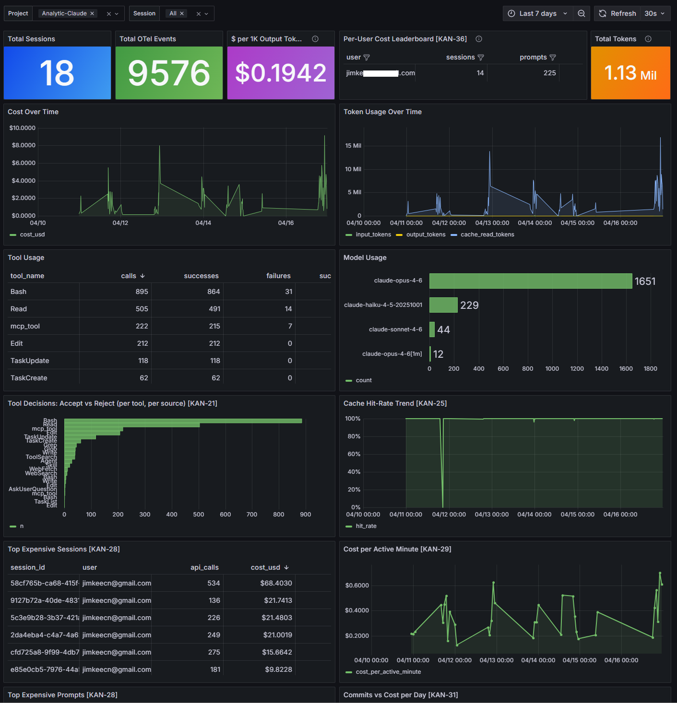
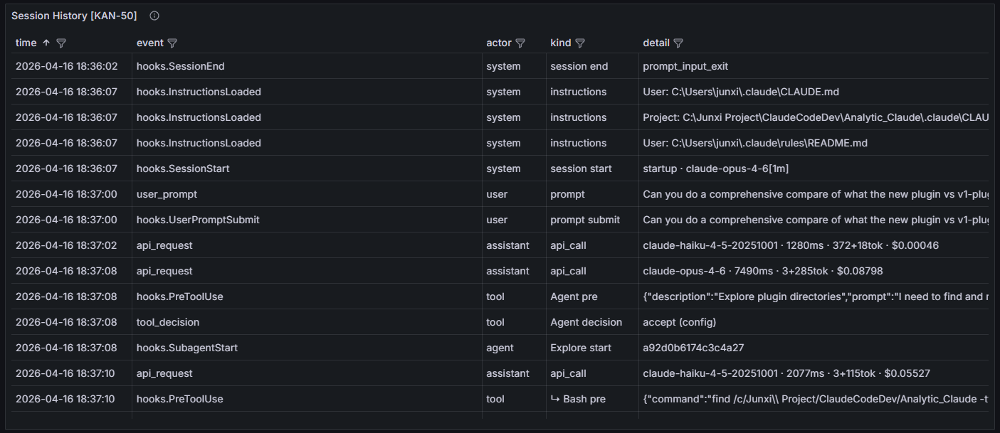
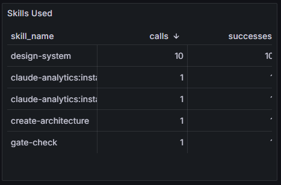
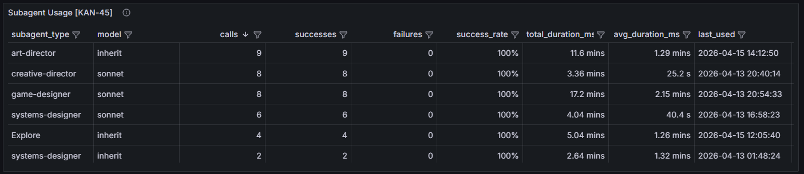
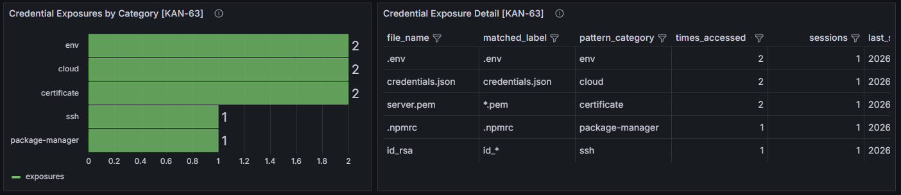
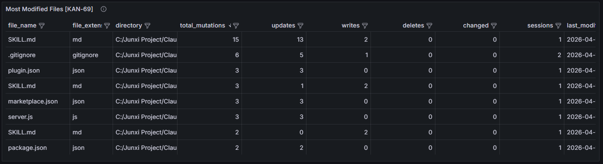
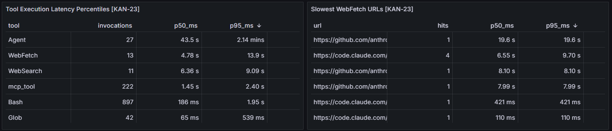

<div align="center">

[English](README.md) | [中文](docs/README.zh-CN.md) | [日本語](docs/README.ja.md) | [Français](docs/README.fr.md) | [Deutsch](docs/README.de.md)

# Claudalytics

**Local analytics dashboard for Claude Code**

Track costs, tokens, tool usage, and session activity across all your projects.
Zero cloud dependencies. Your data stays on your machine.

[](LICENSE)
[](<>)
[](<>)
[](<>)

[Installation](#installation) · [Features](#features) · [Updating](#updating) · [Team Use](#team-use) · [Changelog](CHANGELOG.md)

</div>

---



## Installation

### 1. Clone and run the port preflight check

```bash
git clone https://github.com/jimkeecn/Claudalytics.git
cd Claudalytics
claude
```

In Claude Code, run:

```
/preflight-check
```

This verifies that all required host ports are free **before** you start Docker. The hooks server and OTel exporter are tightly coupled to these port numbers — if any port is in use, free it (the skill prints the process and the terminate command). Do **not** remap Claudalytics' ports.

**Required host ports**

| Port  | Purpose                        |
| ----- | ------------------------------ |
| 13000 | Grafana UI                     |
| 4317  | OTel collector (gRPC receiver) |
| 4318  | OTel collector (HTTP receiver) |
| 4319  | Hooks server                   |
| 8123  | ClickHouse HTTP                |
| 9000  | ClickHouse native TCP          |
| 13133 | OTel collector health endpoint |

### 2. Start the analytics stack

```bash
cd docker-stack
docker compose up -d --build
```

Wait ~30 seconds. Then go back to the repo root:

```bash
cd ..
```

Run `/validate-infra` to verify all 4 containers, tables, and materialized views are healthy.

### 3. Install the plugin

Add the Claudalytics marketplace and install the plugin in any project:

```
/plugin marketplace add jimkeecn/Claudalytics
/plugin install claudalytics@claudalytics
```

The marketplace also has an optional second plugin, `claudalytics-hook-capture`. Don't install it by hand: `/init-claudalytics` turns it on for a project when you pick OTel + hooks mode.

Pin to a specific release:

```
/plugin marketplace add jimkeecn/Claudalytics@v1.1.0
```

A pinned marketplace doesn't move to a new release by itself. To move the pin, see step 5 of [Upgrading from 1.1.0](#upgrading-from-110).

**Local development** — if you're iterating on the plugin code itself, install directly from your local checkout instead:

```
/install-plugin /full/path/to/Claudalytics/plugin
```

### 4. Initialize

```
/init-claudalytics
```

Follow the prompts. The skill asks for your project name and a [capture mode](#capture-modes), writes the OTel block to your user settings file, and keeps only the project name in `.claude/settings.local.json`. Run it once in every project that you want to see by name. The skill backs up each settings file before it changes it, and adds the backup files to the project's `.gitignore`. It needs Node.js 18 or later.

### 5. Restart Claude Code and open dashboards

Restart your session for telemetry to take effect. Start Claude Code in the project's root folder, the folder where you ran `/init-claudalytics` (see [Known limits](#known-limits)). Then open:

**http://localhost:13000** (admin / admin)

Navigate to: **Home > Dashboards > Claudalytics > Claudalytics - OTel Overview**

That's it. Data starts flowing immediately.

---

## Capture modes

| Mode                | What runs                                                                 | What you get                                                                                                                                                     |
| ------------------- | ------------------------------------------------------------------------- | ---------------------------------------------------------------------------------------------------------------------------------------------------------------- |
| OTel only (default) | Claude Code's own OTel export. No Claudalytics hook runs.                 | Every panel, except the two Config Change panels, the session end reason and WebSearch result URLs                                                               |
| OTel + hooks        | OTel export, plus the `claudalytics-hook-capture` plugin for this project | Also settings changes, folder changes, the session end reason, WebSearch result URLs, a few more Session History rows, and a stack health check at session start |

Hooks mode only adds events that OTel doesn't have, so nothing is counted twice. Every row says what wrote it: in `otel_logs` the attribute `event.source` is `otel`, `hook` or `transcript_backfill`, and the tables behind the panels have a `source` column with `otel` or `hook`. Rows from before schema v7 have an empty source. A hook row stores Claude Code's own ids under the same names as an OTel row (`session.id`, `prompt.id`, `tool_use_id`, `agent_id`), so you can match the two rows of one WebSearch call: the query from OTel and the result URLs from the hook. Hooks mode needs the hooks server on port 4319. To send hook events to another server, set `CLAUDALYTICS_HOOKS_URL` (default `http://localhost:4319`) in your shell or in the `env` of your user settings file.

To switch a project to the other mode, run `/init-claudalytics` again in that project and pick the other mode. The change applies in the next session.

### Where the settings live

- **User settings file** (`~/.claude/settings.json`, or `$CLAUDE_CONFIG_DIR/settings.json`): the OTel block below. Claude Code 2.1.282 and later ignore these variables in project files, so `/init-claudalytics` writes them here. It adds only missing keys and asks before it changes a key that has another value.
- **Project file** `.claude/settings.local.json`: only `OTEL_RESOURCE_ATTRIBUTES` with `project.name=<your project>`, plus the on/off entry for `claudalytics-hook-capture`. In OTel + hooks mode `/init-claudalytics` also writes one `CwdChanged` hook that does nothing (`exit 0`): Claude Code sends folder changes to a plugin only when a settings file has a `CwdChanged` hook too. A switch back to OTel only removes that hook and leaves your own hooks alone. The dashboard's Project filter lists each name.

```json
"env": {
  "CLAUDE_CODE_ENABLE_TELEMETRY": "1",
  "CLAUDE_CODE_ENHANCED_TELEMETRY_BETA": "1",
  "OTEL_METRICS_EXPORTER": "otlp",
  "OTEL_LOGS_EXPORTER": "otlp",
  "OTEL_TRACES_EXPORTER": "otlp",
  "OTEL_EXPORTER_OTLP_PROTOCOL": "grpc",
  "OTEL_EXPORTER_OTLP_ENDPOINT": "http://localhost:4317",
  "OTEL_LOG_USER_PROMPTS": "1",
  "OTEL_LOG_TOOL_DETAILS": "1",
  "OTEL_LOG_TOOL_CONTENT": "1",
  "OTEL_METRIC_EXPORT_INTERVAL": "10000",
  "OTEL_LOGS_EXPORT_INTERVAL": "5000",
  "OTEL_RESOURCE_ATTRIBUTES": "project.name=unassigned"
}
```

**This block turns on OTel export for every repo on this machine**, not only for Claudalytics projects. It sends prompts, commands and file paths to your local stack, and also tool content: the text of files Claude reads or writes, and command output (`OTEL_LOG_TOOL_CONTENT=1`, up to 60 KB per tool call, stored as `tool.output` events on `claude_code.tool` spans in `otel_traces`). A repo that you didn't set up shows as `unassigned` in the Project filter, like any other project.

To turn this down for one repo, add one of these sets to the `env` of that repo's `.claude/settings.local.json`. Project files can turn these settings off, but not on, and `/init-claudalytics` keeps them when it runs again.

- No export at all: `"OTEL_LOGS_EXPORTER": "none"`, `"OTEL_METRICS_EXPORTER": "none"`, `"OTEL_TRACES_EXPORTER": "none"`
- Metadata only (no prompt text, tool details or tool content): `"OTEL_LOG_USER_PROMPTS": "0"`, `"OTEL_LOG_TOOL_DETAILS": "0"`, `"OTEL_LOG_TOOL_CONTENT": "0"`

`OTEL_LOG_RAW_API_BODIES` also works only from the user settings file or the shell. It records full API request and response bodies from every repo, so Claudalytics doesn't set it.

**The hooks server stays in both modes.** It creates and updates the ClickHouse schema at each start, answers `/health`, holds the transcript backfill tool, and receives hook events in OTel + hooks mode. Don't remove the container.

---

## Features

### Session Timeline

Every action in a single view — prompts, responses, API calls, tool decisions and results, subagent runs, compaction events — in one chronological timeline from Claude Code's OTel events. In OTel + hooks mode it also shows the few events that only hooks give. The `source` column says what wrote each row: `otel`, `hook` or `transcript_backfill`.

Each table row is one line high, so longer text is cut off on screen. The full text is still there: hover a cell and click the eye icon (inspect) to read the full prompt, response or command. The same works in the other tables with long text, such as Top Expensive Prompts and Recent Errors. The events that Claude Code sends at every start (plugins loaded, hooks registered, MCP connections, managed settings) are hidden. To see them, set the **Startup events** variable at the top of the dashboard to Show.



### Cost & Token Analytics

Track spending across sessions, models, and projects. See cost per 1K output tokens, token usage over time, cache hit rates, and identify your most expensive sessions and prompts.

### Skill & Subagent Tracking

Monitor which skills and subagents Claude uses, their success rates, duration, and model selection. Spot inefficiencies — high re-invocation rates mean the first attempt likely failed.

<div align="center">


</div>

### Credential Exposure Detection

Automatically detects when Claude reads sensitive files — `.env`, AWS credentials, SSH keys, certificates, database configs — across 38 patterns in 17 categories. It sees the Read tool, a Grep whose path is the file itself, and the read commands `cat`, `type`, `head`, `tail`, `less`, `more`, `Get-Content` and `gc` in Bash and PowerShell. No configuration needed. Powered by a ClickHouse materialized view that pattern-matches in real-time.

The panel stores the file name, not the file text. The collector also replaces the text of such a file with `[redacted: credential file]` before it reaches the database. This does not cover every case: see [Known limits](#known-limits).



### File Mutation Tracking

Every file Claude edits, writes, or deletes is tracked with action type, file extension, and directory. See which files get modified most and spot unexpected deletions. Deletes come from `rm`, `del`, `rmdir`, `unlink`, `Remove-Item` and `ri` in Bash and PowerShell commands, one row per deleted file.



### Blocked Action Detection

Rejected tool calls come from Claude Code's `tool_decision` event, with the reason: `user_reject`, `user_abort` (you interrupted the permission prompt), `config` or `hook`. Rows from before the upgrade show as `legacy: no PostToolUse`: 1.1.0 counted a PreToolUse with no PostToolUse, which also caught interrupted calls. Useful for auditing what Claude tried to do but was stopped from doing.

### Tool Latency & Slow URLs

Identify performance bottlenecks — which tools are slowest at p50/p95, and which URLs take the longest to fetch.



### 38 Dashboard Panels

| Category | Panels                                                                                  |
| -------- | --------------------------------------------------------------------------------------- |
| KPIs     | Sessions, events, cost/1K tokens, total tokens, per-user cost                           |
| Cost     | Cost over time, top expensive sessions/prompts, cost per active minute, commits vs cost |
| Tools    | Tool usage, model usage, accept/reject rates, cache hit-rate                            |
| Latency  | API latency percentiles, tool execution latency, slowest WebFetch URLs                  |
| Timeline | Full session event history (2000 row limit)                                             |
| Workflow | Skills used, websites visited, MCP server calls, subagent usage                         |
| Files    | Most modified files with action breakdown, memory files                                 |
| Code     | Lines of code per user, prompt length distribution                                      |
| Security | Blocked actions, blocked rate over time, credential exposures                           |
| Ops      | Config changes, compaction events/frequency, recent errors                              |
| Feedback | Survey funnel                                                                           |

---

## Updating

See [CHANGELOG.md](CHANGELOG.md) for the list of changes in each release.

```bash
cd Claudalytics
git pull
cd docker-stack
docker compose up -d --build
docker compose restart otel-collector
```

The collector reads its config only at start, so the last command makes sure that it uses the new one.

Additive schema changes (new tables, new materialized views) are applied automatically by the hooks server on startup. If a release includes destructive schema changes (dropped views or tables, column type changes, re-partitioning), run `/migrate-db` from the Claudalytics project — it will walk you through the migration with backup prompts. After an update, run `/validate-infra`: when it reports a pending migration, run `/migrate-db`.

This release has two destructive steps, schema v4 and v5, and three automatic ones, v3, v6 and v7. The hooks server applies v6 and v7 by itself, but only after the v5 step is done. See step 4 of [Upgrading from 1.1.0](#upgrading-from-110).

Auto-update is off for this marketplace, so update the plugins yourself: run `claude plugin marketplace update claudalytics`, then `claude plugin update claudalytics@claudalytics` with the scope you installed it with, and start a new session. If you are upgrading from 1.0.0 or 1.1.0, follow the steps below instead. `/init-claudalytics` also removes the 1.0.0 per-project hook files.

### Upgrading from 1.1.0

1.1.0 sends most data through hooks. This release reads it from Claude Code's own OTel events, and Claude Code 2.1.282 and later ignore the OTel export variables in project files, where 1.1.0 wrote them. Do these steps in this order. The commands are for Git Bash on Windows (or any POSIX shell on macOS and Linux), not PowerShell.

1. **Back up ClickHouse.** Close every Claude Code session first: the collector has no buffer, so events sent while ClickHouse is stopped are lost. Write the archive to a folder outside the repo. `MSYS_NO_PATHCONV=1` is for Git Bash on Windows and does nothing in other shells.

   ```bash
   BACKUP_DIR="<folder outside the repo>"
   docker stop claudalytics-clickhouse
   MSYS_NO_PATHCONV=1 docker run --rm -v claudalytics-clickhouse-data:/data -v "$BACKUP_DIR":/backup alpine tar czf /backup/ch-pre-otel.tgz -C /data .
   docker start claudalytics-clickhouse
   ```

   **If your stack was stopped for a long time, back up before you start it.** Every table keeps rows for 90 days (`otel_logs` too). Soon after ClickHouse starts, it deletes older rows, whatever version you run. The backup is then the only copy of them.

2. **Turn on OTel export in the user settings file, with the old stack and the old plugin still running.** Don't `git pull` yet: Grafana reads the dashboard from your checkout, and the new panels fail on the old schema.
   - Add the block from [Where the settings live](#where-the-settings-live) to `env` in `~/.claude/settings.json`. Keep the `project.name` that 1.1.0 wrote in each project's `.claude/settings.local.json`: it still works there.
   - Start a new session in each project that you use, and check that OTel rows arrive with the right project name: the **Tool Usage** panel shows the session's tools under that project.
   - Until step 3, panels that read `otel_logs` directly (for example Session History) show hook rows and OTel rows side by side. The other panels count nothing twice.
   - **Don't rebuild the stack until OTel rows arrive.**

3. **Deploy the new stack.** The hooks server adds the ten OTel-fed views (schema v3) by itself. From now on file edits, writes and shell deletes, credential file reads, rejected tool calls, compactions and website URLs (from WebFetch, shell commands, MCP tools and WebSearch queries) come from OTel events. A 1.1.0 plugin copy sends no hook-capture marker, so the server ignores its hook events. Restart the collector too: it reads its config, with the new credential file redaction and the `event.source` label, only at start.

   ```bash
   git pull
   cd docker-stack
   docker compose up -d --build
   docker compose restart otel-collector
   ```

   **Nothing is missed between the stack rebuild and `/migrate-db` (step 4): the ten OTel-fed views write rows from the rebuild on.** In our test of this time window, 13 of 13 kinds of events got their row: file edits and writes, shell deletes in Bash and PowerShell, credential file reads with Read, Grep and the shell, rejected tool calls, compactions, URLs from WebFetch, shell commands and MCP tools, and WebSearch queries. Still do step 4 right after this step, before the plugin update and `/init-claudalytics`: until it is done, the old views and the old `sessions` table are still there, and `/validate-infra` reports a pending migration.

   **From the stack rebuild until you re-run `/init-claudalytics` and pick hooks mode, there are no ConfigChange, SessionEnd-reason or WebSearch-URL rows.**

4. **Run `/migrate-db` right away.** Start Claude Code in the Claudalytics repo and run it before you do anything else. It asks you to back up first, shows the row counts before and after each step, and restarts the hooks server after each step.
   - **Schema v4** drops the 11 old hook-fed views. The tables and their rows stay.
   - **Schema v5** drops three things: the old view for WebSearch result URLs (`websites_visited_search_mv`), the view `sessions_mv`, and the old `sessions` table. No OTel-fed view is dropped, so the capture goes on. The rows of `credential_exposures`, `file_mutations`, `blocked_tools`, `compaction_events` and `websites_visited` stay. The rows of `sessions` are dropped, but nothing is lost: the new `sessions` view reads the same sessions from `otel_logs`.
   - **Schema v6** needs no action. The hooks server applies it by itself at its first start after the v5 step. It creates `websites_visited_search_mv` again, now without local addresses, and it creates `sessions` as a view.
   - **Schema v7** needs no action. The hooks server applies it by itself right after v6. It adds the `source` column to the five tables and changes the 11 views in place, so nothing is dropped and no event is missed. Rows that are already stored keep an empty `source`.

   Until you do this, `/validate-infra` and the hooks server's `/health` show a pending migration. First they show `v4_drop_legacy_hook_mvs`. After the v4 step is done, they show `v5_drop_replaced_otel_views`. At the end both show schema v7 and nothing pending. During the v5 step (about 15 seconds) the Project and Session drop-downs of the dashboard are empty.

5. **Update the plugins.**
   - Run `claude plugin marketplace update claudalytics`.
   - If you pinned a tag (for example `jimkeecn/Claudalytics@v1.1.0`), move the pin instead: set `ref` to the new tag in the marketplace's `source` under `extraKnownMarketplaces` in `~/.claude/settings.json`. Claude Code fetches the marketplace again when a declared source changes. Don't remove the marketplace: that uninstalls every Claudalytics plugin.
   - In the root folder of each project where you installed 1.1.0, run `claude plugin update claudalytics@claudalytics --scope project`. Updates work per scope, so run it in every project. Use `--scope user` instead if you installed it for your user.
   - Start a new session. The old `WorktreeCreate` hook, which broke worktrees, is gone now.

6. **Re-run `/init-claudalytics` in each project.** It removes the OTel keys that Claude Code ignores in project files, keeps `project.name`, asks for the [capture mode](#capture-modes), and backs up every settings file before it changes it.

7. **Optional:** `npm run backfill` for the days when OTel export was off. It recovers `api_request` rows only. See [Recovering missed telemetry](#recovering-missed-telemetry-transcript-backfill).

### Rolling back

1. Close every Claude Code session, then run `docker compose down` in `docker-stack`. This keeps the volumes.
2. Restore the backup from step 1 of [Upgrading from 1.1.0](#upgrading-from-110):

   ```bash
   MSYS_NO_PATHCONV=1 docker run --rm -v claudalytics-clickhouse-data:/data -v "$BACKUP_DIR":/backup alpine sh -c "find /data -mindepth 1 -delete && tar xzf /backup/ch-pre-otel.tgz -C /data"
   ```

3. Check out the previous release (`git checkout v1.1.0`) and run `docker compose up -d --build` in `docker-stack`.
4. Only if you pinned the marketplace to a tag: to go back to the 1.1.0 plugin too, set its `ref` back to `v1.1.0` and run the `claude plugin update` commands from step 5 of [Upgrading from 1.1.0](#upgrading-from-110). This downgrade has not been tested.

**Restore the volume too. The old stack does not work on the new schema.** Before `/migrate-db`, the old hook-fed views and the new `*_otel_mv` views both fill the same tables, so the counts double. After `/migrate-db`, the old hook-fed views and the old `sessions` table are gone, and the 1.1.0 hooks server does not create the hook-fed views again. If you can't restore and you did not run `/migrate-db` yet, drop the `*_otel_mv` views first.

### Known limits

- **Long PowerShell commands.** OTel keeps only about the first 128 characters of a tool input value that is longer than 512 characters. Bash is not affected, because OTel also sends its full command. So a `Remove-Item` or a URL after about character 128 of a long PowerShell command doesn't reach File Mutation Tracking or Websites Visited. Hook capture doesn't forward PowerShell calls, so this is the same in both modes.
- **Websites Visited sees only some shell commands.** A URL in a Bash or PowerShell command counts only as an argument of `curl`, `wget`, `Invoke-WebRequest`, `iwr`, `Invoke-RestMethod` or `irm`, and one command gives at most 10 rows. A page that another program fetches (a script, `git clone`, `npm install`) gets no row. An MCP tool gets a row only when it has a `url` or `urls` input. Local addresses (`localhost`, `127.0.0.1`, `::1`, `host.docker.internal`) are left out on purpose.
- **In shell commands, File Mutation Tracking sees only deletes.** Files changed with the Edit and Write tools are tracked. In a Bash or PowerShell command, a delete counts for `rm`, `del`, `rmdir`, `unlink`, `Remove-Item` and `ri`. A file that a script or another command removes (for example `git clean` or `find -delete`) gets no row. A relative path is joined to a folder only when the command starts with `cd <folder> &&` and has no other `cd`. In other cases the path is stored as it was written.
- **Credential Exposures sees only some ways to read a file.** It sees the Read tool, a Grep whose path is the file itself, and `cat`, `type`, `head`, `tail`, `less`, `more`, `Get-Content` and `gc` in a shell command. A Grep over a folder, or another program that reads the file (`sed`, `awk`, a script), gets no row. A path from a shell command is stored as it was written, so it can be relative.
- **Rows stored before the upgrade keep the old rules.** The new rules for deletes, credential reads and websites count for new events only. For example, an old `localhost` row stays in Websites Visited until it expires.
- **A failed Edit is not recorded.** Claude Code sends no `tool_result` event when an Edit fails (for example "String to replace not found"), so it is in neither Recent Errors nor Session History. A failed Read and a failed Bash command are recorded.
- **The commit count can be too high.** Claude Code's `claude_code.commit.count` metric also counts a Bash command that only holds the text `git commit`, for example in a heredoc or in a search. In our test, 3 real commits gave a count of 6. Commits vs Cost per Day and the commits column of Per-User Cost Leaderboard use this metric.
- **An interrupted tool call counts as failed.** OTel reports it as a `tool_result` with `success=false`, so Recent Errors includes it. An interrupted permission prompt shows as `user_abort` in Blocked Actions.
- **Only hooks give:** settings changes (the two Config Change panels), the session end reason, WebSearch result URLs (OTel gives the search query), and these Session History rows: session start and end, cwd changes, instructions loaded, notifications, subagent start, elicitation and teammate idle. In OTel-only mode they stay empty. Folder changes need the `CwdChanged` hook that `/init-claudalytics` writes into the project file in OTel + hooks mode; for a project that was set up before, run `/init-claudalytics` once more.
- **Worktrees made with `git worktree add` show as `unassigned`.** In our tests, a worktree that Claude Code creates (`claude --worktree`) got a copy of `.claude/settings.local.json`, but one that you make with `git worktree add` has none. Copy `.claude/settings.local.json` from the main checkout into such a worktree. Hook rows keep the project name, because `forward-hook.sh` reads the project name from the main checkout's `.claude/settings.local.json`.
- **A session started in a sub-folder shows as `unassigned` (Windows).** On Windows, Claude Code reads `.claude/settings.local.json` only from the folder you start it in. It doesn't look in parent folders or in the git root. So start Claude in the repo root, the folder where you ran `/init-claudalytics`. OTel events carry no folder name, so the dashboard can't repair this later. In OTel + hooks mode the hook rows of such a session keep the project name, so the session shows under two names. On macOS and Linux, the Claude Code docs say that v2.1.211 and later read this file from the git root; we tested only Windows.
- **A new repo shows as `unassigned` until you trust it.** Claude Code applies project settings only after you trust the folder.
- **Old 1.1.0 plugin copies stop reaching the dashboard.** The new hooks server ignores hook events without the hook-capture marker, so a project that still has 1.1.0 sends nothing through hooks until you update it (step 5). Its OTel data still arrives.
- **Old rows expire.** Every table keeps rows for 90 days, so rows written by hooks before the upgrade go away over time.
- **The text of a credential file is removed, but a secret can still be stored another way.** When Claude reads a credential-like file (the file names of the Credential Exposures panel) with the Read tool, or with `cat`, `type`, `head`, `tail`, `less`, `more`, `Get-Content` or `gc` in a Bash command, the collector stores `[redacted: credential file]` in place of the file text. It does the same in the trace for the text of a Write or Edit to such a file. A PowerShell command and a Grep are not redacted, and today they don't need it: Claude Code sends no output text for these two tools, so no file text is stored for them. The row in Credential Exposures stays. These cases are not covered: a secret typed in a command (`echo KEY=... > .env`), the output of another command (`grep`, `sed`, `env`, a script), the text of a Write or Edit to such a file in the event log (`tool_input`: a value of up to 512 characters is stored in full, a longer one is cut to about its first 128 characters), a prompt or an answer that repeats the secret, and the full API bodies when you set `OTEL_LOG_RAW_API_BODIES`. Rows stored before this change keep the text until they expire. After an upgrade, restart the collector (`docker compose restart otel-collector`) so it reads the new config.
- **Events sent while the collector is down are lost.** Claude Code keeps events in memory only until the next export (every 5 seconds for events and for traces, whose interval the settings block leaves at its default, and every 10 seconds for metrics) and sends each batch one time. When the collector doesn't answer, the batch is dropped. No Claude Code setting changes this: we checked v2.1.330, and with the gRPC export that Claudalytics uses, a failed export is not sent again and is not kept. The OpenTelemetry settings for the queue size and the export timeout (`OTEL_BLRP_*`, `OTEL_BSP_*`, `OTEL_EXPORTER_OTLP_TIMEOUT`) don't help: they change how many events wait for the next export and how long one export may take, not what happens after a failed export. A running session can also need some seconds to connect again after the collector is back. In our test, a 30-second stop lost about 40 seconds of events, and the session showed no warning. Afterwards you can get back the `api_request` rows (model, tokens and an estimated cost, without duration) with the [transcript backfill](#recovering-missed-telemetry-transcript-backfill). The tool events, prompts, file changes, websites, traces and metrics of the gap can't be recovered.
- **Each table row is one line high.** Longer text is cut off on screen, but nothing is lost: hover a cell and click the eye icon (inspect) to read the full text. In a narrow window, a table whose long text is not in the first column (for example Websites Visited) can need a scroll to the side to reach that column.
- **Prompts that the user did not type are found by their text.** Claude Code sends an agent hand-back and a task notification as normal prompts with no other mark. The prompt counts leave out a prompt that starts with `<agent-message` or `<task-notification`, so a prompt that you start with this text is not counted either.
- **Subagent Usage joins by session and subagent type.** The run time and the model come from `subagent_completed` events. A subagent that is continued later counts as more than one run, and a subagent that is still running has no run time yet.
- **The subagent type, the git branch and the commit id are not shown.** OTel tool events carry only the subagent id, so the `agent_type` column of `file_mutations` and `credential_exposures` is empty for new rows. Claude Code sends the git branch and the commit id (`vcs.ref.head.name`, `vcs.ref.head.revision`) on the result of a git command, but no panel uses them.

---

## Recovering missed telemetry (transcript backfill)

The ingest path is **live and unbuffered**: Claude Code pushes its OTel events to the OTel collector, which writes to ClickHouse. In OTel + hooks mode the hooks server pushes its few hook events the same way. If the Docker stack (or the host) is down, events are dropped with no replay — a gap that looks identical to "nothing happened".

Claude Code itself always journals every turn to `~/.claude/projects/<project>/*.jsonl`, independent of Docker. The backfill tool replays that durable journal into ClickHouse for an outage window:

```bash
cd docker-stack/hooks-server
npm run build
npm run backfill -- --from 2026-06-10 --to 2026-06-13 --dry-run   # report only
npm run backfill -- --from 2026-06-10 --to 2026-06-13             # emit (dates are UTC, inclusive)
```

It is idempotent by `request_id` (rows already in ClickHouse are skipped, so re-runs are safe) and preserves original timestamps.

**What it recovers — and what it cannot.** Transcripts only hold the conversation, so backfill reconstructs **`api_request` rows only** (one per assistant turn): `model`, token counts and an estimated cost. These rows are tagged `event.source=transcript_backfill`. Transcripts hold tokens but no cost, and the repo has no price list. So at each run the tool works out the price per token type of each model from your own real `api_request` rows in ClickHouse, writes the result to `cost_usd` and marks it with `cost_usd_source=estimated`. In our test the estimate was equal to the real cost for all 1,227 requests that we had both ways. A model gets no cost when one set of rates explains fewer than 20 of its real rows: a few rows prove nothing, and an empty cost is better than a guess. `--dry-run` prints the rates per model, the number of real rows behind them, the fit error and the total cost. Requests that Claude Code makes on the side (agent summaries, session titles, web searches) are not in transcripts, so a backfilled time window costs a little less than it really did (about 1% in our test). `duration_ms` stays empty. So **Model Usage**, the token panels and the cost panels are restored. Two panels leave backfilled rows out: Top Expensive Prompts, because they have no prompt id, and API Latency Percentiles, because they have no duration.

Backfill restores nothing else from an outage: prompts, `tool_result`/`tool_decision` events, file mutations, blocked actions, websites visited, traces and metrics, and in OTel + hooks mode the hook events (settings changes, the session end reason, WebSearch result URLs). The materialized views fed by those events stay empty for the gap.

---

## Team Use

This project is designed for individual developers. To adapt it for a team:

1. **Deploy to a shared server** — the Docker stack works on any server. Each developer points `OTEL_EXPORTER_OTLP_ENDPOINT` in their user settings file (and `CLAUDALYTICS_HOOKS_URL` in OTel + hooks mode) to the server address instead of `localhost`.
2. **Add a team name attribute** — include `team.name` in `OTEL_RESOURCE_ATTRIBUTES` alongside `project.name`.
3. **Forward `team.name` from the hook script** (OTel + hooks mode) — extend `plugin-hook-capture/hooks/forward-hook.sh` to append `&teamName=<TEAM>` to the hooks URL, and update the hooks server to record it.
4. **Update ClickHouse tables** — add a `team_name` column to the target tables and materialized views.
5. **Update Grafana** — add a Team dropdown variable and filter all panels by it.

**Before deploying to a server, you must secure the stack:**

- Set a ClickHouse password (the default config has no authentication)
- Change the Grafana admin password
- Change host port bindings in `docker-compose.yaml` from `127.0.0.1:PORT:PORT` to `PORT:PORT` (or a specific interface) so team members can reach the stack — the default shipped bindings are localhost-only for individual-developer safety on public WiFi
- Restrict port access with a firewall — only expose ports 4317 (OTel gRPC), 4319 (hooks, only needed for OTel + hooks mode), and 13000 (Grafana)
- Add TLS for encrypted transport

The Docker Compose file works on a cloud server as-is — but without these security steps, your telemetry data is exposed to anyone who can reach the ports.

---

<div align="center">

**Built with [Claude Code](https://claude.ai/code)**

If this project helps your workflow, give it a star!

</div>

## FAQ

### `/preflight-check` says my ports are free, but `docker compose up` still fails with a port error.

If WinNAT is running, run the following commands in PowerShell (**Run as administrator**):

1. Step 1 - stop WinNAT (Release dynamic exclusions or reserved ports)
   `net stop winnat`

2. Step 2 - start it back (re-allocates from a different offset, usually avoids 4318)
   `net start winnat`

Then re-run `/preflight-check` and retry `docker compose up -d --build`.
