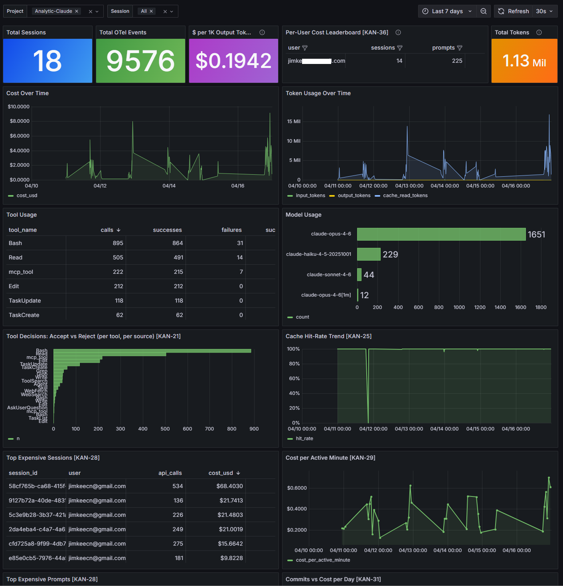
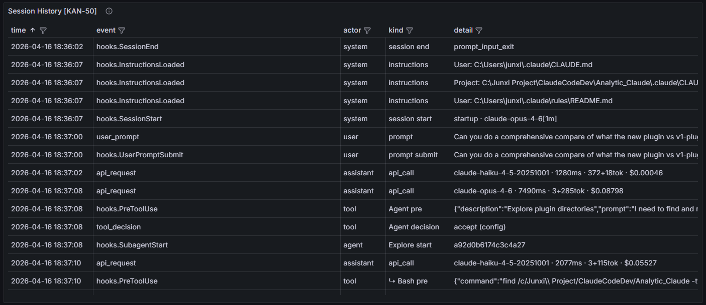
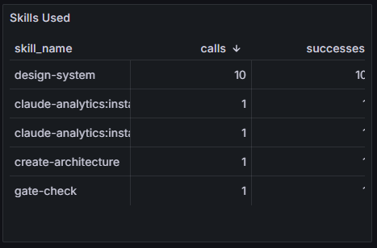
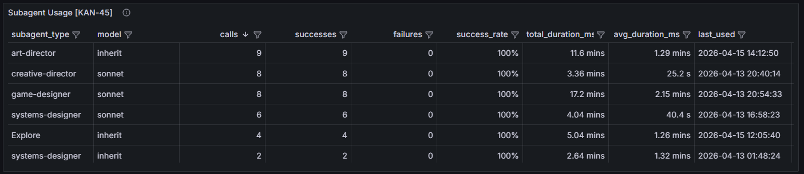
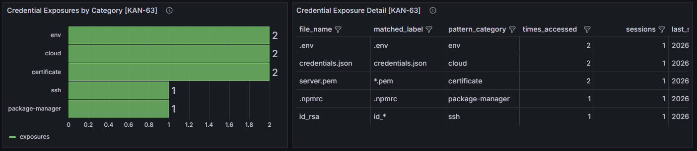
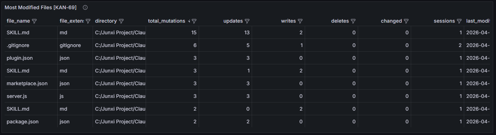
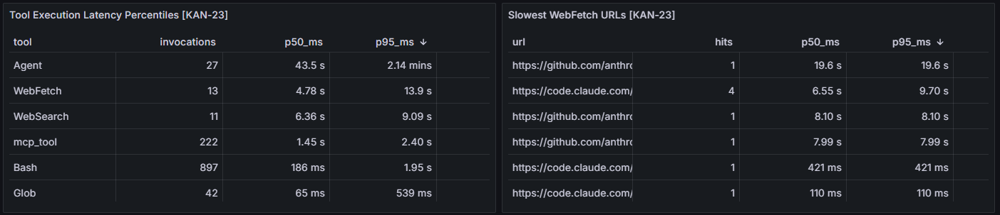

<div align="center">

[English](../README.md) | [中文](README.zh-CN.md) | [日本語](README.ja.md) | [Français](README.fr.md) | Deutsch

# Claudalytics

**Lokales Analytics-Dashboard fuer Claude Code**

Verfolge Kosten, Tokens, Tool-Nutzung und Session-Aktivitaeten ueber alle deine Projekte hinweg.
Keine Cloud-Abhaengigkeiten. Deine Daten bleiben auf deinem Rechner.

[](../LICENSE)
[](<>)
[](<>)
[](<>)

[Installation](#installation) · [Funktionen](#funktionen) · [Aktualisierung](#aktualisierung) · [Teamnutzung](#teamnutzung) · [Changelog](../CHANGELOG.md)

</div>

---



## Installation

### 1. Klonen und Port-Vorabpruefung ausfuehren

```bash
git clone https://github.com/jimkeecn/Claudalytics.git
cd Claudalytics
claude
```

Fuehre in Claude Code aus:

```
/preflight-check
```

Dies prueft, dass alle erforderlichen Host-Ports frei sind, **bevor** du Docker startest. Der Hooks-Server und der OTel-Exporter sind eng mit diesen Portnummern verknuepft — wenn ein Port belegt ist, gib ihn frei (der Skill zeigt den Prozess und den Befehl zum Beenden an). Mappe Claudalytics' Ports **nicht** um.

**Erforderliche Host-Ports**

| Port  | Zweck                          |
| ----- | ------------------------------ |
| 13000 | Grafana-Oberflaeche            |
| 4317  | OTel-Collector (gRPC-Receiver) |
| 4318  | OTel-Collector (HTTP-Receiver) |
| 4319  | Hooks-Server                   |
| 8123  | ClickHouse HTTP                |
| 9000  | ClickHouse Native TCP          |
| 13133 | OTel-Collector Health-Endpoint |

### 2. Analytics-Stack starten

```bash
cd docker-stack
docker compose up -d --build
```

Warte ca. 30 Sekunden. Gehe dann zurueck ins Repository-Stammverzeichnis:

```bash
cd ..
```

Fuehre `/validate-infra` aus, um zu pruefen, ob alle 4 Container, Tabellen und Materialized Views ordnungsgemaess funktionieren.

### 3. Plugin installieren

Fuege den Claudalytics-Marketplace hinzu und installiere das Plugin in einem beliebigen Projekt:

```
/plugin marketplace add jimkeecn/Claudalytics
/plugin install claudalytics@claudalytics
```

Der Marketplace enthaelt auch ein optionales zweites Plugin, `claudalytics-hook-capture`. Installiere es nicht von Hand: `/init-claudalytics` schaltet es fuer ein Projekt ein, wenn du den Modus OTel + hooks waehlst.

An ein bestimmtes Release binden:

```
/plugin marketplace add jimkeecn/Claudalytics@v1.1.0
```

Ein gebundener Marketplace wechselt nicht von selbst zu einem neuen Release. Wie du die Bindung verschiebst, steht in Schritt 5 von [Upgrade von 1.1.0](#upgrade-von-110).

**Lokale Entwicklung** — Wenn du am Plugin-Code selbst arbeitest, installiere stattdessen direkt aus deinem lokalen Checkout:

```
/install-plugin /full/path/to/Claudalytics/plugin
```

### 4. Initialisieren

```
/init-claudalytics
```

Folge den Eingabeaufforderungen. Der Skill fragt nach deinem Projektnamen und einem [Erfassungsmodus](#erfassungsmodi), schreibt den OTel-Block in deine Benutzer-Einstellungsdatei und behaelt in `.claude/settings.local.json` nur den Projektnamen. Fuehre ihn einmal in jedem Projekt aus, das du unter seinem Namen sehen willst. Der Skill sichert jede Einstellungsdatei, bevor er sie aendert, und traegt die Sicherungsdateien in die `.gitignore` des Projekts ein. Er braucht Node.js 18 oder neuer.

### 5. Claude Code neu starten und Dashboards oeffnen

Starte deine Session neu, damit die Telemetrie wirksam wird. Starte Claude Code im Stammordner des Projekts, also in dem Ordner, in dem du `/init-claudalytics` ausgefuehrt hast (siehe [Bekannte Grenzen](#bekannte-grenzen)). Oeffne dann:

**http://localhost:13000** (admin / admin)

Navigiere zu: **Home > Dashboards > Claudalytics > Claudalytics - OTel Overview**

Das war's. Daten fliessen sofort.

---

## Erfassungsmodi

| Modus               | Was laeuft                                                                  | Was du bekommst                                                                                                                                                                                             |
| ------------------- | --------------------------------------------------------------------------- | ----------------------------------------------------------------------------------------------------------------------------------------------------------------------------------------------------------- |
| Nur OTel (Standard) | Der eigene OTel-Export von Claude Code. Kein Claudalytics-Hook laeuft.      | Alle Panels, ausser den zwei Config-Change-Panels, dem Grund fuer das Session-Ende und den URLs der WebSearch-Ergebnisse                                                                                    |
| OTel + hooks        | OTel-Export plus das Plugin `claudalytics-hook-capture` fuer dieses Projekt | Zusaetzlich Einstellungsaenderungen, Ordnerwechsel, den Grund fuer das Session-Ende, die URLs der WebSearch-Ergebnisse, einige weitere Zeilen in Session History und eine Stack-Pruefung beim Session-Start |

Der Hooks-Modus fuegt nur Ereignisse hinzu, die OTel nicht hat, daher wird nichts doppelt gezaehlt. Jede Zeile sagt, was sie geschrieben hat: in `otel_logs` ist das Attribut `event.source` `otel`, `hook` oder `transcript_backfill`, und die Tabellen hinter den Panels haben eine Spalte `source` mit `otel` oder `hook`. Zeilen aus der Zeit vor Schema v7 haben eine leere Quelle. Eine Hook-Zeile speichert die IDs von Claude Code unter denselben Namen wie eine OTel-Zeile (`session.id`, `prompt.id`, `tool_use_id`, `agent_id`), sodass du die zwei Zeilen eines WebSearch-Aufrufs einander zuordnen kannst: die Suchanfrage aus OTel und die Ergebnis-URLs aus dem Hook. Der Hooks-Modus braucht den Hooks-Server auf Port 4319. Um Hook-Ereignisse an einen anderen Server zu senden, setze `CLAUDALYTICS_HOOKS_URL` (Standard `http://localhost:4319`) in deiner Shell oder im `env` deiner Benutzer-Einstellungsdatei.

Um ein Projekt in den anderen Modus zu wechseln, fuehre `/init-claudalytics` in diesem Projekt erneut aus und waehle den anderen Modus. Die Aenderung gilt ab der naechsten Session.

### Wo die Einstellungen liegen

- **Benutzer-Einstellungsdatei** (`~/.claude/settings.json` oder `$CLAUDE_CONFIG_DIR/settings.json`): der OTel-Block unten. Claude Code 2.1.282 und neuer ignorieren diese Variablen in Projektdateien, daher schreibt `/init-claudalytics` sie hierher. Es fuegt nur fehlende Schluessel hinzu und fragt nach, bevor es einen Schluessel mit einem anderen Wert aendert.
- **Projektdatei** `.claude/settings.local.json`: nur `OTEL_RESOURCE_ATTRIBUTES` mit `project.name=<dein Projekt>` und der Ein/Aus-Eintrag fuer `claudalytics-hook-capture`. Im Modus OTel + hooks schreibt `/init-claudalytics` ausserdem einen `CwdChanged`-Hook, der nichts tut (`exit 0`): Claude Code sendet Ordnerwechsel nur dann an ein Plugin, wenn auch eine Einstellungsdatei einen `CwdChanged`-Hook hat. Beim Wechsel zurueck zu Nur OTel wird dieser Hook entfernt, deine eigenen Hooks bleiben unveraendert. Der Project-Filter im Dashboard listet jeden Namen.

```json
"env": {
  "CLAUDE_CODE_ENABLE_TELEMETRY": "1",
  "CLAUDE_CODE_ENHANCED_TELEMETRY_BETA": "1",
  "OTEL_METRICS_EXPORTER": "otlp",
  "OTEL_LOGS_EXPORTER": "otlp",
  "OTEL_TRACES_EXPORTER": "otlp",
  "OTEL_EXPORTER_OTLP_PROTOCOL": "grpc",
  "OTEL_EXPORTER_OTLP_ENDPOINT": "http://localhost:4317",
  "OTEL_LOG_USER_PROMPTS": "1",
  "OTEL_LOG_TOOL_DETAILS": "1",
  "OTEL_LOG_TOOL_CONTENT": "1",
  "OTEL_METRIC_EXPORT_INTERVAL": "10000",
  "OTEL_LOGS_EXPORT_INTERVAL": "5000",
  "OTEL_RESOURCE_ATTRIBUTES": "project.name=unassigned"
}
```

**Dieser Block schaltet den OTel-Export fuer jedes Repo auf diesem Rechner ein**, nicht nur fuer Claudalytics-Projekte. Er sendet Prompts, Befehle und Dateipfade an deinen lokalen Stack, und dazu den Tool-Inhalt: den Text von Dateien, die Claude liest oder schreibt, und die Ausgabe von Befehlen (`OTEL_LOG_TOOL_CONTENT=1`, bis zu 60 KB pro Tool-Aufruf, als `tool.output`-Ereignisse der `claude_code.tool`-Spans in `otel_traces`). Ein Repo, das du nicht eingerichtet hast, erscheint im Project-Filter als `unassigned`, wie jedes andere Projekt.

Um die Erfassung fuer ein Repo zu verringern, fuege eine dieser Gruppen zum `env` in der `.claude/settings.local.json` dieses Repos hinzu. Projektdateien koennen diese Einstellungen aus-, aber nicht einschalten, und `/init-claudalytics` behaelt sie bei einem erneuten Lauf.

- Gar kein Export: `"OTEL_LOGS_EXPORTER": "none"`, `"OTEL_METRICS_EXPORTER": "none"`, `"OTEL_TRACES_EXPORTER": "none"`
- Nur Metadaten (kein Prompt-Text, keine Tool-Details, kein Tool-Inhalt): `"OTEL_LOG_USER_PROMPTS": "0"`, `"OTEL_LOG_TOOL_DETAILS": "0"`, `"OTEL_LOG_TOOL_CONTENT": "0"`

`OTEL_LOG_RAW_API_BODIES` wirkt ebenfalls nur aus der Benutzer-Einstellungsdatei oder der Shell. Es zeichnet die vollstaendigen API-Anfragen und -Antworten aus jedem Repo auf, daher setzt Claudalytics es nicht.

**Der Hooks-Server bleibt in beiden Modi noetig.** Er legt bei jedem Start das ClickHouse-Schema an und aktualisiert es, beantwortet `/health`, enthaelt das Backfill-Werkzeug fuer Transkripte und empfaengt im Modus OTel + hooks die Hook-Ereignisse. Entferne den Container nicht.

---

## Funktionen

### Session-Zeitleiste

Jede Aktion in einer einzigen Ansicht — Prompts, Antworten, API-Aufrufe, Tool-Entscheidungen und -Ergebnisse, Subagent-Laeufe, Compaction-Ereignisse — in einer chronologischen Zeitleiste aus den OTel-Ereignissen von Claude Code. Im Modus OTel + hooks zeigt sie auch die wenigen Ereignisse, die nur Hooks liefern. Die Spalte `source` sagt, was jede Zeile geschrieben hat: `otel`, `hook` oder `transcript_backfill`.

In einer Tabelle ist jede Zeile nur eine Textzeile hoch, laengerer Text wird daher in der Anzeige abgeschnitten. Der vollstaendige Text ist weiterhin da: Fahre mit der Maus ueber eine Zelle und klicke auf das Augensymbol (inspect), um den vollstaendigen Prompt, die vollstaendige Antwort oder den vollstaendigen Befehl zu lesen. Das funktioniert auch in den anderen Tabellen mit langem Text, zum Beispiel Top Expensive Prompts und Recent Errors. Die Ereignisse, die Claude Code bei jedem Start sendet (geladene Plugins, registrierte Hooks, MCP-Verbindungen, verwaltete Einstellungen), sind ausgeblendet. Um sie zu sehen, setze die Variable **Startup events** oben im Dashboard auf Show.



### Kosten- & Token-Analyse

Verfolge Ausgaben ueber Sessions, Modelle und Projekte hinweg. Sieh Kosten pro 1K Output-Tokens, Token-Nutzung im Zeitverlauf, Cache-Trefferquoten und identifiziere deine teuersten Sessions und Prompts.

### Skill- & Subagent-Tracking

Ueberwache, welche Skills und Subagents Claude verwendet, ihre Erfolgsquoten, Dauer und Modellauswahl. Erkenne Ineffizienzen — hohe Wiederaufrufquoten bedeuten, dass der erste Versuch wahrscheinlich fehlgeschlagen ist.

<div align="center">


</div>

### Erkennung von Zugangsdaten-Exposition

Erkennt automatisch, wenn Claude sensible Dateien liest — `.env`, AWS-Zugangsdaten, SSH-Schluessel, Zertifikate, Datenbank-Konfigurationen — ueber 38 Muster in 17 Kategorien. Erfasst werden das Read-Tool, ein Grep, dessen Pfad die Datei selbst ist, und die Lesebefehle `cat`, `type`, `head`, `tail`, `less`, `more`, `Get-Content` und `gc` in Bash und PowerShell. Keine Konfiguration noetig. Basiert auf einer ClickHouse Materialized View, die in Echtzeit Pattern-Matching durchfuehrt.

Das Panel speichert den Dateinamen, nicht den Dateitext. Ausserdem ersetzt der Collector den Text einer solchen Datei durch `[redacted: credential file]`, bevor er die Datenbank erreicht. Das deckt nicht jeden Fall ab: siehe [Bekannte Grenzen](#bekannte-grenzen).



### Dateimodifikations-Tracking

Jede Datei, die Claude bearbeitet, schreibt oder loescht, wird mit Aktionstyp, Dateiendung und Verzeichnis erfasst. Sieh, welche Dateien am haeufigsten geaendert werden, und erkenne unerwartete Loeschungen. Loeschungen kommen aus `rm`, `del`, `rmdir`, `unlink`, `Remove-Item` und `ri` in Bash- und PowerShell-Befehlen, mit einer Zeile pro geloeschter Datei.



### Erkennung blockierter Aktionen

Abgelehnte Tool-Aufrufe kommen aus dem `tool_decision`-Ereignis von Claude Code, mit dem Grund: `user_reject`, `user_abort` (du hast die Berechtigungsabfrage unterbrochen), `config` oder `hook`. Zeilen von vor dem Upgrade erscheinen als `legacy: no PostToolUse`: 1.1.0 zaehlte ein PreToolUse ohne PostToolUse, was auch unterbrochene Aufrufe erfasste. Nuetzlich fuer die Ueberpruefung, was Claude versucht hat, aber daran gehindert wurde.

### Tool-Latenz & Langsame URLs

Identifiziere Performance-Engpaesse — welche Tools bei p50/p95 am langsamsten sind und welche URLs am laengsten zum Abrufen brauchen.



### 38 Dashboard-Panels

| Kategorie  | Panels                                                                                          |
| ---------- | ----------------------------------------------------------------------------------------------- |
| KPIs       | Sessions, Ereignisse, Kosten/1K Tokens, Gesamt-Tokens, Kosten pro Benutzer                      |
| Kosten     | Kosten im Zeitverlauf, teuerste Sessions/Prompts, Kosten pro aktiver Minute, Commits vs. Kosten |
| Tools      | Tool-Nutzung, Modell-Nutzung, Akzeptieren/Ablehnen-Quoten, Cache-Trefferquote                   |
| Latenz     | API-Latenz-Perzentile, Tool-Ausfuehrungslatenz, langsamste WebFetch-URLs                        |
| Zeitleiste | Vollstaendiger Session-Ereignisverlauf (Limit: 2000 Zeilen)                                     |
| Workflow   | Verwendete Skills, besuchte Websites, MCP-Server-Aufrufe, Subagent-Nutzung                      |
| Dateien    | Am haeufigsten geaenderte Dateien mit Aktionsaufschluesselung, Memory-Dateien                   |
| Code       | Codezeilen pro Benutzer, Prompt-Laengenverteilung                                               |
| Sicherheit | Blockierte Aktionen, Blockierungsrate im Zeitverlauf, Zugangsdaten-Expositionen                 |
| Betrieb    | Konfigurationsaenderungen, Compaction-Ereignisse/-Haeufigkeit, aktuelle Fehler                  |
| Feedback   | Umfrage-Trichter                                                                                |

---

## Aktualisierung

Siehe [CHANGELOG.md](../CHANGELOG.md) fuer die Liste der Aenderungen pro Release.

```bash
cd Claudalytics
git pull
cd docker-stack
docker compose up -d --build
docker compose restart otel-collector
```

Der Collector liest seine Konfiguration nur beim Start, daher stellt der letzte Befehl sicher, dass er die neue verwendet.

Additive Schema-Aenderungen (neue Tabellen, neue Materialized Views) werden beim Start des Hooks-Servers automatisch angewendet. Wenn ein Release destruktive Schema-Aenderungen enthaelt (entfernte Views oder Tabellen, Spaltentyp-Aenderungen, Neu-Partitionierung), fuehre `/migrate-db` im Claudalytics-Projekt aus — es fuehrt dich mit Backup-Aufforderungen durch die Migration. Fuehre nach einem Update `/validate-infra` aus: Wenn es eine ausstehende Migration meldet, fuehre `/migrate-db` aus.

Dieses Release hat zwei destruktive Schritte, Schema v4 und v5, und drei automatische, v3, v6 und v7. Der Hooks-Server wendet v6 und v7 selbst an, aber erst, wenn der v5-Schritt abgeschlossen ist. Siehe Schritt 4 von [Upgrade von 1.1.0](#upgrade-von-110).

Auto-Update ist fuer diesen Marketplace aus, daher aktualisierst du die Plugins selbst: fuehre `claude plugin marketplace update claudalytics` aus, dann `claude plugin update claudalytics@claudalytics` mit dem Scope, mit dem du es installiert hast, und starte eine neue Session. Wenn du von 1.0.0 oder 1.1.0 aktualisierst, folge stattdessen den Schritten unten. `/init-claudalytics` entfernt auch die projektlokalen Hook-Dateien von 1.0.0.

### Upgrade von 1.1.0

1.1.0 sendet die meisten Daten ueber Hooks. Dieses Release liest sie aus den eigenen OTel-Ereignissen von Claude Code, und Claude Code 2.1.282 und neuer ignorieren die OTel-Export-Variablen in Projektdateien, wo 1.1.0 sie hingeschrieben hat. Fuehre diese Schritte in dieser Reihenfolge aus. Die Befehle sind fuer Git Bash unter Windows (oder eine POSIX-Shell unter macOS und Linux), nicht fuer PowerShell.

1. **ClickHouse sichern.** Schliesse zuerst alle Claude-Code-Sessions: der Collector hat keinen Puffer, daher gehen Ereignisse verloren, die gesendet werden, waehrend ClickHouse gestoppt ist. Schreibe das Archiv in einen Ordner ausserhalb des Repos. `MSYS_NO_PATHCONV=1` ist fuer Git Bash unter Windows und hat in anderen Shells keine Wirkung.

   ```bash
   BACKUP_DIR="<Ordner ausserhalb des Repos>"
   docker stop claudalytics-clickhouse
   MSYS_NO_PATHCONV=1 docker run --rm -v claudalytics-clickhouse-data:/data -v "$BACKUP_DIR":/backup alpine tar czf /backup/ch-pre-otel.tgz -C /data .
   docker start claudalytics-clickhouse
   ```

   **Wenn dein Stack lange gestoppt war, sichere ihn, bevor du ihn startest.** Jede Tabelle behaelt Zeilen 90 Tage lang (`otel_logs` auch). Kurz nach dem Start von ClickHouse werden aeltere Zeilen geloescht, egal welche Version laeuft. Die Sicherung ist dann ihre einzige Kopie.

2. **Den OTel-Export in der Benutzer-Einstellungsdatei einschalten, waehrend der alte Stack und das alte Plugin noch laufen.** Noch kein `git pull`: Grafana liest das Dashboard aus deinem Checkout, und die neuen Panels schlagen auf dem alten Schema fehl.
   - Fuege den Block aus [Wo die Einstellungen liegen](#wo-die-einstellungen-liegen) zum `env` in `~/.claude/settings.json` hinzu. Behalte den `project.name`, den 1.1.0 in die `.claude/settings.local.json` jedes Projekts geschrieben hat: dort wirkt er weiterhin.
   - Starte in jedem Projekt, das du nutzt, eine neue Session und pruefe, dass OTel-Zeilen mit dem richtigen Projektnamen ankommen: das Panel **Tool Usage** zeigt die Tools der Session unter diesem Projekt.
   - Bis Schritt 3 zeigen Panels, die `otel_logs` direkt lesen (zum Beispiel Session History), Hook-Zeilen und OTel-Zeilen nebeneinander. Die anderen Panels zaehlen nichts doppelt.
   - **Baue den Stack erst neu, wenn OTel-Zeilen ankommen.**

3. **Den neuen Stack bereitstellen.** Der Hooks-Server fuegt die zehn OTel-gespeisten Views (Schema v3) selbst hinzu. Ab jetzt kommen Dateibearbeitungen, Schreibvorgaenge und Shell-Loeschungen, das Lesen von Zugangsdaten-Dateien, abgelehnte Tool-Aufrufe, Compactions und Website-URLs (aus WebFetch, Shell-Befehlen, MCP-Tools und WebSearch-Suchanfragen) aus OTel-Ereignissen. Eine 1.1.0-Kopie des Plugins sendet keine hook-capture-Markierung, daher ignoriert der Server ihre Hook-Ereignisse. Starte auch den Collector neu: er liest seine Konfiguration, mit der neuen Schwaerzung von Zugangsdaten-Dateien und der Markierung `event.source`, nur beim Start.

   ```bash
   git pull
   cd docker-stack
   docker compose up -d --build
   docker compose restart otel-collector
   ```

   **Zwischen dem Neubau des Stacks und `/migrate-db` (Schritt 4) geht nichts verloren: die zehn OTel-gespeisten Views schreiben ab dem Neubau Zeilen.** In unserem Test dieses Zeitraums bekamen 13 von 13 Ereignisarten ihre Zeile: Dateibearbeitungen und Schreibvorgaenge, Shell-Loeschungen in Bash und PowerShell, das Lesen von Zugangsdaten-Dateien mit Read, Grep und der Shell, abgelehnte Tool-Aufrufe, Compactions, URLs aus WebFetch, Shell-Befehlen und MCP-Tools sowie WebSearch-Suchanfragen. Fuehre Schritt 4 trotzdem direkt nach diesem Schritt aus, vor dem Plugin-Update und vor `/init-claudalytics`: bis er abgeschlossen ist, sind die alten Views und die alte Tabelle `sessions` noch da, und `/validate-infra` meldet eine ausstehende Migration.

   **Vom Neubau des Stacks, bis du `/init-claudalytics` erneut ausfuehrst und den Hooks-Modus waehlst, gibt es keine ConfigChange-, SessionEnd-Grund- oder WebSearch-URL-Zeilen.**

4. **`/migrate-db` sofort ausfuehren.** Starte Claude Code im Claudalytics-Repo und fuehre es aus, bevor du irgendetwas anderes tust. Es fordert dich zuerst zu einer Sicherung auf, zeigt die Zeilenzahlen vor und nach jedem Schritt und startet den Hooks-Server nach jedem Schritt neu.
   - **Schema v4** entfernt die 11 alten Hook-gespeisten Views. Die Tabellen und ihre Zeilen bleiben.
   - **Schema v5** entfernt drei Dinge: die alte View fuer WebSearch-Ergebnis-URLs (`websites_visited_search_mv`), die View `sessions_mv` und die alte Tabelle `sessions`. Keine OTel-gespeiste View wird entfernt, die Erfassung laeuft also weiter. Die Zeilen von `credential_exposures`, `file_mutations`, `blocked_tools`, `compaction_events` und `websites_visited` bleiben. Die Zeilen von `sessions` werden entfernt, aber es geht nichts verloren: die neue View `sessions` liest dieselben Sessions aus `otel_logs`.
   - **Schema v6** erfordert keine Aktion. Der Hooks-Server wendet es selbst an, bei seinem ersten Start nach dem v5-Schritt. Es legt `websites_visited_search_mv` neu an, jetzt ohne lokale Adressen, und es legt `sessions` als View an.
   - **Schema v7** erfordert keine Aktion. Der Hooks-Server wendet es selbst an, direkt nach v6. Es fuegt den fuenf Tabellen die Spalte `source` hinzu und aendert die 11 Views an Ort und Stelle, daher wird nichts entfernt und kein Ereignis geht verloren. Bereits gespeicherte Zeilen behalten ein leeres `source`.

   Bis dahin zeigen `/validate-infra` und `/health` des Hooks-Servers eine ausstehende Migration an. Zuerst zeigen sie `v4_drop_legacy_hook_mvs`. Wenn der v4-Schritt abgeschlossen ist, zeigen sie `v5_drop_replaced_otel_views`. Am Ende zeigen beide Schema v7 und nichts Ausstehendes. Waehrend des v5-Schritts (etwa 15 Sekunden) sind die Dropdowns Project und Session des Dashboards leer.

5. **Die Plugins aktualisieren.**
   - Fuehre `claude plugin marketplace update claudalytics` aus.
   - Wenn du an einen Tag gebunden hast (zum Beispiel `jimkeecn/Claudalytics@v1.1.0`), verschiebe stattdessen die Bindung: setze `ref` auf den neuen Tag in der `source` des Marketplace unter `extraKnownMarketplaces` in `~/.claude/settings.json`. Claude Code laedt den Marketplace neu, wenn sich eine deklarierte Quelle aendert. Entferne den Marketplace nicht: das deinstalliert alle Claudalytics-Plugins.
   - Fuehre im Stammordner jedes Projekts, in dem du 1.1.0 installiert hast, `claude plugin update claudalytics@claudalytics --scope project` aus. Updates gelten pro Scope, daher in jedem Projekt. Nutze stattdessen `--scope user`, wenn du es fuer deinen Benutzer installiert hast.
   - Starte eine neue Session. Der alte `WorktreeCreate`-Hook, der Worktrees kaputt machte, ist jetzt weg.

6. **`/init-claudalytics` in jedem Projekt erneut ausfuehren.** Es entfernt die OTel-Schluessel, die Claude Code in Projektdateien ignoriert, behaelt `project.name`, fragt nach dem [Erfassungsmodus](#erfassungsmodi) und sichert jede Einstellungsdatei, bevor es sie aendert.

7. **Optional:** `npm run backfill` fuer die Tage, an denen der OTel-Export aus war. Es stellt nur `api_request`-Zeilen wieder her. Siehe [Verpasste Telemetrie wiederherstellen](#verpasste-telemetrie-wiederherstellen-transkript-backfill).

### Zuruecksetzen

1. Schliesse alle Claude-Code-Sessions und fuehre dann `docker compose down` in `docker-stack` aus. Die Volumes bleiben erhalten.
2. Stelle die Sicherung aus Schritt 1 von [Upgrade von 1.1.0](#upgrade-von-110) wieder her:

   ```bash
   MSYS_NO_PATHCONV=1 docker run --rm -v claudalytics-clickhouse-data:/data -v "$BACKUP_DIR":/backup alpine sh -c "find /data -mindepth 1 -delete && tar xzf /backup/ch-pre-otel.tgz -C /data"
   ```

3. Checke das vorherige Release aus (`git checkout v1.1.0`) und fuehre `docker compose up -d --build` in `docker-stack` aus.
4. Nur wenn du den Marketplace an einen Tag gebunden hast: Um auch zum Plugin 1.1.0 zurueckzukehren, setze sein `ref` wieder auf `v1.1.0` und fuehre die `claude plugin update`-Befehle aus Schritt 5 von [Upgrade von 1.1.0](#upgrade-von-110) aus. Dieses Downgrade ist nicht getestet.

**Stelle auch das Volume wieder her. Der alte Stack funktioniert nicht auf dem neuen Schema.** Vor `/migrate-db` fuellen die alten Hook-gespeisten Views und die neuen `*_otel_mv`-Views dieselben Tabellen, und die Zahlen verdoppeln sich. Nach `/migrate-db` sind die alten Hook-gespeisten Views und die alte Tabelle `sessions` weg, und der Hooks-Server von 1.1.0 legt die Hook-gespeisten Views nicht wieder an. Wenn du nicht wiederherstellen kannst und `/migrate-db` noch nicht ausgefuehrt hast, entferne zuerst die `*_otel_mv`-Views.

### Bekannte Grenzen

- **Lange PowerShell-Befehle.** OTel behaelt von einem Tool-Eingabewert mit mehr als 512 Zeichen nur etwa die ersten 128 Zeichen. Bash ist nicht betroffen, weil OTel auch den vollstaendigen Befehl sendet. Ein `Remove-Item` oder eine URL nach etwa Zeichen 128 eines langen PowerShell-Befehls erreicht daher weder das Dateimodifikations-Tracking noch Websites Visited. Die Hook-Erfassung leitet keine PowerShell-Aufrufe weiter, daher gilt das in beiden Modi.
- **Websites Visited erfasst nur manche Shell-Befehle.** Eine URL in einem Bash- oder PowerShell-Befehl zaehlt nur als Argument von `curl`, `wget`, `Invoke-WebRequest`, `iwr`, `Invoke-RestMethod` oder `irm`, und ein Befehl ergibt hoechstens 10 Zeilen. Eine Seite, die ein anderes Programm abruft (ein Skript, `git clone`, `npm install`), bekommt keine Zeile. Ein MCP-Tool bekommt nur dann eine Zeile, wenn es eine Eingabe `url` oder `urls` hat. Lokale Adressen (`localhost`, `127.0.0.1`, `::1`, `host.docker.internal`) werden absichtlich ausgelassen.
- **Bei Shell-Befehlen erfasst das Dateimodifikations-Tracking nur Loeschungen.** Dateien, die mit den Tools Edit und Write geaendert werden, werden erfasst. In einem Bash- oder PowerShell-Befehl zaehlt eine Loeschung bei `rm`, `del`, `rmdir`, `unlink`, `Remove-Item` und `ri`. Eine Datei, die ein Skript oder ein anderer Befehl entfernt (zum Beispiel `git clean` oder `find -delete`), bekommt keine Zeile. Ein relativer Pfad wird nur dann mit einem Ordner verbunden, wenn der Befehl mit `cd <folder> &&` beginnt und kein weiteres `cd` enthaelt. In anderen Faellen wird der Pfad so gespeichert, wie er geschrieben wurde.
- **Credential Exposures erfasst nur manche Arten, eine Datei zu lesen.** Erfasst werden das Read-Tool, ein Grep, dessen Pfad die Datei selbst ist, und `cat`, `type`, `head`, `tail`, `less`, `more`, `Get-Content` und `gc` in einem Shell-Befehl. Ein Grep ueber einen Ordner oder ein anderes Programm, das die Datei liest (`sed`, `awk`, ein Skript), bekommt keine Zeile. Ein Pfad aus einem Shell-Befehl wird so gespeichert, wie er geschrieben wurde, er kann also relativ sein.
- **Zeilen, die vor dem Upgrade gespeichert wurden, behalten die alten Regeln.** Die neuen Regeln fuer Loeschungen, das Lesen von Zugangsdaten-Dateien und Websites gelten nur fuer neue Ereignisse. Zum Beispiel bleibt eine alte `localhost`-Zeile in Websites Visited, bis sie ablaeuft.
- **Ein fehlgeschlagenes Edit wird nicht aufgezeichnet.** Claude Code sendet kein `tool_result`-Ereignis, wenn ein Edit fehlschlaegt (zum Beispiel "String to replace not found"), daher steht es weder in Recent Errors noch in Session History. Ein fehlgeschlagenes Read und ein fehlgeschlagener Bash-Befehl werden aufgezeichnet.
- **Die Commit-Zahl kann zu hoch sein.** Die Metrik `claude_code.commit.count` von Claude Code zaehlt auch einen Bash-Befehl, der nur den Text `git commit` enthaelt, zum Beispiel in einem Heredoc oder in einer Suche. In unserem Test ergaben 3 echte Commits eine Zahl von 6. Commits vs Cost per Day und die Commit-Spalte von Per-User Cost Leaderboard nutzen diese Metrik.
- **Ein unterbrochener Tool-Aufruf zaehlt als fehlgeschlagen.** OTel meldet ihn als `tool_result` mit `success=false`, daher enthaelt Recent Errors ihn. Eine unterbrochene Berechtigungsabfrage erscheint in Blocked Actions als `user_abort`.
- **Nur Hooks liefern:** Einstellungsaenderungen (die zwei Config-Change-Panels), den Grund fuer das Session-Ende, die URLs der WebSearch-Ergebnisse (OTel liefert die Suchanfrage) und diese Zeilen in Session History: Session-Start und -Ende, cwd-Wechsel, geladene Anweisungen, Benachrichtigungen, Subagent-Start, Elicitation und Teammate Idle. Im Modus Nur OTel bleiben sie leer. Ordnerwechsel brauchen den `CwdChanged`-Hook, den `/init-claudalytics` im Modus OTel + hooks in die Projektdatei schreibt; fuer ein Projekt, das vorher eingerichtet wurde, fuehre `/init-claudalytics` noch einmal aus.
- **Worktrees aus `git worktree add` erscheinen als `unassigned`.** In unseren Tests bekam ein Worktree, den Claude Code anlegt (`claude --worktree`), eine Kopie von `.claude/settings.local.json`, ein mit `git worktree add` angelegter aber nicht. Kopiere `.claude/settings.local.json` aus dem Haupt-Checkout in einen solchen Worktree. Hook-Zeilen behalten den Projektnamen, weil `forward-hook.sh` den Projektnamen aus der `.claude/settings.local.json` des Haupt-Checkouts liest.
- **Eine Session, die in einem Unterordner gestartet wird, erscheint als `unassigned` (Windows).** Unter Windows liest Claude Code `.claude/settings.local.json` nur aus dem Ordner, in dem du es startest. Es sucht weder in uebergeordneten Ordnern noch im Git-Stammverzeichnis. Starte Claude daher im Stammverzeichnis des Repos, also in dem Ordner, in dem du `/init-claudalytics` ausgefuehrt hast. OTel-Ereignisse enthalten keinen Ordnernamen, daher kann das Dashboard das spaeter nicht korrigieren. Im Modus OTel + hooks behalten die Hook-Zeilen einer solchen Session den Projektnamen, daher erscheint die Session unter zwei Namen. Fuer macOS und Linux steht in der Claude-Code-Dokumentation, dass v2.1.211 und neuer diese Datei aus dem Git-Stammverzeichnis lesen; wir haben nur Windows getestet.
- **Ein neues Repo erscheint als `unassigned`, bis du ihm vertraust.** Claude Code wendet Projekteinstellungen erst an, nachdem du dem Ordner vertraut hast.
- **Alte 1.1.0-Kopien des Plugins erreichen das Dashboard nicht mehr.** Der neue Hooks-Server ignoriert Hook-Ereignisse ohne die hook-capture-Markierung, daher sendet ein Projekt, das noch 1.1.0 hat, nichts ueber Hooks, bis du es aktualisierst (Schritt 5). Seine OTel-Daten kommen weiterhin an.
- **Alte Zeilen laufen ab.** Jede Tabelle behaelt Zeilen 90 Tage lang, daher verschwinden Zeilen, die Hooks vor dem Upgrade geschrieben haben, mit der Zeit.
- **Der Text einer Zugangsdaten-Datei wird entfernt, aber ein Geheimnis kann trotzdem auf anderem Weg gespeichert werden.** Wenn Claude eine Datei, die nach Zugangsdaten aussieht (die Dateinamen des Panels Credential Exposures), mit dem Read-Tool liest oder mit `cat`, `type`, `head`, `tail`, `less`, `more`, `Get-Content` oder `gc` in einem Bash-Befehl, speichert der Collector `[redacted: credential file]` anstelle des Dateitexts. Dasselbe macht er im Trace mit dem Text eines Write oder Edit auf eine solche Datei. Ein PowerShell-Befehl und ein Grep werden nicht geschwaerzt, und heute ist das auch nicht noetig: Claude Code sendet fuer diese beiden Tools keinen Ausgabetext, daher wird fuer sie kein Dateitext gespeichert. Die Zeile in Credential Exposures bleibt. Diese Faelle sind nicht abgedeckt: ein Geheimnis, das in einem Befehl eingegeben wird (`echo KEY=... > .env`), die Ausgabe eines anderen Befehls (`grep`, `sed`, `env`, ein Skript), der Text eines Write oder Edit auf eine solche Datei im Ereignisprotokoll (`tool_input`: ein Wert mit bis zu 512 Zeichen wird vollstaendig gespeichert, ein laengerer wird auf etwa seine ersten 128 Zeichen gekuerzt), ein Prompt oder eine Antwort, die das Geheimnis wiederholt, und die vollstaendigen API-Bodies, wenn du `OTEL_LOG_RAW_API_BODIES` setzt. Zeilen, die vor dieser Aenderung gespeichert wurden, behalten den Text, bis sie ablaufen. Starte nach einem Upgrade den Collector neu (`docker compose restart otel-collector`), damit er die neue Konfiguration liest.
- **Ereignisse, die gesendet werden, waehrend der Collector nicht laeuft, gehen verloren.** Claude Code haelt Ereignisse nur bis zum naechsten Export im Speicher (alle 5 Sekunden fuer Ereignisse und fuer Traces, deren Intervall der Einstellungsblock auf dem Standardwert laesst, und alle 10 Sekunden fuer Metriken) und sendet jeden Batch ein einziges Mal. Wenn der Collector nicht antwortet, wird der Batch verworfen. Keine Einstellung von Claude Code aendert das: wir haben v2.1.330 geprueft, und mit dem gRPC-Export, den Claudalytics nutzt, wird ein fehlgeschlagener Export weder erneut gesendet noch aufbewahrt. Die OpenTelemetry-Einstellungen fuer die Queue-Groesse und das Export-Timeout (`OTEL_BLRP_*`, `OTEL_BSP_*`, `OTEL_EXPORTER_OTLP_TIMEOUT`) helfen nicht: sie aendern, wie viele Ereignisse auf den naechsten Export warten und wie lange ein Export dauern darf, nicht aber, was nach einem fehlgeschlagenen Export passiert. Eine laufende Session kann ausserdem einige Sekunden brauchen, um sich wieder zu verbinden, nachdem der Collector zurueck ist. In unserem Test gingen bei einem Stopp von 30 Sekunden etwa 40 Sekunden an Ereignissen verloren, und die Session zeigte keine Warnung. Danach kannst du die `api_request`-Zeilen (Modell, Tokens und geschaetzte Kosten, ohne Dauer) mit dem [Transkript-Backfill](#verpasste-telemetrie-wiederherstellen-transkript-backfill) zurueckholen. Die Tool-Ereignisse, Prompts, Dateiaenderungen, Websites, Traces und Metriken der Luecke lassen sich nicht wiederherstellen.
- **In Tabellen ist jede Zeile nur eine Textzeile hoch.** Laengerer Text wird in der Anzeige abgeschnitten, aber es geht nichts verloren: Fahre mit der Maus ueber eine Zelle und klicke auf das Augensymbol (inspect), um den vollstaendigen Text zu lesen. In einem schmalen Fenster kann es bei einer Tabelle, deren langer Text nicht in der ersten Spalte steht (zum Beispiel Websites Visited), noetig sein, zur Seite zu scrollen, um diese Spalte zu erreichen.
- **Prompts, die der Benutzer nicht eingegeben hat, werden an ihrem Text erkannt.** Claude Code sendet die Rueckgabe eines Agenten und eine Task-Benachrichtigung als normale Prompts ohne weitere Kennzeichnung. Die Prompt-Zaehlungen lassen einen Prompt aus, der mit `<agent-message` oder `<task-notification` beginnt, daher wird auch ein Prompt nicht gezaehlt, den du selbst mit diesem Text beginnst.
- **Subagent Usage verknuepft nach Session und Subagent-Typ.** Die Laufzeit und das Modell kommen aus `subagent_completed`-Ereignissen. Ein Subagent, der spaeter fortgesetzt wird, zaehlt als mehr als ein Lauf, und ein Subagent, der noch laeuft, hat noch keine Laufzeit.
- **Der Subagent-Typ, der Git-Branch und die Commit-ID werden nicht angezeigt.** OTel-Tool-Ereignisse enthalten nur die Subagent-ID, daher ist die Spalte `agent_type` von `file_mutations` und `credential_exposures` bei neuen Zeilen leer. Claude Code sendet den Git-Branch und die Commit-ID (`vcs.ref.head.name`, `vcs.ref.head.revision`) mit dem Ergebnis eines Git-Befehls, aber kein Panel nutzt sie.

---

## Verpasste Telemetrie wiederherstellen (Transkript-Backfill)

Der Erfassungsweg ist **live und ungepuffert**: Claude Code sendet seine OTel-Ereignisse an den OTel-Collector, der in ClickHouse schreibt. Im Modus OTel + hooks sendet der Hooks-Server seine wenigen Hook-Ereignisse auf demselben Weg. Wenn der Docker-Stack (oder der Host) nicht laeuft, werden Ereignisse ohne Wiederholung verworfen — eine Luecke, die genauso aussieht wie "nichts ist passiert".

Claude Code selbst protokolliert jeden Turn immer in `~/.claude/projects/<project>/*.jsonl`, unabhaengig von Docker. Das Backfill-Werkzeug spielt dieses dauerhafte Protokoll fuer das Zeitfenster eines Ausfalls in ClickHouse ein:

```bash
cd docker-stack/hooks-server
npm run build
npm run backfill -- --from 2026-06-10 --to 2026-06-13 --dry-run   # report only
npm run backfill -- --from 2026-06-10 --to 2026-06-13             # emit (dates are UTC, inclusive)
```

Es ist idempotent ueber `request_id` (Zeilen, die schon in ClickHouse sind, werden uebersprungen, daher sind wiederholte Laeufe sicher) und behaelt die urspruenglichen Zeitstempel.

**Was es wiederherstellt — und was nicht.** Transkripte enthalten nur die Unterhaltung, daher rekonstruiert der Backfill **nur `api_request`-Zeilen** (eine pro Assistant-Turn): `model`, die Token-Zahlen und geschaetzte Kosten. Diese Zeilen sind mit `event.source=transcript_backfill` markiert. Transkripte enthalten Tokens, aber keine Kosten, und das Repo hat keine Preisliste. Deshalb berechnet das Tool bei jedem Lauf den Preis pro Token-Art fuer jedes Modell aus deinen eigenen echten `api_request`-Zeilen in ClickHouse, schreibt das Ergebnis in `cost_usd` und markiert es mit `cost_usd_source=estimated`. In unserem Test war die Schaetzung bei allen 1.227 Anfragen, die wir auf beiden Wegen hatten, gleich den echten Kosten. Ein Modell bekommt keine Kosten, wenn ein Satz von Preisen weniger als 20 seiner echten Zeilen erklaert: wenige Zeilen beweisen nichts, und leere Kosten sind besser als geratene. `--dry-run` gibt die Preise pro Modell, die Zahl der echten Zeilen dahinter, den Fehler der Anpassung und die Gesamtkosten aus. Anfragen, die Claude Code nebenbei stellt (Agent-Zusammenfassungen, Session-Titel, Websuchen), stehen nicht in den Transkripten, daher kostet ein Zeitraum aus dem Backfill etwas weniger als in Wirklichkeit (etwa 1 % in unserem Test). `duration_ms` bleibt leer. Das Panel **Model Usage**, die Token-Panels und die Kosten-Panels werden also wiederhergestellt. Zwei Panels lassen Backfill-Zeilen aus: Top Expensive Prompts, weil sie keine Prompt-ID haben, und API Latency Percentiles, weil sie keine Dauer haben.

Der Backfill stellt sonst nichts aus einem Ausfall wieder her: Prompts, `tool_result`/`tool_decision`-Ereignisse, Dateimodifikationen, blockierte Aktionen, besuchte Websites, Traces und Metriken, und im Modus OTel + hooks die Hook-Ereignisse (Einstellungsaenderungen, der Grund fuer das Session-Ende, die URLs der WebSearch-Ergebnisse). Die Materialized Views, die von diesen Ereignissen gespeist werden, bleiben fuer die Luecke leer.

---

## Teamnutzung

Dieses Projekt ist fuer einzelne Entwickler konzipiert. Um es fuer ein Team anzupassen:

1. **Auf einem gemeinsamen Server bereitstellen** — der Docker-Stack funktioniert auf jedem Server. Jeder Entwickler richtet `OTEL_EXPORTER_OTLP_ENDPOINT` in seiner Benutzer-Einstellungsdatei (und im Modus OTel + hooks `CLAUDALYTICS_HOOKS_URL`) auf die Serveradresse statt auf `localhost` aus.
2. **Team-Attribut hinzufuegen** — `team.name` in `OTEL_RESOURCE_ATTRIBUTES` neben `project.name` einfuegen.
3. **`team.name` im Hook-Skript weiterleiten** (Modus OTel + hooks) — `plugin-hook-capture/hooks/forward-hook.sh` erweitern, damit `&teamName=<TEAM>` an die Hooks-URL angehaengt wird, und den Hooks-Server so anpassen, dass er den Wert erfasst.
4. **ClickHouse-Tabellen aktualisieren** — eine `team_name`-Spalte zu den Zieltabellen und Materialized Views hinzufuegen.
5. **Grafana aktualisieren** — eine Team-Dropdown-Variable hinzufuegen und alle Panels danach filtern.

**Bevor du den Stack auf einem Server bereitstellst, musst du ihn absichern:**

- ClickHouse-Passwort setzen (die Standardkonfiguration hat keine Authentifizierung)
- Grafana-Admin-Passwort aendern
- Host-Port-Bindungen in `docker-compose.yaml` von `127.0.0.1:PORT:PORT` zu `PORT:PORT` (oder einer bestimmten Schnittstelle) aendern, damit Teammitglieder den Stack erreichen koennen — die Standardbindungen sind aus Sicherheitsgruenden fuer Einzelentwickler in oeffentlichen WLANs auf localhost beschraenkt
- Port-Zugriff mit einer Firewall einschraenken — nur Ports 4317 (OTel gRPC), 4319 (hooks, nur fuer den Modus OTel + hooks noetig) und 13000 (Grafana) freigeben
- TLS fuer verschluesselte Uebertragung einrichten

Die Docker Compose-Datei funktioniert auf einem Cloud-Server ohne Aenderungen — aber ohne diese Sicherheitsmassnahmen sind deine Telemetriedaten fuer jeden zugaenglich, der die Ports erreichen kann.

---

<div align="center">

**Erstellt mit [Claude Code](https://claude.ai/code)**

Wenn dieses Projekt deinen Workflow verbessert, gib ihm einen Stern!

</div>

## FAQ

### Laut `/preflight-check` sind meine Ports frei, aber `docker compose up` scheitert weiterhin mit einem Port-Fehler.

Wenn WinNAT laeuft, fuehre die folgenden Befehle in PowerShell aus (**Als Administrator ausfuehren**):

1. Schritt 1 - WinNAT stoppen (gibt dynamische Ausschluesse oder reservierte Ports frei)
   `net stop winnat`

2. Schritt 2 - WinNAT wieder starten (weist die Ports ab einem anderen Offset neu zu, das vermeidet meist 4318)
   `net start winnat`

Fuehre dann `/preflight-check` erneut aus und versuche `docker compose up -d --build` noch einmal.
