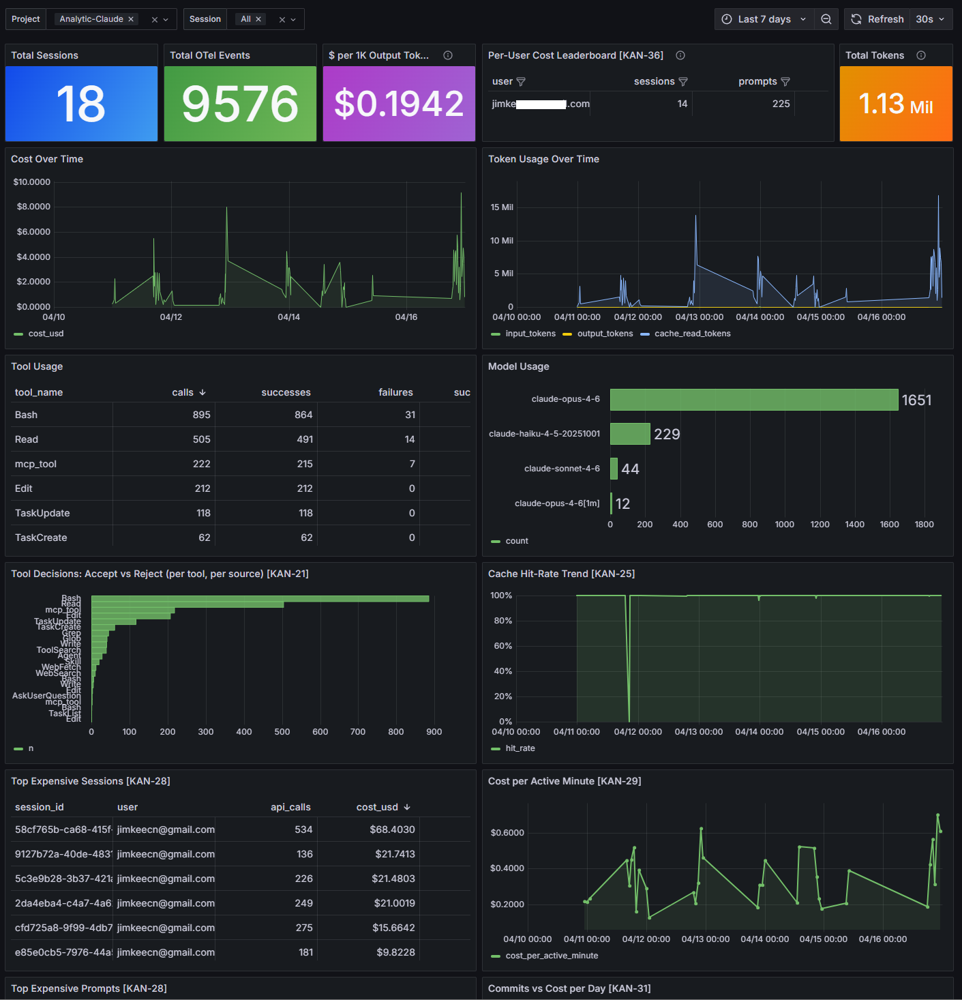
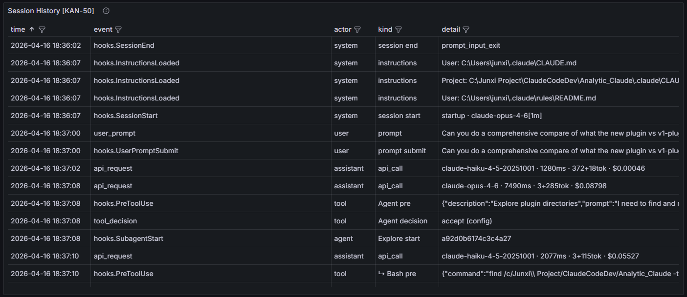
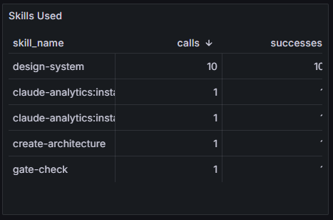
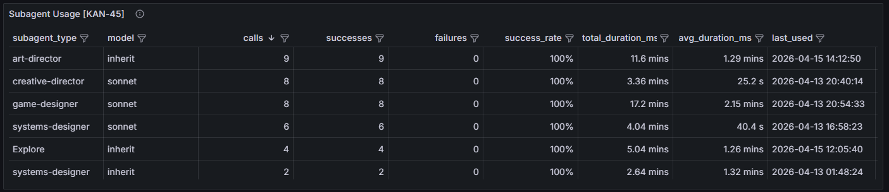
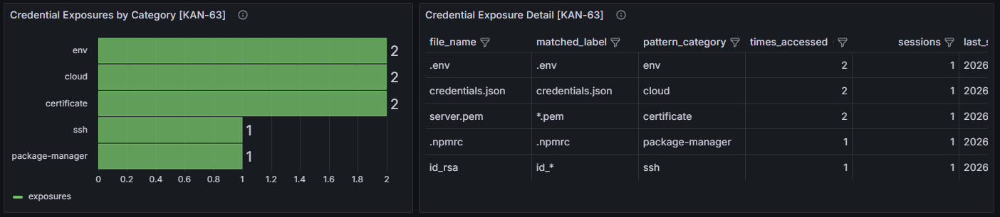
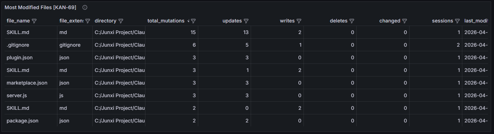
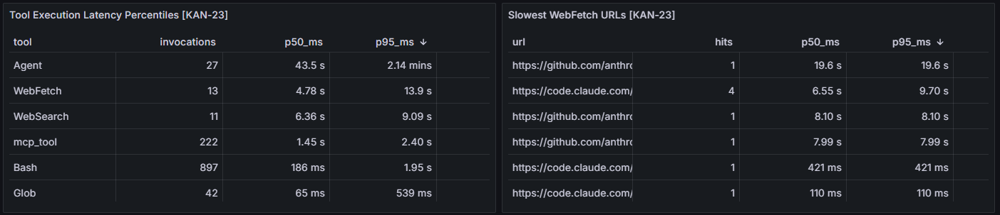

<div align="center">

[English](../README.md) | [中文](README.zh-CN.md) | [日本語](README.ja.md) | Français | [Deutsch](README.de.md)

# Claudalytics

**Tableau de bord analytique local pour Claude Code**

Suivez les coûts, les tokens, l'utilisation des outils et l'activité des sessions dans tous vos projets.
Aucune dépendance cloud. Vos données restent sur votre machine.

[](../LICENSE)
[](<>)
[](<>)
[](<>)

[Installation](#installation) · [Fonctionnalités](#fonctionnalités) · [Mise à jour](#mise-à-jour) · [Utilisation en équipe](#utilisation-en-équipe) · [Changelog](../CHANGELOG.md)

</div>

---



## Installation

### 1. Cloner et exécuter la vérification préalable des ports

```bash
git clone https://github.com/jimkeecn/Claudalytics.git
cd Claudalytics
claude
```

Dans Claude Code, exécutez :

```
/preflight-check
```

Cela vérifie que tous les ports hôte requis sont libres **avant** de démarrer Docker. Le serveur de hooks et l'exportateur OTel sont étroitement couplés à ces numéros de port — si un port est occupé, libérez-le (le skill affiche le processus et la commande pour le terminer). Ne remappez **pas** les ports de Claudalytics.

**Ports hôte requis**

| Port  | Usage                            |
| ----- | -------------------------------- |
| 13000 | Interface Grafana                |
| 4317  | Collecteur OTel (récepteur gRPC) |
| 4318  | Collecteur OTel (récepteur HTTP) |
| 4319  | Serveur de hooks                 |
| 8123  | ClickHouse HTTP                  |
| 9000  | ClickHouse natif (TCP)           |
| 13133 | Endpoint de santé du collecteur  |

### 2. Démarrer la stack analytique

```bash
cd docker-stack
docker compose up -d --build
```

Attendez environ 30 secondes. Revenez ensuite à la racine du dépôt :

```bash
cd ..
```

Exécutez `/validate-infra` pour vérifier que les 4 conteneurs, les tables et les vues matérialisées sont en bon état.

### 3. Installer le plugin

Ajoutez le marketplace Claudalytics et installez le plugin dans n'importe quel projet :

```
/plugin marketplace add jimkeecn/Claudalytics
/plugin install claudalytics@claudalytics
```

Le marketplace contient aussi un second plugin optionnel, `claudalytics-hook-capture`. Ne l'installez pas à la main : `/init-claudalytics` l'active pour un projet quand vous choisissez le mode OTel + hooks.

Épinglez une version spécifique :

```
/plugin marketplace add jimkeecn/Claudalytics@v1.1.0
```

Un marketplace épinglé ne passe pas tout seul à une nouvelle version. Pour déplacer l'épingle, voir l'étape 5 de [Mise à niveau depuis la 1.1.0](#mise-à-niveau-depuis-la-110).

**Développement local** — si vous itérez sur le code du plugin lui-même, installez directement depuis votre checkout local :

```
/install-plugin /full/path/to/Claudalytics/plugin
```

### 4. Initialiser

```
/init-claudalytics
```

Suivez les instructions. Le skill demande le nom de votre projet et un [mode de capture](#modes-de-capture), écrit le bloc OTel dans votre fichier de réglages utilisateur, et ne garde que le nom du projet dans `.claude/settings.local.json`. Lancez-le une fois dans chaque projet que vous voulez voir sous son nom. Le skill sauvegarde chaque fichier de réglages avant de le modifier et ajoute les fichiers de sauvegarde au `.gitignore` du projet. Il a besoin de Node.js 18 ou plus récent.

### 5. Redémarrer Claude Code et ouvrir les tableaux de bord

Redémarrez votre session pour que la télémétrie prenne effet. Démarrez Claude Code dans le dossier racine du projet, celui où vous avez lancé `/init-claudalytics` (voir [Limites connues](#limites-connues)). Ouvrez ensuite :

**http://localhost:13000** (admin / admin)

Naviguez vers : **Home > Dashboards > Claudalytics > Claudalytics - OTel Overview**

C'est tout. Les données commencent à affluer immédiatement.

---

## Modes de capture

| Mode                   | Ce qui tourne                                                            | Ce que vous obtenez                                                                                                                                                                                                                      |
| ---------------------- | ------------------------------------------------------------------------ | ---------------------------------------------------------------------------------------------------------------------------------------------------------------------------------------------------------------------------------------- |
| OTel seul (par défaut) | L'export OTel propre à Claude Code. Aucun hook Claudalytics ne tourne.   | Tous les panneaux, sauf les deux panneaux Config Change, la raison de fin de session et les URLs de résultats WebSearch                                                                                                                  |
| OTel + hooks           | L'export OTel, plus le plugin `claudalytics-hook-capture` pour ce projet | En plus : les changements de réglages, les changements de dossier, la raison de fin de session, les URLs de résultats WebSearch, quelques lignes de plus dans Session History et un contrôle de santé de la stack au début de la session |

Le mode hooks n'ajoute que des événements absents d'OTel, donc rien n'est compté deux fois. Chaque ligne indique ce qui l'a écrite : dans `otel_logs`, l'attribut `event.source` vaut `otel`, `hook` ou `transcript_backfill`, et les tables derrière les panneaux ont une colonne `source` qui vaut `otel` ou `hook`. Les lignes antérieures au schéma v7 ont une source vide. Une ligne de hook stocke les identifiants de Claude Code sous les mêmes noms qu'une ligne OTel (`session.id`, `prompt.id`, `tool_use_id`, `agent_id`), ce qui permet de rapprocher les deux lignes d'un même appel WebSearch : la requête venant d'OTel et les URLs de résultats venant du hook. Le mode hooks a besoin du serveur de hooks sur le port 4319. Pour envoyer les événements de hooks vers un autre serveur, définissez `CLAUDALYTICS_HOOKS_URL` (par défaut `http://localhost:4319`) dans votre shell ou dans l'`env` de votre fichier de réglages utilisateur.

Pour passer un projet dans l'autre mode, relancez `/init-claudalytics` dans ce projet et choisissez l'autre mode. Le changement s'applique à la session suivante.

### Où se trouvent les réglages

- **Fichier de réglages utilisateur** (`~/.claude/settings.json`, ou `$CLAUDE_CONFIG_DIR/settings.json`) : le bloc OTel ci-dessous. Claude Code 2.1.282 et les versions suivantes ignorent ces variables dans les fichiers de projet, donc `/init-claudalytics` les écrit ici. Il n'ajoute que les clés manquantes et demande avant de changer une clé qui a une autre valeur.
- **Fichier de projet** `.claude/settings.local.json` : seulement `OTEL_RESOURCE_ATTRIBUTES` avec `project.name=<votre projet>`, plus l'entrée qui active ou désactive `claudalytics-hook-capture`. En mode OTel + hooks, `/init-claudalytics` écrit aussi un hook `CwdChanged` qui ne fait rien (`exit 0`) : Claude Code n'envoie les changements de dossier à un plugin que si un fichier de réglages contient lui aussi un hook `CwdChanged`. Le retour au mode OTel seul supprime ce hook et ne touche pas à vos propres hooks. Le filtre Project du tableau de bord liste chaque nom.

```json
"env": {
  "CLAUDE_CODE_ENABLE_TELEMETRY": "1",
  "CLAUDE_CODE_ENHANCED_TELEMETRY_BETA": "1",
  "OTEL_METRICS_EXPORTER": "otlp",
  "OTEL_LOGS_EXPORTER": "otlp",
  "OTEL_TRACES_EXPORTER": "otlp",
  "OTEL_EXPORTER_OTLP_PROTOCOL": "grpc",
  "OTEL_EXPORTER_OTLP_ENDPOINT": "http://localhost:4317",
  "OTEL_LOG_USER_PROMPTS": "1",
  "OTEL_LOG_TOOL_DETAILS": "1",
  "OTEL_LOG_TOOL_CONTENT": "1",
  "OTEL_METRIC_EXPORT_INTERVAL": "10000",
  "OTEL_LOGS_EXPORT_INTERVAL": "5000",
  "OTEL_RESOURCE_ATTRIBUTES": "project.name=unassigned"
}
```

**Ce bloc active l'export OTel pour chaque dépôt de cette machine**, pas seulement pour les projets Claudalytics. Il envoie à votre stack locale les prompts, les commandes et les chemins de fichiers, et aussi le contenu des outils : le texte des fichiers que Claude lit ou écrit, et la sortie des commandes (`OTEL_LOG_TOOL_CONTENT=1`, jusqu'à 60 Ko par appel d'outil, stocké comme événements `tool.output` des spans `claude_code.tool` dans `otel_traces`). Un dépôt que vous n'avez pas configuré apparaît comme `unassigned` dans le filtre Project, comme n'importe quel autre projet.

Pour réduire la capture dans un dépôt, ajoutez l'un de ces ensembles à l'`env` du `.claude/settings.local.json` de ce dépôt. Les fichiers de projet peuvent désactiver ces réglages, mais pas les activer, et `/init-claudalytics` les garde quand il est relancé.

- Aucun export : `"OTEL_LOGS_EXPORTER": "none"`, `"OTEL_METRICS_EXPORTER": "none"`, `"OTEL_TRACES_EXPORTER": "none"`
- Métadonnées seulement (sans texte des prompts, détails ni contenu des outils) : `"OTEL_LOG_USER_PROMPTS": "0"`, `"OTEL_LOG_TOOL_DETAILS": "0"`, `"OTEL_LOG_TOOL_CONTENT": "0"`

`OTEL_LOG_RAW_API_BODIES` ne fonctionne lui aussi que depuis le fichier de réglages utilisateur ou le shell. Il enregistre les corps complets des requêtes et réponses API de chaque dépôt, donc Claudalytics ne le définit pas.

**Le serveur de hooks reste nécessaire dans les deux modes.** Il crée et met à jour le schéma ClickHouse à chaque démarrage, répond à `/health`, contient l'outil de backfill des transcripts et reçoit les événements de hooks en mode OTel + hooks. Ne supprimez pas ce conteneur.

---

## Fonctionnalités

### Chronologie des sessions

Chaque action dans une vue unique — prompts, réponses, appels API, décisions et résultats d'outils, exécutions de subagents, événements de compaction — dans une chronologie unique tirée des événements OTel de Claude Code. En mode OTel + hooks, elle montre aussi les quelques événements que seuls les hooks fournissent. La colonne `source` indique ce qui a écrit chaque ligne : `otel`, `hook` ou `transcript_backfill`.

Dans un tableau, chaque ligne a la hauteur d'une seule ligne de texte, donc un texte plus long est coupé à l'écran. Le texte complet est toujours là : survolez une cellule et cliquez sur l'icône en forme d'œil (inspect) pour lire le prompt, la réponse ou la commande en entier. Cela vaut aussi pour les autres tableaux qui contiennent du texte long, comme Top Expensive Prompts et Recent Errors. Les événements que Claude Code envoie à chaque démarrage (plugins chargés, hooks enregistrés, connexions MCP, réglages gérés) sont masqués. Pour les voir, mettez la variable **Startup events**, en haut du tableau de bord, sur Show.



### Analyse des coûts et des tokens

Suivez les dépenses par session, modèle et projet. Consultez le coût par 1K tokens de sortie, l'utilisation des tokens dans le temps, les taux de cache hit, et identifiez vos sessions et prompts les plus coûteux.

### Suivi des skills et des subagents

Surveillez quels skills et subagents Claude utilise, leurs taux de réussite, leur durée et la sélection du modèle. Repérez les inefficacités — un taux élevé de ré-invocation signifie que la première tentative a probablement échoué.

<div align="center">


</div>

### Détection d'exposition de credentials

Détecte automatiquement quand Claude lit des fichiers sensibles — `.env`, credentials AWS, clés SSH, certificats, configurations de bases de données — à travers 38 patterns dans 17 catégories. La détection voit l'outil Read, un Grep dont le chemin est le fichier lui-même, et les commandes de lecture `cat`, `type`, `head`, `tail`, `less`, `more`, `Get-Content` et `gc` dans Bash et PowerShell. Aucune configuration nécessaire. Propulsé par une vue matérialisée ClickHouse qui effectue du pattern-matching en temps réel.

Le panneau stocke le nom du fichier, pas son texte. Le collecteur remplace aussi le texte d'un tel fichier par `[redacted: credential file]` avant qu'il n'atteigne la base de données. Cela ne couvre pas tous les cas : voir [Limites connues](#limites-connues).



### Suivi des mutations de fichiers

Chaque fichier que Claude modifie, écrit ou supprime est suivi avec le type d'action, l'extension de fichier et le répertoire. Voyez quels fichiers sont le plus souvent modifiés et repérez les suppressions inattendues. Les suppressions viennent de `rm`, `del`, `rmdir`, `unlink`, `Remove-Item` et `ri` dans les commandes Bash et PowerShell, à raison d'une ligne par fichier supprimé.



### Détection des actions bloquées

Les appels d'outils refusés viennent de l'événement `tool_decision` de Claude Code, avec la raison : `user_reject`, `user_abort` (vous avez interrompu la demande de permission), `config` ou `hook`. Les lignes d'avant la mise à niveau apparaissent comme `legacy: no PostToolUse` : la 1.1.0 comptait un PreToolUse sans PostToolUse, ce qui incluait aussi les appels interrompus. Utile pour auditer ce que Claude a tenté de faire mais en a été empêché.

### Latence des outils et URLs lentes

Identifiez les goulots d'étranglement de performance — quels outils sont les plus lents au p50/p95, et quelles URLs prennent le plus de temps à récupérer.



### 38 panneaux de tableau de bord

| Catégorie   | Panneaux                                                                                       |
| ----------- | ---------------------------------------------------------------------------------------------- |
| KPIs        | Sessions, événements, coût/1K tokens, total tokens, coût par utilisateur                       |
| Coûts       | Coût dans le temps, sessions/prompts les plus coûteux, coût par minute active, commits vs coût |
| Outils      | Utilisation des outils, utilisation des modèles, taux d'acceptation/rejet, taux de cache hit   |
| Latence     | Percentiles de latence API, latence d'exécution des outils, URLs WebFetch les plus lentes      |
| Chronologie | Historique complet des événements de session (limite de 2000 lignes)                           |
| Workflow    | Skills utilisés, sites web visités, appels serveur MCP, utilisation des subagents              |
| Fichiers    | Fichiers les plus modifiés avec répartition par action, fichiers de mémoire                    |
| Code        | Lignes de code par utilisateur, distribution de la longueur des prompts                        |
| Sécurité    | Actions bloquées, taux de blocage dans le temps, expositions de credentials                    |
| Ops         | Changements de configuration, événements/fréquence de compaction, erreurs récentes             |
| Feedback    | Entonnoir de sondage                                                                           |

---

## Mise à jour

Consultez [CHANGELOG.md](../CHANGELOG.md) pour la liste des changements de chaque version.

```bash
cd Claudalytics
git pull
cd docker-stack
docker compose up -d --build
docker compose restart otel-collector
```

Le collecteur ne lit sa configuration qu'au démarrage ; la dernière commande garantit donc qu'il utilise la nouvelle.

Les changements de schéma additifs (nouvelles tables, nouvelles vues matérialisées) sont appliqués automatiquement par le serveur de hooks au démarrage. Si une version inclut des changements de schéma destructifs (vues ou tables supprimées, modification de types de colonnes, re-partitionnement), exécutez `/migrate-db` depuis le projet Claudalytics — il vous guidera à travers la migration avec des invites de sauvegarde. Après une mise à jour, exécutez `/validate-infra` : s'il signale une migration en attente, exécutez `/migrate-db`.

Cette version comporte deux étapes destructives, les schémas v4 et v5, et trois étapes automatiques, v3, v6 et v7. Le serveur de hooks applique la v6 et la v7 tout seul, mais seulement une fois l'étape v5 terminée. Voir l'étape 4 de [Mise à niveau depuis la 1.1.0](#mise-à-niveau-depuis-la-110).

La mise à jour automatique est désactivée pour ce marketplace, donc mettez les plugins à jour vous-même : lancez `claude plugin marketplace update claudalytics`, puis `claude plugin update claudalytics@claudalytics` avec la portée (scope) utilisée à l'installation, et démarrez une nouvelle session. Si vous venez de la 1.0.0 ou de la 1.1.0, suivez plutôt les étapes ci-dessous. `/init-claudalytics` supprime aussi les fichiers de hooks par projet de la 1.0.0.

### Mise à niveau depuis la 1.1.0

La 1.1.0 envoie la plupart des données par les hooks. Cette version les lit dans les événements OTel propres à Claude Code, et Claude Code 2.1.282 et les versions suivantes ignorent les variables d'export OTel dans les fichiers de projet, là où la 1.1.0 les écrivait. Suivez ces étapes dans cet ordre. Les commandes sont pour Git Bash sous Windows (ou un shell POSIX sous macOS et Linux), pas pour PowerShell.

1. **Sauvegardez ClickHouse.** Fermez d'abord toutes les sessions Claude Code : le collecteur n'a pas de tampon, donc les événements envoyés pendant l'arrêt de ClickHouse sont perdus. Écrivez l'archive dans un dossier hors du dépôt. `MSYS_NO_PATHCONV=1` sert à Git Bash sous Windows et n'a aucun effet dans les autres shells.

   ```bash
   BACKUP_DIR="<dossier hors du dépôt>"
   docker stop claudalytics-clickhouse
   MSYS_NO_PATHCONV=1 docker run --rm -v claudalytics-clickhouse-data:/data -v "$BACKUP_DIR":/backup alpine tar czf /backup/ch-pre-otel.tgz -C /data .
   docker start claudalytics-clickhouse
   ```

   **Si votre stack est restée arrêtée longtemps, sauvegardez avant de la démarrer.** Chaque table garde les lignes 90 jours (`otel_logs` aussi). Peu après le démarrage de ClickHouse, les lignes plus anciennes sont supprimées, quelle que soit la version. La sauvegarde est alors leur seule copie.

2. **Activez l'export OTel dans le fichier de réglages utilisateur, avec l'ancienne stack et l'ancien plugin toujours actifs.** Ne faites pas encore `git pull` : Grafana lit le tableau de bord depuis votre checkout, et les nouveaux panneaux échouent sur l'ancien schéma.
   - Ajoutez le bloc de [Où se trouvent les réglages](#où-se-trouvent-les-réglages) à l'`env` de `~/.claude/settings.json`. Gardez le `project.name` que la 1.1.0 a écrit dans le `.claude/settings.local.json` de chaque projet : il fonctionne toujours là.
   - Démarrez une nouvelle session dans chaque projet que vous utilisez, et vérifiez que les lignes OTel arrivent avec le bon nom de projet : le panneau **Tool Usage** montre les outils de la session sous ce projet.
   - Jusqu'à l'étape 3, les panneaux qui lisent `otel_logs` directement (par exemple Session History) montrent les lignes de hooks et les lignes OTel côte à côte. Les autres panneaux ne comptent rien deux fois.
   - **Ne reconstruisez pas la stack avant l'arrivée des lignes OTel.**

3. **Déployez la nouvelle stack.** Le serveur de hooks ajoute tout seul les dix vues alimentées par OTel (schéma v3). À partir de là, les modifications et écritures de fichiers, les suppressions par le shell, les lectures de fichiers de credentials, les appels d'outils refusés, les compactions et les URLs de sites web (venant de WebFetch, des commandes shell, des outils MCP et des requêtes WebSearch) viennent des événements OTel. Une copie du plugin 1.1.0 n'envoie pas de marqueur hook-capture, donc le serveur ignore ses événements de hooks. Redémarrez aussi le collecteur : il ne lit sa configuration, avec le nouveau masquage des fichiers de credentials et le tag `event.source`, qu'au démarrage.

   ```bash
   git pull
   cd docker-stack
   docker compose up -d --build
   docker compose restart otel-collector
   ```

   **Rien n'est perdu entre la reconstruction de la stack et `/migrate-db` (étape 4) : les dix vues alimentées par OTel écrivent des lignes dès la reconstruction.** Dans notre test de cette période, 13 types d'événements sur 13 ont eu leur ligne : les modifications et écritures de fichiers, les suppressions par le shell dans Bash et PowerShell, les lectures de fichiers de credentials avec Read, Grep et le shell, les appels d'outils refusés, les compactions, les URLs venant de WebFetch, des commandes shell et des outils MCP, et les requêtes WebSearch. Faites quand même l'étape 4 juste après celle-ci, avant la mise à jour des plugins et `/init-claudalytics` : tant qu'elle n'est pas terminée, les anciennes vues et l'ancienne table `sessions` sont encore là, et `/validate-infra` signale une migration en attente.

   **Entre la reconstruction de la stack et le moment où vous relancez `/init-claudalytics` en choisissant le mode hooks, il n'y a aucune ligne ConfigChange, raison de SessionEnd ou URL WebSearch.**

4. **Lancez `/migrate-db` tout de suite.** Démarrez Claude Code dans le dépôt Claudalytics et lancez-le avant de faire quoi que ce soit d'autre. Il vous demande d'abord de faire une sauvegarde, montre le nombre de lignes avant et après chaque étape, et redémarre le serveur de hooks après chaque étape.
   - **Le schéma v4** supprime les 11 anciennes vues alimentées par les hooks. Les tables et leurs lignes restent.
   - **Le schéma v5** supprime trois choses : l'ancienne vue des URLs de résultats WebSearch (`websites_visited_search_mv`), la vue `sessions_mv` et l'ancienne table `sessions`. Aucune vue alimentée par OTel n'est supprimée, donc la capture continue. Les lignes de `credential_exposures`, `file_mutations`, `blocked_tools`, `compaction_events` et `websites_visited` restent. Les lignes de `sessions` sont supprimées, mais rien n'est perdu : la nouvelle vue `sessions` lit les mêmes sessions dans `otel_logs`.
   - **Le schéma v6** ne demande aucune action. Le serveur de hooks l'applique tout seul, à son premier démarrage après l'étape v5. Il recrée `websites_visited_search_mv`, désormais sans les adresses locales, et il crée `sessions` sous forme de vue.
   - **Le schéma v7** ne demande aucune action. Le serveur de hooks l'applique tout seul, juste après la v6. Il ajoute la colonne `source` aux cinq tables et modifie les 11 vues sur place : rien n'est supprimé et aucun événement n'est manqué. Les lignes déjà stockées gardent une `source` vide.

   Tant que ce n'est pas fait, `/validate-infra` et le `/health` du serveur de hooks indiquent une migration en attente. Ils indiquent d'abord `v4_drop_legacy_hook_mvs`. Une fois l'étape v4 terminée, ils indiquent `v5_drop_replaced_otel_views`. À la fin, les deux indiquent le schéma v7 et plus rien en attente. Pendant l'étape v5 (environ 15 secondes), les listes déroulantes Project et Session du tableau de bord sont vides.

5. **Mettez à jour les plugins.**
   - Lancez `claude plugin marketplace update claudalytics`.
   - Si vous avez épinglé un tag (par exemple `jimkeecn/Claudalytics@v1.1.0`), déplacez plutôt l'épingle : mettez le nouveau tag dans `ref`, dans la `source` du marketplace sous `extraKnownMarketplaces` dans `~/.claude/settings.json`. Claude Code récupère à nouveau le marketplace quand une source déclarée change. Ne supprimez pas le marketplace : cela désinstalle tous les plugins Claudalytics.
   - Dans le dossier racine de chaque projet où vous avez installé la 1.1.0, lancez `claude plugin update claudalytics@claudalytics --scope project`. Les mises à jour se font par portée, donc lancez-la dans chaque projet. Utilisez plutôt `--scope user` si vous l'avez installé pour votre utilisateur.
   - Démarrez une nouvelle session. L'ancien hook `WorktreeCreate`, qui cassait les worktrees, a maintenant disparu.

6. **Relancez `/init-claudalytics` dans chaque projet.** Il supprime les clés OTel que Claude Code ignore dans les fichiers de projet, garde `project.name`, demande le [mode de capture](#modes-de-capture) et sauvegarde chaque fichier de réglages avant de le modifier.

7. **Optionnel :** `npm run backfill` pour les jours où l'export OTel était désactivé. Il ne récupère que les lignes `api_request`. Voir [Récupérer la télémétrie manquée](#récupérer-la-télémétrie-manquée-backfill-des-transcripts).

### Retour arrière

1. Fermez toutes les sessions Claude Code, puis lancez `docker compose down` dans `docker-stack`. Les volumes sont conservés.
2. Restaurez la sauvegarde de l'étape 1 de [Mise à niveau depuis la 1.1.0](#mise-à-niveau-depuis-la-110) :

   ```bash
   MSYS_NO_PATHCONV=1 docker run --rm -v claudalytics-clickhouse-data:/data -v "$BACKUP_DIR":/backup alpine sh -c "find /data -mindepth 1 -delete && tar xzf /backup/ch-pre-otel.tgz -C /data"
   ```

3. Récupérez la version précédente (`git checkout v1.1.0`) et lancez `docker compose up -d --build` dans `docker-stack`.
4. Seulement si vous avez épinglé le marketplace sur un tag : pour revenir aussi au plugin 1.1.0, remettez `v1.1.0` dans son `ref` et lancez les commandes `claude plugin update` de l'étape 5 de [Mise à niveau depuis la 1.1.0](#mise-à-niveau-depuis-la-110). Ce retour à une version plus ancienne n'a pas été testé.

**Restaurez aussi le volume. L'ancienne stack ne fonctionne pas sur le nouveau schéma.** Avant `/migrate-db`, les anciennes vues alimentées par les hooks et les nouvelles vues `*_otel_mv` remplissent les mêmes tables, et les comptes doublent. Après `/migrate-db`, les anciennes vues alimentées par les hooks et l'ancienne table `sessions` ont disparu, et le serveur de hooks 1.1.0 ne recrée pas les vues alimentées par les hooks. Si vous ne pouvez pas restaurer et que vous n'avez pas encore lancé `/migrate-db`, supprimez d'abord les vues `*_otel_mv`.

### Limites connues

- **Longues commandes PowerShell.** OTel ne garde qu'environ les 128 premiers caractères d'une valeur d'entrée d'outil de plus de 512 caractères. Bash n'est pas touché, car OTel envoie aussi sa commande complète. Donc un `Remove-Item` ou une URL après environ le 128e caractère d'une longue commande PowerShell n'arrive ni dans le suivi des mutations de fichiers ni dans Websites Visited. La capture par hooks ne transmet pas les appels PowerShell, donc c'est pareil dans les deux modes.
- **Websites Visited ne voit que certaines commandes shell.** Une URL dans une commande Bash ou PowerShell ne compte que comme argument de `curl`, `wget`, `Invoke-WebRequest`, `iwr`, `Invoke-RestMethod` ou `irm`, et une commande donne au plus 10 lignes. Une page récupérée par un autre programme (un script, `git clone`, `npm install`) n'a pas de ligne. Un outil MCP n'a une ligne que s'il a une entrée `url` ou `urls`. Les adresses locales (`localhost`, `127.0.0.1`, `::1`, `host.docker.internal`) sont exclues volontairement.
- **Dans les commandes shell, le suivi des mutations de fichiers ne voit que les suppressions.** Les fichiers modifiés avec les outils Edit et Write sont suivis. Dans une commande Bash ou PowerShell, une suppression compte pour `rm`, `del`, `rmdir`, `unlink`, `Remove-Item` et `ri`. Un fichier supprimé par un script ou par une autre commande (par exemple `git clean` ou `find -delete`) n'a pas de ligne. Un chemin relatif n'est rattaché à un dossier que si la commande commence par `cd <folder> &&` et ne contient aucun autre `cd`. Dans les autres cas, le chemin est stocké tel qu'il a été écrit.
- **Credential Exposures ne voit que certaines façons de lire un fichier.** Il voit l'outil Read, un Grep dont le chemin est le fichier lui-même, et `cat`, `type`, `head`, `tail`, `less`, `more`, `Get-Content` et `gc` dans une commande shell. Un Grep sur un dossier, ou un autre programme qui lit le fichier (`sed`, `awk`, un script), n'a pas de ligne. Un chemin venant d'une commande shell est stocké tel qu'il a été écrit, donc il peut être relatif.
- **Les lignes stockées avant la mise à niveau gardent les anciennes règles.** Les nouvelles règles pour les suppressions, les lectures de credentials et les sites web ne s'appliquent qu'aux nouveaux événements. Par exemple, une ancienne ligne `localhost` reste dans Websites Visited jusqu'à son expiration.
- **Un Edit en échec n'est pas enregistré.** Claude Code n'envoie pas d'événement `tool_result` quand un Edit échoue (par exemple « String to replace not found »), donc il n'apparaît ni dans Recent Errors ni dans Session History. Un Read en échec et une commande Bash en échec sont enregistrés.
- **Le nombre de commits peut être trop élevé.** La métrique `claude_code.commit.count` de Claude Code compte aussi une commande Bash qui contient seulement le texte `git commit`, par exemple dans un heredoc ou dans une recherche. Dans notre test, 3 vrais commits ont donné un compte de 6. Commits vs Cost per Day et la colonne des commits de Per-User Cost Leaderboard utilisent cette métrique.
- **Un appel d'outil interrompu compte comme un échec.** OTel le signale comme un `tool_result` avec `success=false`, donc Recent Errors l'inclut. Une demande de permission interrompue apparaît comme `user_abort` dans Blocked Actions.
- **Seuls les hooks fournissent :** les changements de réglages (les deux panneaux Config Change), la raison de fin de session, les URLs de résultats WebSearch (OTel fournit la requête de recherche), et ces lignes de Session History : début et fin de session, changements de cwd, instructions chargées, notifications, début de subagent, elicitation et teammate idle. En mode OTel seul, elles restent vides. Les changements de dossier ont besoin du hook `CwdChanged` que `/init-claudalytics` écrit dans le fichier de projet en mode OTel + hooks ; pour un projet configuré avant, relancez `/init-claudalytics` une fois.
- **Les worktrees créés avec `git worktree add` apparaissent comme `unassigned`.** Dans nos tests, un worktree créé par Claude Code (`claude --worktree`) recevait une copie de `.claude/settings.local.json`, mais pas un worktree créé avec `git worktree add`. Copiez `.claude/settings.local.json` du checkout principal dans un tel worktree. Les lignes de hooks gardent le nom du projet, car `forward-hook.sh` lit le nom du projet dans le `.claude/settings.local.json` du checkout principal.
- **Une session démarrée dans un sous-dossier apparaît comme `unassigned` (Windows).** Sous Windows, Claude Code ne lit `.claude/settings.local.json` que dans le dossier où vous le démarrez. Il ne cherche ni dans les dossiers parents ni à la racine git. Démarrez donc Claude à la racine du dépôt, le dossier où vous avez lancé `/init-claudalytics`. Les événements OTel ne portent aucun nom de dossier, donc le tableau de bord ne peut pas corriger cela après coup. En mode OTel + hooks, les lignes de hooks d'une telle session gardent le nom du projet, donc la session apparaît sous deux noms. Sous macOS et Linux, la documentation de Claude Code indique que la v2.1.211 et les versions suivantes lisent ce fichier depuis la racine git ; nous n'avons testé que Windows.
- **Un nouveau dépôt apparaît comme `unassigned` tant que vous ne lui faites pas confiance.** Claude Code n'applique les réglages de projet qu'après que vous avez fait confiance au dossier.
- **Les anciennes copies du plugin 1.1.0 n'atteignent plus le tableau de bord.** Le nouveau serveur de hooks ignore les événements de hooks sans le marqueur hook-capture, donc un projet encore en 1.1.0 n'envoie rien par les hooks tant que vous ne le mettez pas à jour (étape 5). Ses données OTel arrivent toujours.
- **Les anciennes lignes expirent.** Chaque table garde les lignes 90 jours, donc les lignes écrites par les hooks avant la mise à niveau disparaissent avec le temps.
- **Le texte d'un fichier de credentials est retiré, mais un secret peut encore être stocké d'une autre façon.** Quand Claude lit un fichier de type credentials (les noms de fichiers du panneau Credential Exposures) avec l'outil Read, ou avec `cat`, `type`, `head`, `tail`, `less`, `more`, `Get-Content` ou `gc` dans une commande Bash, le collecteur stocke `[redacted: credential file]` à la place du texte du fichier. Il fait de même dans la trace pour le texte d'un Write ou d'un Edit sur un tel fichier. Une commande PowerShell et un Grep ne sont pas masqués, et aujourd'hui ce n'est pas nécessaire : Claude Code n'envoie aucun texte de sortie pour ces deux outils, donc aucun texte de fichier n'est stocké pour eux. La ligne dans Credential Exposures reste. Ces cas ne sont pas couverts : un secret tapé dans une commande (`echo KEY=... > .env`), la sortie d'une autre commande (`grep`, `sed`, `env`, un script), le texte d'un Write ou d'un Edit sur un tel fichier dans le journal des événements (`tool_input` : une valeur de 512 caractères au plus est stockée en entier, une valeur plus longue est coupée à environ ses 128 premiers caractères), un prompt ou une réponse qui répète le secret, et les corps API complets quand vous définissez `OTEL_LOG_RAW_API_BODIES`. Les lignes stockées avant ce changement gardent le texte jusqu'à leur expiration. Après une mise à niveau, redémarrez le collecteur (`docker compose restart otel-collector`) pour qu'il lise la nouvelle configuration.
- **Les événements envoyés pendant que le collecteur est arrêté sont perdus.** Claude Code ne garde les événements en mémoire que jusqu'à l'export suivant (toutes les 5 secondes pour les événements et pour les traces, dont le bloc de réglages laisse l'intervalle à sa valeur par défaut, et toutes les 10 secondes pour les métriques) et n'envoie chaque lot qu'une seule fois. Quand le collecteur ne répond pas, le lot est abandonné. Aucun réglage de Claude Code ne change cela : nous avons vérifié la v2.1.330, et avec l'export gRPC qu'utilise Claudalytics, un export en échec n'est ni renvoyé ni conservé. Les réglages OpenTelemetry pour la taille de la file d'attente et le délai d'export (`OTEL_BLRP_*`, `OTEL_BSP_*`, `OTEL_EXPORTER_OTLP_TIMEOUT`) n'aident pas : ils changent le nombre d'événements qui attendent l'export suivant et la durée maximale d'un export, pas ce qui se passe après un export en échec. Une session en cours peut aussi avoir besoin de quelques secondes pour se reconnecter après le retour du collecteur. Dans notre test, un arrêt de 30 secondes a fait perdre environ 40 secondes d'événements, et la session n'a affiché aucun avertissement. Après coup, vous pouvez récupérer les lignes `api_request` (modèle, tokens et coût estimé, sans durée) avec le [backfill des transcripts](#récupérer-la-télémétrie-manquée-backfill-des-transcripts). Les événements d'outils, les prompts, les changements de fichiers, les sites web, les traces et les métriques de ce trou ne peuvent pas être récupérés.
- **Dans les tableaux, chaque ligne a la hauteur d'une seule ligne de texte.** Un texte plus long est coupé à l'écran, mais rien n'est perdu : survolez une cellule et cliquez sur l'icône en forme d'œil (inspect) pour lire le texte complet. Dans une fenêtre étroite, un tableau dont le texte long n'est pas dans la première colonne (par exemple Websites Visited) peut demander un défilement horizontal pour atteindre cette colonne.
- **Les prompts que l'utilisateur n'a pas tapés sont reconnus à leur texte.** Claude Code envoie le compte rendu d'un agent et une notification de tâche comme des prompts normaux, sans autre marque. Les comptes de prompts excluent un prompt qui commence par `<agent-message` ou `<task-notification`, donc un prompt que vous commencez par ce texte n'est pas compté non plus.
- **Subagent Usage fait la jointure par session et par type de subagent.** La durée d'exécution et le modèle viennent des événements `subagent_completed`. Un subagent qui est repris plus tard compte pour plus d'une exécution, et un subagent encore en cours n'a pas encore de durée d'exécution.
- **Le type de subagent, la branche git et l'id de commit ne sont pas affichés.** Les événements d'outils OTel ne portent que l'id du subagent, donc la colonne `agent_type` de `file_mutations` et de `credential_exposures` est vide pour les nouvelles lignes. Claude Code envoie la branche git et l'id de commit (`vcs.ref.head.name`, `vcs.ref.head.revision`) avec le résultat d'une commande git, mais aucun panneau ne les utilise.

---

## Récupérer la télémétrie manquée (backfill des transcripts)

Le chemin d'ingestion est **en direct et sans tampon** : Claude Code envoie ses événements OTel au collecteur OTel, qui écrit dans ClickHouse. En mode OTel + hooks, le serveur de hooks envoie ses quelques événements de hooks par le même chemin. Si la stack Docker (ou l'hôte) est arrêtée, les événements sont perdus sans possibilité de rejeu — un trou qui ressemble exactement à « il ne s'est rien passé ».

Claude Code, lui, journalise toujours chaque tour dans `~/.claude/projects/<project>/*.jsonl`, indépendamment de Docker. L'outil de backfill rejoue ce journal durable dans ClickHouse pour la période de la panne :

```bash
cd docker-stack/hooks-server
npm run build
npm run backfill -- --from 2026-06-10 --to 2026-06-13 --dry-run   # report only
npm run backfill -- --from 2026-06-10 --to 2026-06-13             # emit (dates are UTC, inclusive)
```

Il est idempotent par `request_id` (les lignes déjà dans ClickHouse sont ignorées, donc vous pouvez le relancer sans risque) et conserve les horodatages d'origine.

**Ce qu'il récupère — et ce qu'il ne peut pas récupérer.** Les transcripts ne contiennent que la conversation, donc le backfill ne reconstruit **que les lignes `api_request`** (une par tour de l'assistant) : `model`, les nombres de tokens et un coût estimé. Ces lignes portent le tag `event.source=transcript_backfill`. Les transcripts contiennent les tokens mais pas le coût, et le dépôt n'a pas de liste de prix. À chaque exécution, l'outil calcule donc le prix par type de token de chaque modèle à partir de vos propres lignes `api_request` réelles dans ClickHouse, écrit le résultat dans `cost_usd` et le marque avec `cost_usd_source=estimated`. Dans notre test, l'estimation était égale au coût réel pour les 1 227 requêtes que nous avions des deux façons. Un modèle ne reçoit aucun coût quand un même jeu de prix explique moins de 20 de ses lignes réelles : quelques lignes ne prouvent rien, et un coût vide vaut mieux qu'un coût deviné. `--dry-run` affiche les prix par modèle, le nombre de lignes réelles dont ils viennent, l'erreur d'ajustement et le coût total. Les requêtes que Claude Code fait en parallèle (résumés d'agents, titres de session, recherches web) ne sont pas dans les transcripts, donc une période issue du backfill coûte un peu moins qu'en réalité (environ 1 % dans notre test). `duration_ms` reste vide. Le panneau **Model Usage**, les panneaux de tokens et les panneaux de coût sont donc rétablis. Deux panneaux laissent de côté les lignes issues du backfill : Top Expensive Prompts, car elles n'ont pas d'identifiant de prompt, et API Latency Percentiles, car elles n'ont pas de durée.

Le backfill ne récupère rien d'autre d'une panne : les prompts, les événements `tool_result`/`tool_decision`, les mutations de fichiers, les actions bloquées, les sites web visités, les traces et les métriques, et en mode OTel + hooks les événements de hooks (changements de réglages, raison de fin de session, URLs de résultats WebSearch). Les vues matérialisées alimentées par ces événements restent vides pour ce trou.

---

## Utilisation en équipe

Ce projet est conçu pour les développeurs individuels. Pour l'adapter à une équipe :

1. **Déployer sur un serveur partagé** — la stack Docker fonctionne sur n'importe quel serveur. Chaque développeur pointe `OTEL_EXPORTER_OTLP_ENDPOINT` dans son fichier de réglages utilisateur (et `CLAUDALYTICS_HOOKS_URL` en mode OTel + hooks) vers l'adresse du serveur au lieu de `localhost`.
2. **Ajouter un attribut de nom d'équipe** — incluez `team.name` dans `OTEL_RESOURCE_ATTRIBUTES` en plus de `project.name`.
3. **Faire suivre `team.name` depuis le script de hook** (mode OTel + hooks) — étendez `plugin-hook-capture/hooks/forward-hook.sh` pour ajouter `&teamName=<TEAM>` à l'URL des hooks, et mettez à jour le serveur de hooks pour l'enregistrer.
4. **Mettre à jour les tables ClickHouse** — ajoutez une colonne `team_name` aux tables cibles et aux vues matérialisées.
5. **Mettre à jour Grafana** — ajoutez une variable déroulante Team et filtrez tous les panneaux par celle-ci.

**Avant de déployer sur un serveur, vous devez sécuriser la stack :**

- Définissez un mot de passe ClickHouse (la configuration par défaut n'a pas d'authentification)
- Changez le mot de passe administrateur Grafana
- Modifiez les bindings de ports hôte dans `docker-compose.yaml` de `127.0.0.1:PORT:PORT` vers `PORT:PORT` (ou une interface spécifique) pour que les membres de l'équipe puissent atteindre la stack — les bindings par défaut sont limités à localhost pour protéger les développeurs individuels sur les réseaux WiFi publics
- Restreignez l'accès aux ports avec un pare-feu — n'exposez que les ports 4317 (OTel gRPC), 4319 (hooks, seulement pour le mode OTel + hooks) et 13000 (Grafana)
- Ajoutez TLS pour le transport chiffré

Le fichier Docker Compose fonctionne sur un serveur cloud tel quel — mais sans ces mesures de sécurité, vos données de télémétrie sont exposées à quiconque peut atteindre les ports.

---

<div align="center">

**Construit avec [Claude Code](https://claude.ai/code)**

Si ce projet améliore votre workflow, donnez-lui une étoile !

</div>

## FAQ

### Mes ports sont libres d'après `/preflight-check`, mais `docker compose up` échoue encore avec une erreur de port.

Si WinNAT est en cours d'exécution, lancez les commandes suivantes dans PowerShell (**Exécuter en tant qu'administrateur**) :

1. Étape 1 - arrêtez WinNAT (libère les exclusions dynamiques ou les ports réservés)
   `net stop winnat`

2. Étape 2 - redémarrez-le (réalloue à partir d'un autre offset, ce qui évite généralement le 4318)
   `net start winnat`

Relancez ensuite `/preflight-check` et réessayez `docker compose up -d --build`.
