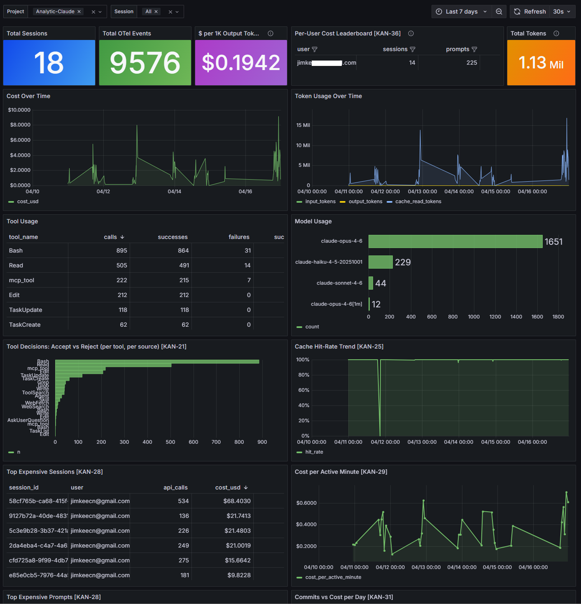
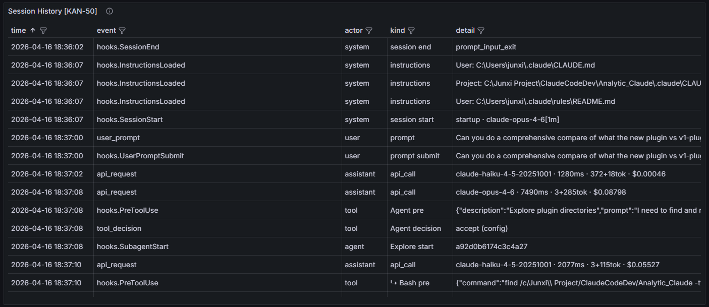
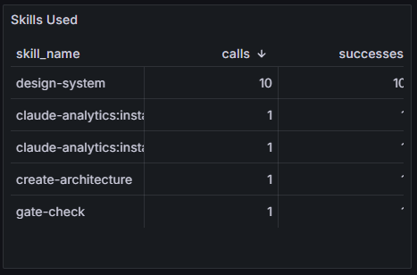
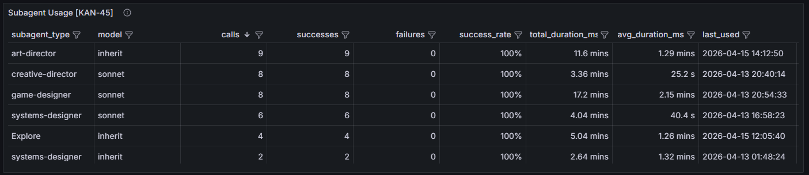
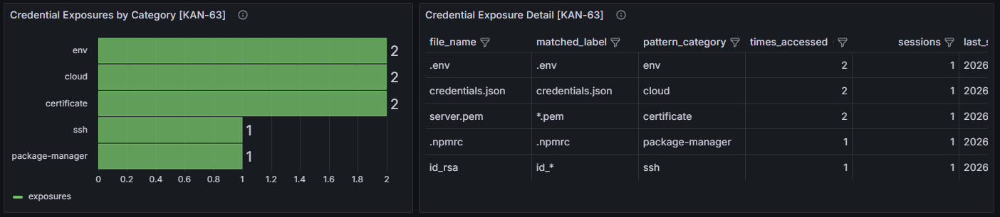
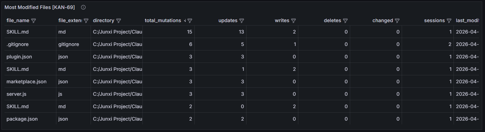
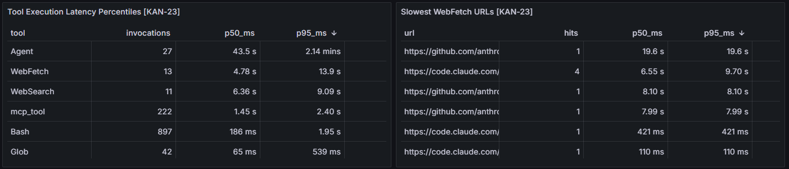

<div align="center">

[English](../README.md) | [中文](README.zh-CN.md) | 日本語 | [Français](README.fr.md) | [Deutsch](README.de.md)

# Claudalytics

**Claude Code のためのローカル分析ダッシュボード**

すべてのプロジェクトにおけるコスト、トークン、ツール使用状況、セッションアクティビティを追跡します。
クラウド依存ゼロ。データはあなたのマシンに保存されます。

[](../LICENSE)
[](<>)
[](<>)
[](<>)

[インストール](#インストール) · [機能](#機能) · [アップデート](#アップデート) · [チーム利用](#チーム利用) · [変更履歴](../CHANGELOG.md)

</div>

---



## インストール

### 1. クローンしてポートの事前チェックを実行する

```bash
git clone https://github.com/jimkeecn/Claudalytics.git
cd Claudalytics
claude
```

Claude Code で以下を実行します:

```
/preflight-check
```

これは Docker を起動する**前に**、必要なホストポートがすべて空いていることを確認します。hooks サーバーと OTel エクスポーターはこれらのポート番号に密結合しています — ポートが使用中の場合は解放してください（スキルがプロセスと終了コマンドを表示します）。Claudalytics のポートは再マッピング**しないでください**。

**必要なホストポート**

| ポート | 用途                                 |
| ------ | ------------------------------------ |
| 13000  | Grafana UI                           |
| 4317   | OTel コレクター (gRPC レシーバー)    |
| 4318   | OTel コレクター (HTTP レシーバー)    |
| 4319   | hooks サーバー                       |
| 8123   | ClickHouse HTTP                      |
| 9000   | ClickHouse ネイティブ TCP            |
| 13133  | OTel コレクター ヘルスエンドポイント |

### 2. 分析スタックを起動する

```bash
cd docker-stack
docker compose up -d --build
```

約30秒お待ちください。その後、リポジトリのルートに戻ります:

```bash
cd ..
```

`/validate-infra` を実行して、4つのコンテナ、テーブル、Materialized View がすべて正常であることを確認します。

### 3. プラグインをインストールする

任意のプロジェクトで Claudalytics マーケットプレイスを追加し、プラグインをインストールします:

```
/plugin marketplace add jimkeecn/Claudalytics
/plugin install claudalytics@claudalytics
```

マーケットプレイスには、オプションの2つ目のプラグイン `claudalytics-hook-capture` もあります。手動でインストールしないでください。OTel + hooks モードを選ぶと、`/init-claudalytics` がそのプロジェクトで有効にします。

特定のリリースに固定する場合:

```
/plugin marketplace add jimkeecn/Claudalytics@v1.1.0
```

固定したマーケットプレイスは、新しいリリースに自動では移りません。固定を移すには、[1.1.0 からのアップグレード](#110-からのアップグレード)の手順 5 を参照してください。

**ローカル開発** — プラグインのコード自体を編集している場合は、ローカルのチェックアウトから直接インストールしてください:

```
/install-plugin /full/path/to/Claudalytics/plugin
```

### 4. 初期化する

```
/init-claudalytics
```

プロンプトに従って操作します。スキルはプロジェクト名と[キャプチャモード](#キャプチャモード)を尋ね、OTel ブロックをユーザー設定ファイルに書き込み、`.claude/settings.local.json` にはプロジェクト名だけを残します。名前で表示したいプロジェクトごとに一度実行してください。スキルは各設定ファイルを変更する前にバックアップし、バックアップファイルをプロジェクトの `.gitignore` に追加します。Node.js 18 以降が必要です。

### 5. Claude Code を再起動してダッシュボードを開く

テレメトリを有効にするためにセッションを再起動します。Claude Code はプロジェクトのルートフォルダー、つまり `/init-claudalytics` を実行したフォルダーで起動してください（[既知の制限](#既知の制限)を参照）。その後、以下を開きます:

**http://localhost:13000** (admin / admin)

次の順に移動します: **Home > Dashboards > Claudalytics > Claudalytics - OTel Overview**

以上です。データはすぐに流れ始めます。

---

## キャプチャモード

| モード                  | 実行されるもの                                                                                 | 得られるデータ                                                                                                                                     |
| ----------------------- | ---------------------------------------------------------------------------------------------- | -------------------------------------------------------------------------------------------------------------------------------------------------- |
| OTel のみ（デフォルト） | Claude Code 自身の OTel エクスポート。Claudalytics のフックは一切実行されません。              | 2つの Config Change パネル、セッション終了理由、WebSearch の結果 URL を除くすべてのパネル                                                          |
| OTel + hooks            | OTel エクスポートに加えて、このプロジェクトで有効にした `claudalytics-hook-capture` プラグイン | さらに設定変更、フォルダーの変更、セッション終了理由、WebSearch の結果 URL、Session History の追加の行、セッション開始時のスタックのヘルスチェック |

hooks モードは OTel にないイベントだけを追加するので、二重にカウントされることはありません。どの行にも、その行を書き込んだものが記録されます。`otel_logs` では属性 `event.source` が `otel`、`hook`、`transcript_backfill` のいずれかになり、パネルの元になるテーブルには `otel` または `hook` が入る `source` 列があります。スキーマ v7 より前の行では、この値は空です。フックの行は Claude Code 自身の ID を OTel の行と同じ名前（`session.id`、`prompt.id`、`tool_use_id`、`agent_id`）で保存するので、1 回の WebSearch 呼び出しの 2 つの行（OTel からのクエリと、フックからの結果 URL）を突き合わせることができます。hooks モードにはポート 4319 の hooks サーバーが必要です。フックイベントを別のサーバーに送るには、シェルまたはユーザー設定ファイルの `env` で `CLAUDALYTICS_HOOKS_URL`（デフォルト `http://localhost:4319`）を設定します。

プロジェクトを別のモードに切り替えるには、そのプロジェクトで `/init-claudalytics` をもう一度実行し、別のモードを選びます。変更は次のセッションから有効になります。

### 設定の保存場所

- **ユーザー設定ファイル**（`~/.claude/settings.json`、または `$CLAUDE_CONFIG_DIR/settings.json`）：下の OTel ブロック。Claude Code 2.1.282 以降はプロジェクトファイル内のこれらの変数を無視するため、`/init-claudalytics` はここに書き込みます。足りないキーだけを追加し、別の値を持つキーを変更する前には確認します。
- **プロジェクトファイル** `.claude/settings.local.json`：`project.name=<あなたのプロジェクト>` を値に持つ `OTEL_RESOURCE_ATTRIBUTES` と、`claudalytics-hook-capture` のオン/オフの項目だけです。OTel + hooks モードでは、`/init-claudalytics` は何もしない `CwdChanged` フック（`exit 0`）も 1 つ書き込みます。Claude Code は、設定ファイルにも `CwdChanged` フックがある場合にだけ、フォルダーの変更をプラグインに送るためです。OTel のみモードに戻すとこのフックは削除され、あなた自身のフックはそのまま残ります。ダッシュボードの Project フィルターに各名前が表示されます。

```json
"env": {
  "CLAUDE_CODE_ENABLE_TELEMETRY": "1",
  "CLAUDE_CODE_ENHANCED_TELEMETRY_BETA": "1",
  "OTEL_METRICS_EXPORTER": "otlp",
  "OTEL_LOGS_EXPORTER": "otlp",
  "OTEL_TRACES_EXPORTER": "otlp",
  "OTEL_EXPORTER_OTLP_PROTOCOL": "grpc",
  "OTEL_EXPORTER_OTLP_ENDPOINT": "http://localhost:4317",
  "OTEL_LOG_USER_PROMPTS": "1",
  "OTEL_LOG_TOOL_DETAILS": "1",
  "OTEL_LOG_TOOL_CONTENT": "1",
  "OTEL_METRIC_EXPORT_INTERVAL": "10000",
  "OTEL_LOGS_EXPORT_INTERVAL": "5000",
  "OTEL_RESOURCE_ATTRIBUTES": "project.name=unassigned"
}
```

**このブロックは、このマシン上のすべてのリポジトリで OTel エクスポートを有効にします**。Claudalytics のプロジェクトだけではありません。プロンプト、コマンド、ファイルパスに加えて、ツールの内容（Claude が読み書きするファイルの本文とコマンドの出力。`OTEL_LOG_TOOL_CONTENT=1`、1 回のツール呼び出しにつき最大 60 KB、`otel_traces` の `claude_code.tool` スパンの `tool.output` イベントとして保存）もローカルのスタックに送られます。設定していないリポジトリは、Project フィルターに他のプロジェクトと同じように `unassigned` として表示されます。

あるリポジトリで収集を抑えるには、そのリポジトリの `.claude/settings.local.json` の `env` に次のどちらかを追加します。プロジェクトファイルではこれらの設定をオフにできますが、オンにはできません。`/init-claudalytics` を再実行しても、これらの値は残ります。

- エクスポートしない：`"OTEL_LOGS_EXPORTER": "none"`、`"OTEL_METRICS_EXPORTER": "none"`、`"OTEL_TRACES_EXPORTER": "none"`
- メタデータのみ（プロンプト本文、ツールの詳細、ツールの内容なし）：`"OTEL_LOG_USER_PROMPTS": "0"`、`"OTEL_LOG_TOOL_DETAILS": "0"`、`"OTEL_LOG_TOOL_CONTENT": "0"`

`OTEL_LOG_RAW_API_BODIES` も、ユーザー設定ファイルかシェルからしか有効になりません。すべてのリポジトリの API リクエストとレスポンスの本文をそのまま記録するため、Claudalytics はこれを設定しません。

**hooks サーバーはどちらのモードでも必要です。** 起動のたびに ClickHouse のスキーマを作成・更新し、`/health` に応答し、トランスクリプトのバックフィルツールを持ち、OTel + hooks モードではフックイベントを受け取ります。コンテナを削除しないでください。

---

## 機能

### セッションタイムライン

すべてのアクションを一つのビューで確認できます — プロンプト、応答、API呼び出し、ツールの判定と結果、サブエージェントの実行、コンパクションイベント — Claude Code の OTel イベントから一つの時系列タイムラインにまとめられます。OTel + hooks モードでは、フックだけが提供する少数のイベントも表示されます。`source` 列は、各行を書き込んだもの（`otel`、`hook`、`transcript_backfill`）を示します。

テーブルの各行は 1 行分の高さなので、長いテキストは画面上では途中で切れて表示されます。全文は残っています。セルにカーソルを合わせて目のアイコン（inspect）をクリックすると、プロンプト、応答、コマンドの全文を読めます。Top Expensive Prompts や Recent Errors など、長いテキストを持つ他のテーブルでも同じです。Claude Code が起動のたびに送るイベント（プラグインの読み込み、フックの登録、MCP 接続、管理対象設定）は非表示です。表示するには、ダッシュボード上部の **Startup events** 変数を Show に設定します。



### コスト & トークン分析

セッション、モデル、プロジェクトごとの支出を追跡します。1Kアウトプットトークンあたりのコスト、時間経過によるトークン使用量、キャッシュヒット率を確認し、最もコストの高いセッションやプロンプトを特定できます。

### スキル & サブエージェント追跡

Claude が使用するスキルやサブエージェント、その成功率、所要時間、モデル選択を監視します。非効率を発見できます — 再呼び出し率が高い場合、最初の試行が失敗した可能性があります。

<div align="center">


</div>

### 認証情報の露出検知

Claude が機密ファイル — `.env`、AWS認証情報、SSHキー、証明書、データベース設定 — を読み取ったことを自動検知します。17カテゴリ38パターンに対応。Read ツール、パスがそのファイル自体である Grep、および Bash と PowerShell の読み取りコマンド `cat`、`type`、`head`、`tail`、`less`、`more`、`Get-Content`、`gc` を検出します。設定は不要です。ClickHouse の Materialized View によるリアルタイムのパターンマッチングで動作します。

パネルが保存するのはファイル名で、ファイルの本文ではありません。また、コレクターはそのようなファイルの本文を、データベースに届く前に `[redacted: credential file]` に置き換えます。これですべてのケースが対象になるわけではありません。[既知の制限](#既知の制限)を参照してください。



### ファイル変更追跡

Claude が編集、書き込み、削除したすべてのファイルが、アクションタイプ、ファイル拡張子、ディレクトリとともに追跡されます。最も頻繁に変更されるファイルを確認し、予期しない削除を検出できます。削除は Bash と PowerShell のコマンド内の `rm`、`del`、`rmdir`、`unlink`、`Remove-Item`、`ri` から記録され、削除されたファイルごとに 1 行になります。



### ブロックされたアクションの検知

拒否されたツール呼び出しは、Claude Code の `tool_decision` イベントから理由付きで記録されます：`user_reject`、`user_abort`（権限プロンプトを中断した場合）、`config`、`hook`。アップグレード前の行は `legacy: no PostToolUse` と表示されます。1.1.0 は PostToolUse のない PreToolUse を数えていたため、中断された呼び出しも含まれていました。Claude が実行しようとしたが阻止されたアクションの監査に役立ちます。

### ツールレイテンシ & 低速URL

パフォーマンスのボトルネックを特定します — p50/p95で最も遅いツール、フェッチに最も時間がかかるURLを確認できます。



### 38のダッシュボードパネル

| カテゴリ       | パネル                                                                                                |
| -------------- | ----------------------------------------------------------------------------------------------------- |
| KPI            | セッション数、イベント数、1Kトークンあたりのコスト、総トークン数、ユーザーあたりのコスト              |
| コスト         | 時間経過によるコスト、最高コストのセッション/プロンプト、アクティブ分あたりのコスト、コミット対コスト |
| ツール         | ツール使用状況、モデル使用状況、承認/拒否率、キャッシュヒット率                                       |
| レイテンシ     | APIレイテンシパーセンタイル、ツール実行レイテンシ、最も遅いWebFetch URL                               |
| タイムライン   | 完全なセッションイベント履歴（2000行制限）                                                            |
| ワークフロー   | 使用されたスキル、訪問したウェブサイト、MCP server呼び出し、サブエージェント使用状況                  |
| ファイル       | アクション内訳付きの最も変更されたファイル、メモリファイル                                            |
| コード         | ユーザーあたりのコード行数、プロンプト長の分布                                                        |
| セキュリティ   | ブロックされたアクション、時間経過によるブロック率、認証情報の露出                                    |
| 運用           | 設定変更、コンパクションイベント/頻度、最近のエラー                                                   |
| フィードバック | アンケートファネル                                                                                    |

---

## アップデート

各リリースの変更内容は [CHANGELOG.md](../CHANGELOG.md) を参照してください。

```bash
cd Claudalytics
git pull
cd docker-stack
docker compose up -d --build
docker compose restart otel-collector
```

コレクターは起動時にしか設定を読み込まないため、最後のコマンドで新しい設定を確実に使わせます。

追加的なスキーマ変更（新しいテーブル、新しいマテリアライズドビュー）は hooks サーバーの起動時に自動的に適用されます。破壊的なスキーマ変更（ビューやテーブルの削除、カラム型の変更、パーティションの再構成）を含むリリースの場合は、Claudalytics プロジェクトから `/migrate-db` を実行してください — バックアップの確認を含めて移行を案内します。アップデートの後は `/validate-infra` を実行し、保留中のマイグレーションが報告されたら `/migrate-db` を実行してください。

このリリースには、破壊的なステップが 2 つ（スキーマ v4 と v5）、自動のステップが 3 つ（v3、v6、v7）あります。v6 と v7 は hooks サーバーが自動で適用しますが、v5 のステップが終わった後に限ります。[1.1.0 からのアップグレード](#110-からのアップグレード)の手順 4 を参照してください。

このマーケットプレイスは自動更新がオフなので、プラグインは自分で更新します：`claude plugin marketplace update claudalytics` を実行し、インストールしたときのスコープで `claude plugin update claudalytics@claudalytics` を実行してから、新しいセッションを開始します。1.0.0 または 1.1.0 からアップグレードする場合は、代わりに次の手順に従ってください。`/init-claudalytics` は 1.0.0 のプロジェクト単位のフックファイルも削除します。

### 1.1.0 からのアップグレード

1.1.0 はほとんどのデータをフック経由で送ります。このリリースは Claude Code 自身の OTel イベントからデータを読み取ります。また Claude Code 2.1.282 以降は、1.1.0 が書き込んだプロジェクトファイル内の OTel エクスポート変数を無視します。次の順番で進めてください。以下のコマンドは Windows の Git Bash（macOS と Linux では POSIX シェル）用で、PowerShell 用ではありません。

1. **ClickHouse をバックアップする。** まずすべての Claude Code セッションを閉じます。コレクターにはバッファがないため、ClickHouse が停止している間に送られたイベントは失われます。アーカイブはリポジトリの外のフォルダーに書き込みます。`MSYS_NO_PATHCONV=1` は Windows の Git Bash 用で、他のシェルでは何もしません。

   ```bash
   BACKUP_DIR="<リポジトリの外のフォルダー>"
   docker stop claudalytics-clickhouse
   MSYS_NO_PATHCONV=1 docker run --rm -v claudalytics-clickhouse-data:/data -v "$BACKUP_DIR":/backup alpine tar czf /backup/ch-pre-otel.tgz -C /data .
   docker start claudalytics-clickhouse
   ```

   **スタックを長い間停止していた場合は、起動する前にバックアップしてください。** すべてのテーブル（`otel_logs` も含む）は行を 90 日間だけ保持します。ClickHouse が起動するとすぐに、どのバージョンでも古い行が削除されます。そのときはバックアップが唯一のコピーになります。

2. **古いスタックと古いプラグインを動かしたまま、ユーザー設定ファイルで OTel エクスポートを有効にする。** まだ `git pull` しないでください。Grafana はチェックアウトから直接ダッシュボードを読み込むため、新しいパネルは古いスキーマではエラーになります。
   - [設定の保存場所](#設定の保存場所)のブロックを `~/.claude/settings.json` の `env` に追加します。1.1.0 が各プロジェクトの `.claude/settings.local.json` に書いた `project.name` はそのまま残してください。そこではまだ有効です。
   - 使っている各プロジェクトで新しいセッションを開始し、OTel の行が正しいプロジェクト名で届くことを確認します。**Tool Usage** パネルに、そのプロジェクトのセッションのツールが表示されます。
   - 手順 3 までは、`otel_logs` を直接読むパネル（例：Session History）にフックの行と OTel の行が並んで表示されます。その他のパネルは二重にカウントしません。
   - **OTel の行が届くまで、スタックを再ビルドしないでください。**

3. **新しいスタックをデプロイする。** hooks サーバーが 10 個の OTel 用のビュー（スキーマ v3）を自動で追加します。以降、ファイルの編集と書き込み、シェルでの削除、認証情報ファイルの読み取り、拒否されたツール呼び出し、コンパクション、ウェブサイトの URL（WebFetch、シェルコマンド、MCP ツール、WebSearch のクエリからのもの）は OTel イベントから取得されます。1.1.0 のプラグインのコピーは hook-capture マーカーを送らないため、サーバーはそのフックイベントを無視します。コレクターも再起動してください。コレクターは、認証情報ファイルの新しいマスキングと `event.source` のタグを含む設定を起動時にしか読み込みません。

   ```bash
   git pull
   cd docker-stack
   docker compose up -d --build
   docker compose restart otel-collector
   ```

   **スタックの再ビルドから `/migrate-db`（手順 4）までの間に、取りこぼしはありません。10 個の OTel 用のビューは、再ビルドの直後から行を書き込みます。** この期間を対象にした私たちのテストでは、13 種類のイベントのすべてに行が作成されました：ファイルの編集と書き込み、Bash と PowerShell でのシェル削除、Read・Grep・シェルによる認証情報ファイルの読み取り、拒否されたツール呼び出し、コンパクション、WebFetch・シェルコマンド・MCP ツールからの URL、WebSearch のクエリです。それでも、この手順のすぐ後、プラグインの更新と `/init-claudalytics` の前に手順 4 を行ってください。手順 4 が終わるまでは古いビューと古い `sessions` テーブルが残り、`/validate-infra` は保留中のマイグレーションを報告します。

   **スタックを再ビルドしてから、`/init-claudalytics` を再実行して hooks モードを選ぶまでの間は、ConfigChange、SessionEnd の理由、WebSearch の URL の行はありません。**

4. **すぐに `/migrate-db` を実行する。** Claudalytics リポジトリで Claude Code を起動し、他のことをする前に実行してください。最初にバックアップを求め、各ステップの前後の行数を表示し、各ステップの後に hooks サーバーを再起動します。
   - **スキーマ v4** は 11 個の古いフック用ビューを削除します。テーブルとその行は残ります。
   - **スキーマ v5** は次の 3 つを削除します：WebSearch の結果 URL 用の古いビュー（`websites_visited_search_mv`）、`sessions_mv` ビュー、古い `sessions` テーブル。OTel 用のビューは 1 つも削除されないため、キャプチャは続きます。`credential_exposures`、`file_mutations`、`blocked_tools`、`compaction_events`、`websites_visited` の行は残ります。`sessions` の行は削除されますが、失われるものはありません。新しい `sessions` ビューが同じセッションを `otel_logs` から読み取ります。
   - **スキーマ v6** には操作は必要ありません。hooks サーバーが、v5 のステップの後の最初の起動時に自動で適用します。`websites_visited_search_mv` を、ローカルアドレスを除外する形で作り直し、`sessions` をビューとして作成します。
   - **スキーマ v7** にも操作は必要ありません。hooks サーバーが v6 の直後に自動で適用します。5 つのテーブルに `source` 列を追加し、11 個のビューをその場で変更するので、何も削除されず、イベントの取りこぼしもありません。すでに保存されている行の `source` は空のままです。

   これを行うまで、`/validate-infra` と hooks サーバーの `/health` は保留中のマイグレーションを表示します。最初に表示されるのは `v4_drop_legacy_hook_mvs` です。v4 のステップが終わると、`v5_drop_replaced_otel_views` が表示されます。完了すると、どちらもスキーマ v7 を示し、保留中のものはなくなります。v5 のステップの間（約 15 秒）は、ダッシュボードの Project と Session のドロップダウンが空になります。

5. **プラグインを更新する。**
   - `claude plugin marketplace update claudalytics` を実行します。
   - タグに固定している場合（例：`jimkeecn/Claudalytics@v1.1.0`）は、代わりに固定を移します。`~/.claude/settings.json` の `extraKnownMarketplaces` にあるマーケットプレイスの `source` で、`ref` を新しいタグに設定します。宣言されたソースが変わると、Claude Code はマーケットプレイスを取得し直します。マーケットプレイスは削除しないでください。削除するとすべての Claudalytics プラグインがアンインストールされます。
   - 1.1.0 をインストールした各プロジェクトのルートフォルダーで、`claude plugin update claudalytics@claudalytics --scope project` を実行します。更新はスコープごとに行われるため、すべてのプロジェクトで実行してください。ユーザー用にインストールした場合は、代わりに `--scope user` を使います。
   - 新しいセッションを開始します。ワークツリーを壊していた古い `WorktreeCreate` フックはこれでなくなります。

6. **各プロジェクトで `/init-claudalytics` を再実行する。** Claude Code がプロジェクトファイルで無視する OTel キーを削除し、`project.name` を残し、[キャプチャモード](#キャプチャモード)を尋ね、設定ファイルを変更する前に必ずバックアップします。

7. **任意：** OTel エクスポートがオフだった日について `npm run backfill` を実行します。復元できるのは `api_request` の行だけです。[取りこぼしたテレメトリの復元](#取りこぼしたテレメトリの復元-トランスクリプトのバックフィル)を参照してください。

### ロールバック

1. すべての Claude Code セッションを閉じ、`docker-stack` で `docker compose down` を実行します。ボリュームは残ります。
2. [1.1.0 からのアップグレード](#110-からのアップグレード)の手順 1 のバックアップを復元します：

   ```bash
   MSYS_NO_PATHCONV=1 docker run --rm -v claudalytics-clickhouse-data:/data -v "$BACKUP_DIR":/backup alpine sh -c "find /data -mindepth 1 -delete && tar xzf /backup/ch-pre-otel.tgz -C /data"
   ```

3. 以前のリリースをチェックアウトし（`git checkout v1.1.0`）、`docker-stack` で `docker compose up -d --build` を実行します。
4. マーケットプレイスをタグに固定している場合のみ：プラグインも 1.1.0 に戻すには、その `ref` を `v1.1.0` に戻し、[1.1.0 からのアップグレード](#110-からのアップグレード)の手順 5 の `claude plugin update` コマンドを実行します。このダウングレードはテストされていません。

**ボリュームも必ず復元してください。古いスタックは新しいスキーマでは動作しません。** `/migrate-db` の前は、古いフック用ビューと新しい `*_otel_mv` ビューの両方が同じテーブルに書き込むため、カウントが2倍になります。`/migrate-db` の後は、古いフック用ビューと古い `sessions` テーブルがなくなっており、1.1.0 の hooks サーバーはフック用ビューを作り直しません。復元できず、まだ `/migrate-db` を実行していない場合は、先に `*_otel_mv` ビューを削除してください。

### 既知の制限

- **長い PowerShell コマンド。** ツール入力の値が 512 文字を超えると、OTel は最初の約 128 文字だけを残します。Bash は影響を受けません。OTel が完全なコマンドも送るためです。そのため、長い PowerShell コマンドの約 128 文字目より後にある `Remove-Item` や URL は、ファイル変更追跡や Websites Visited に届きません。フックキャプチャは PowerShell の呼び出しを転送しないため、どちらのモードでも同じです。
- **Websites Visited は一部のシェルコマンドしか検出しません。** Bash または PowerShell のコマンド内の URL は、`curl`、`wget`、`Invoke-WebRequest`、`iwr`、`Invoke-RestMethod`、`irm` の引数である場合にだけ数えられ、1 つのコマンドから作られる行は最大 10 行です。別のプログラム（スクリプト、`git clone`、`npm install`）が取得するページには行が作られません。MCP ツールは、`url` または `urls` の入力を持つ場合にだけ行が作られます。ローカルアドレス（`localhost`、`127.0.0.1`、`::1`、`host.docker.internal`）は意図的に除外しています。
- **シェルコマンドについては、ファイル変更追跡は削除しか検出しません。** Edit ツールと Write ツールで変更したファイルは追跡されます。Bash または PowerShell のコマンドで削除として数えられるのは `rm`、`del`、`rmdir`、`unlink`、`Remove-Item`、`ri` です。スクリプトや別のコマンド（例：`git clean` や `find -delete`）が削除したファイルには行が作られません。相対パスがフォルダーと結合されるのは、コマンドが `cd <folder> &&` で始まり、他に `cd` がない場合だけです。それ以外の場合、パスは書かれたとおりに保存されます。
- **Credential Exposures は、ファイルを読む方法の一部しか検出しません。** 検出するのは、Read ツール、パスがそのファイル自体である Grep、およびシェルコマンド内の `cat`、`type`、`head`、`tail`、`less`、`more`、`Get-Content`、`gc` です。フォルダーに対する Grep や、ファイルを読む別のプログラム（`sed`、`awk`、スクリプト）には行が作られません。シェルコマンドのパスは書かれたとおりに保存されるため、相対パスの場合があります。
- **アップグレード前に保存された行には古いルールが残ります。** 削除、認証情報の読み取り、ウェブサイトの新しいルールは、新しいイベントにだけ適用されます。たとえば、古い `localhost` の行は期限切れになるまで Websites Visited に残ります。
- **失敗した Edit は記録されません。** Edit が失敗したとき（例：「String to replace not found」）、Claude Code は `tool_result` イベントを送らないため、Recent Errors にも Session History にも表示されません。失敗した Read と失敗した Bash コマンドは記録されます。
- **コミット数が実際より多くなることがあります。** Claude Code の `claude_code.commit.count` メトリクスは、`git commit` という文字列を含むだけの Bash コマンド（ヒアドキュメント内や検索内など）も数えます。私たちのテストでは、実際のコミット 3 件に対してカウントは 6 でした。Commits vs Cost per Day と Per-User Cost Leaderboard のコミット列がこのメトリクスを使います。
- **中断されたツール呼び出しは失敗として数えられます。** OTel は `success=false` の `tool_result` として報告するため、Recent Errors に含まれます。中断された権限プロンプトは Blocked Actions に `user_abort` として表示されます。
- **フックだけが提供するもの：** 設定変更（2つの Config Change パネル）、セッション終了理由、WebSearch の結果 URL（OTel は検索クエリを提供）、および Session History の次の行：セッションの開始と終了、cwd の変更、指示の読み込み、通知、サブエージェントの開始、elicitation、teammate idle。OTel のみモードでは空のままです。フォルダーの変更には、OTel + hooks モードで `/init-claudalytics` がプロジェクトファイルに書き込む `CwdChanged` フックが必要です。それより前に設定したプロジェクトでは、`/init-claudalytics` をもう一度実行してください。
- **`git worktree add` で作ったワークツリーは `unassigned` と表示されます。** 私たちのテストでは、Claude Code が作るワークツリー（`claude --worktree`）には `.claude/settings.local.json` のコピーがありましたが、`git worktree add` で作ったものにはありません。そのようなワークツリーには、メインのチェックアウトから `.claude/settings.local.json` をコピーしてください。フックの行はプロジェクト名を保ちます。`forward-hook.sh` がメインのチェックアウトの `.claude/settings.local.json` からプロジェクト名を読むためです。
- **サブフォルダーで開始したセッションは `unassigned` と表示されます（Windows）。** Windows では、Claude Code は起動したフォルダーの `.claude/settings.local.json` だけを読みます。親フォルダーや git のルートは探しません。そのため、Claude はリポジトリのルート、つまり `/init-claudalytics` を実行したフォルダーで起動してください。OTel イベントにはフォルダー名が含まれないため、ダッシュボードで後から修正することはできません。OTel + hooks モードでは、そのようなセッションのフックの行はプロジェクト名を保つため、セッションが 2 つの名前で表示されます。macOS と Linux については、Claude Code のドキュメントに、v2.1.211 以降はこのファイルを git のルートから読むとあります。私たちがテストしたのは Windows だけです。
- **新しいリポジトリは、信頼するまで `unassigned` と表示されます。** Claude Code はフォルダーを信頼した後にのみプロジェクト設定を適用します。
- **古い 1.1.0 のプラグインのコピーはダッシュボードに届かなくなります。** 新しい hooks サーバーは hook-capture マーカーのないフックイベントを無視するため、1.1.0 のままのプロジェクトは、更新するまで（手順 5）フック経由では何も送りません。OTel のデータは引き続き届きます。
- **古い行は期限切れになります。** すべてのテーブルは行を 90 日間保持するため、アップグレード前にフックが書き込んだ行は時間とともに消えていきます。
- **認証情報ファイルの本文は削除されますが、シークレットが別の経路で保存されることはあります。** Claude が認証情報らしいファイル（Credential Exposures パネルのファイル名）を Read ツールで、または Bash コマンド内の `cat`、`type`、`head`、`tail`、`less`、`more`、`Get-Content`、`gc` で読むと、コレクターはファイルの本文の代わりに `[redacted: credential file]` を保存します。そのようなファイルへの Write や Edit の本文についても、トレースでは同じ処理を行います。PowerShell コマンドと Grep はマスキングされませんが、現時点ではその必要もありません。Claude Code はこの 2 つのツールの出力テキストを送らないため、ファイルの本文は保存されません。Credential Exposures の行は残ります。次のケースは対象外です：コマンドに直接入力されたシークレット（`echo KEY=... > .env`）、別のコマンド（`grep`、`sed`、`env`、スクリプト）の出力、イベントログ内の、そのようなファイルへの Write や Edit の本文（`tool_input`。512 文字以下の値は全文が保存され、それより長い値は最初の約 128 文字に切り詰められます）、シークレットを繰り返すプロンプトや応答、`OTEL_LOG_RAW_API_BODIES` を設定した場合の API の本文全体。この変更より前に保存された行は、期限切れになるまで本文を保持します。アップグレードの後は、新しい設定を読み込ませるためにコレクターを再起動してください（`docker compose restart otel-collector`）。
- **コレクターが停止している間に送られたイベントは失われます。** Claude Code はイベントを次のエクスポートまで（イベントとトレースは 5 秒ごと、メトリクスは 10 秒ごと。トレースの間隔は設定ブロックでは指定せず、既定値のままです）メモリに保持するだけで、各バッチを 1 回だけ送ります。コレクターが応答しないと、そのバッチは破棄されます。これを変える Claude Code の設定はありません。v2.1.330 で確認したところ、Claudalytics が使う gRPC エクスポートでは、失敗したエクスポートは再送も保持もされません。キューサイズとエクスポートタイムアウトの OpenTelemetry 設定（`OTEL_BLRP_*`、`OTEL_BSP_*`、`OTEL_EXPORTER_OTLP_TIMEOUT`）も役に立ちません。これらが変えるのは、次のエクスポートを待つイベントの数と 1 回のエクスポートにかけられる時間で、エクスポートが失敗した後の動作ではありません。また、実行中のセッションは、コレクターが復帰してから再接続するまでに数秒かかることがあります。私たちのテストでは、30 秒の停止で約 40 秒分のイベントが失われ、セッションには警告が表示されませんでした。後から、[トランスクリプトのバックフィル](#取りこぼしたテレメトリの復元-トランスクリプトのバックフィル)で `api_request` の行（モデル、トークン、推定コスト。所要時間はなし）を取り戻せます。空白期間のツールイベント、プロンプト、ファイル変更、ウェブサイト、トレース、メトリクスは復元できません。
- **テーブルの各行は 1 行分の高さです。** 長いテキストは画面上では途中で切れて表示されますが、失われるものはありません。セルにカーソルを合わせて目のアイコン（inspect）をクリックすると、全文を読めます。幅の狭いウィンドウでは、長いテキストが最初の列にないテーブル（例：Websites Visited）で、その列に届くまで横スクロールが必要になることがあります。
- **ユーザーが入力していないプロンプトは、その本文で判別されます。** Claude Code は、エージェントからの引き継ぎとタスク通知を、他に目印のない通常のプロンプトとして送ります。プロンプト数は `<agent-message` または `<task-notification` で始まるプロンプトを除外するため、あなたがこの文字列で始めたプロンプトも数えられません。
- **Subagent Usage はセッションとサブエージェントの種類で結合します。** 実行時間とモデルは `subagent_completed` イベントから取得します。後で再開されたサブエージェントは複数回の実行として数えられ、まだ実行中のサブエージェントには実行時間がありません。
- **サブエージェントの種類、git ブランチ、コミット ID は表示されません。** OTel のツールイベントにはサブエージェントの ID しか含まれないため、新しい行では `file_mutations` と `credential_exposures` の `agent_type` 列は空です。Claude Code は git コマンドの結果に git ブランチとコミット ID（`vcs.ref.head.name`、`vcs.ref.head.revision`）を付けて送りますが、それらを使うパネルはありません。

---

## 取りこぼしたテレメトリの復元 (トランスクリプトのバックフィル)

取り込み経路は**リアルタイムでバッファがありません**。Claude Code が自身の OTel イベントを OTel コレクターに送り、コレクターが ClickHouse に書き込みます。OTel + hooks モードでは、hooks サーバーも少数のフックイベントを同じ経路で送ります。Docker スタック（またはホスト）が停止していると、イベントは再送されずに破棄されます — この空白は「何も起きなかった」場合と見分けがつきません。

Claude Code 自体は、Docker とは無関係に、すべてのターンを常に `~/.claude/projects/<project>/*.jsonl` に記録しています。バックフィルツールは、この永続的な記録を、停止していた期間について ClickHouse に再生します：

```bash
cd docker-stack/hooks-server
npm run build
npm run backfill -- --from 2026-06-10 --to 2026-06-13 --dry-run   # report only
npm run backfill -- --from 2026-06-10 --to 2026-06-13             # emit (dates are UTC, inclusive)
```

`request_id` について冪等で（すでに ClickHouse にある行はスキップされるため、再実行しても安全です）、元のタイムスタンプを保持します。

**復元できるものと、できないもの。** トランスクリプトには会話しか含まれないため、バックフィルが再構築するのは **`api_request` の行だけ**（アシスタントのターンごとに 1 行）で、内容は `model`、トークン数、推定コストです。これらの行には `event.source=transcript_backfill` のタグが付きます。トランスクリプトにはトークン数はありますがコストはなく、リポジトリにも価格表はありません。そのため、ツールは実行のたびに、ClickHouse にあるあなた自身の実際の `api_request` の行から、モデルごとにトークンの種類ごとの単価を計算し、結果を `cost_usd` に書き込み、`cost_usd_source=estimated` を付けます。私たちのテストでは、両方の値がある 1,227 件のリクエストすべてで、推定値は実際のコストと一致しました。1 組の単価で説明できる実際の行が 20 行未満のモデルには、コストを書き込みません。少数の行では何も証明できず、推測した値より空のままのほうがよいからです。`--dry-run` は、モデルごとの単価、その元になった実際の行数、フィットの誤差、合計コストを表示します。Claude Code が裏で行うリクエスト（エージェントの要約、セッションタイトル、ウェブ検索）はトランスクリプトに含まれないため、バックフィルした期間のコストは実際より少し低くなります（私たちのテストでは約 1%）。`duration_ms` は空のままです。そのため、**Model Usage** パネル、トークンのパネル、コストのパネルは復元されます。次の 2 つのパネルは、バックフィルされた行を対象にしません。Top Expensive Prompts は、それらの行にプロンプト ID がないためです。API Latency Percentiles は、それらの行に所要時間がないためです。

バックフィルは、停止期間中のそれ以外のデータを復元しません：プロンプト、`tool_result`/`tool_decision` イベント、ファイル変更、ブロックされたアクション、訪問したウェブサイト、トレース、メトリクス、および OTel + hooks モードのフックイベント（設定変更、セッション終了理由、WebSearch の結果 URL）。これらのイベントから作られる Materialized View は、空白期間については空のままです。

---

## チーム利用

このプロジェクトは個人開発者向けに設計されています。チームで利用するには:

1. **共有サーバーにデプロイする** — Docker スタックは任意のサーバーで動作します。各開発者はユーザー設定ファイルの `OTEL_EXPORTER_OTLP_ENDPOINT`（OTel + hooks モードでは `CLAUDALYTICS_HOOKS_URL` も）を `localhost` ではなくサーバーアドレスに向けます。
2. **チーム名属性を追加する** — `OTEL_RESOURCE_ATTRIBUTES` に `project.name` と並べて `team.name` を含めます。
3. **フックスクリプトから `team.name` を転送する**（OTel + hooks モード）— `plugin-hook-capture/hooks/forward-hook.sh` を拡張して、hooks URL に `&teamName=<TEAM>` を追記し、hooks サーバー側もそれを記録できるように更新します。
4. **ClickHouse テーブルを更新する** — 対象テーブルと Materialized View に `team_name` カラムを追加します。
5. **Grafana を更新する** — チームのドロップダウン変数を追加し、すべてのパネルをその変数でフィルタリングします。

**サーバーにデプロイする前に、スタックのセキュリティを確保する必要があります:**

- ClickHouse のパスワードを設定する（デフォルト設定では認証なし）
- Grafana の管理者パスワードを変更する
- `docker-compose.yaml` のホストポートバインディングを `127.0.0.1:PORT:PORT` から `PORT:PORT`（または特定のインターフェース）に変更し、チームメンバーがスタックにアクセスできるようにします — デフォルトのバインディングは、公共 Wi-Fi での個人開発者の安全のために localhost のみに設定されています
- ファイアウォールでポートアクセスを制限する — 4317（OTel gRPC）、4319（hooks、OTel + hooks モードでのみ必要）、13000（Grafana）のみを公開
- 暗号化通信のためにTLSを追加する

Docker Compose ファイルはクラウドサーバーでそのまま動作しますが、これらのセキュリティ対策なしでは、テレメトリデータがポートにアクセスできる誰にでも公開されてしまいます。

---

<div align="center">

**[Claude Code](https://claude.ai/code) で構築**

このプロジェクトがあなたのワークフローに役立ったら、スターをお願いします!

</div>

## FAQ

### `/preflight-check` ではポートが空いているのに、`docker compose up` がポートのエラーで失敗する

WinNAT が動作している場合は、PowerShell（**管理者として実行**）で次のコマンドを実行してください。

1. ステップ 1 - WinNAT を停止する（動的な除外範囲や予約済みポートを解放します）
   `net stop winnat`

2. ステップ 2 - WinNAT を再び起動する（別のオフセットから割り当て直すため、通常は 4318 を避けられます）
   `net start winnat`

その後、`/preflight-check` を再実行し、`docker compose up -d --build` をもう一度試してください。
