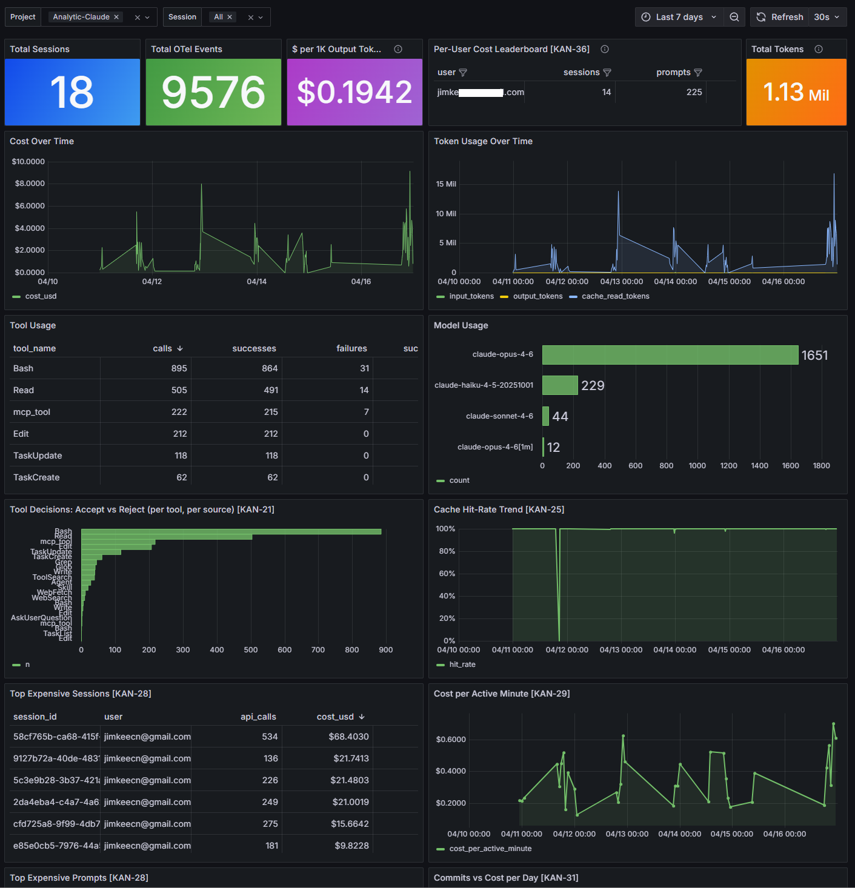
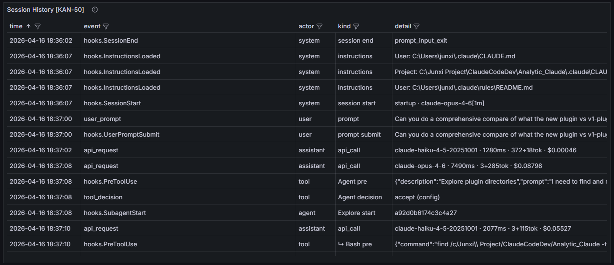
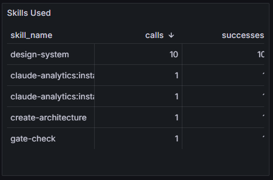
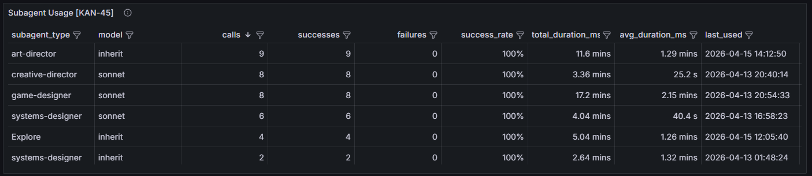
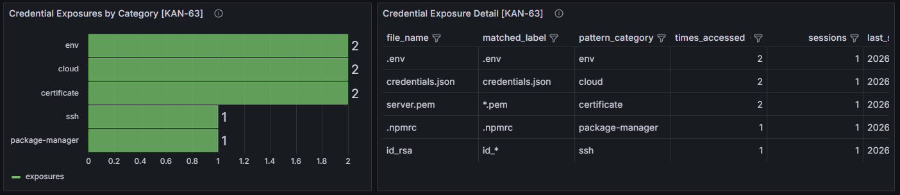
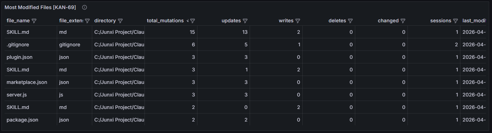
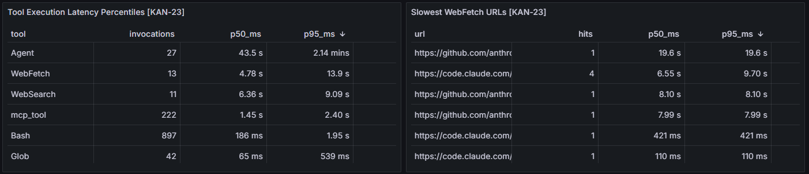

<div align="center">

[English](../README.md) | 中文 | [日本語](README.ja.md) | [Français](README.fr.md) | [Deutsch](README.de.md)

# Claudalytics

**Claude Code 本地分析仪表板**

跟踪所有项目的成本、令牌使用量、工具使用情况和会话活动。
零云依赖。数据完全保留在本地。

[](../LICENSE)
[](<>)
[](<>)
[](<>)

[安装](#安装) · [功能](#功能) · [更新](#更新) · [团队使用](#团队使用) · [更新日志](../CHANGELOG.md)

</div>

---



## 安装

### 1. 克隆并运行端口预检查

```bash
git clone https://github.com/jimkeecn/Claudalytics.git
cd Claudalytics
claude
```

在 Claude Code 中，运行：

```
/preflight-check
```

这会在启动 Docker **之前**验证所有所需的主机端口是否空闲。hooks 服务器和 OTel 导出器与这些端口号紧密耦合 — 如果某个端口被占用，请释放它（技能会显示进程和终止命令）。**请勿**重新映射 Claudalytics 的端口。

**所需主机端口**

| 端口  | 用途                       |
| ----- | -------------------------- |
| 13000 | Grafana 仪表板             |
| 4317  | OTel 收集器（gRPC 接收器） |
| 4318  | OTel 收集器（HTTP 接收器） |
| 4319  | Hooks 服务器               |
| 8123  | ClickHouse HTTP            |
| 9000  | ClickHouse 原生 TCP        |
| 13133 | OTel 收集器健康检查端点    |

### 2. 启动分析服务栈

```bash
cd docker-stack
docker compose up -d --build
```

等待约 30 秒。然后返回仓库根目录：

```bash
cd ..
```

运行 `/validate-infra` 以验证所有 4 个容器、数据表和物化视图是否正常运行。

### 3. 安装插件

在任意项目中添加 Claudalytics 市场并安装插件：

```
/plugin marketplace add jimkeecn/Claudalytics
/plugin install claudalytics@claudalytics
```

市场中还有一个可选的第二个插件 `claudalytics-hook-capture`。不要手动安装它：当你选择 OTel + hooks 模式时，`/init-claudalytics` 会为该项目开启它。

固定到特定版本：

```
/plugin marketplace add jimkeecn/Claudalytics@v1.1.0
```

固定版本的市场不会自动跟到新版本。如需移动固定的版本，请参阅[从 1.1.0 升级](#从-110-升级)的第 5 步。

**本地开发** — 如果你正在迭代插件代码本身，请改用本地检出目录进行安装：

```
/install-plugin /full/path/to/Claudalytics/plugin
```

### 4. 初始化

```
/init-claudalytics
```

按照提示操作。技能会询问项目名称和[采集模式](#采集模式)，把 OTel 配置块写入你的用户设置文件，并在 `.claude/settings.local.json` 中只保留项目名称。请在每个希望按名称查看的项目中运行一次。技能在修改每个设置文件之前都会先备份，并把备份文件加入项目的 `.gitignore`。该技能需要 Node.js 18 或更高版本。

### 5. 重启 Claude Code 并打开仪表板

重启会话以使遥测生效。请在项目的根目录，也就是你运行 `/init-claudalytics` 的那个文件夹中启动 Claude Code（参阅[已知限制](#已知限制)）。然后打开：

**http://localhost:13000** (admin / admin)

导航至：**Home > Dashboards > Claudalytics > Claudalytics - OTel Overview**

完成。数据会立即开始流入。

---

## 采集模式

| 模式            | 运行内容                                                         | 你能得到                                                                                                                  |
| --------------- | ---------------------------------------------------------------- | ------------------------------------------------------------------------------------------------------------------------- |
| 仅 OTel（默认） | Claude Code 自带的 OTel 导出。不运行任何 Claudalytics hook。     | 所有面板，但两个 Config Change 面板、会话结束原因和 WebSearch 结果 URL 除外                                               |
| OTel + hooks    | OTel 导出，再加上为该项目开启的 `claudalytics-hook-capture` 插件 | 另外还有设置变更、文件夹切换、会话结束原因、WebSearch 结果 URL、多几种 Session History 行，以及会话开始时的服务栈健康检查 |

hooks 模式只添加 OTel 没有的事件，因此不会重复计数。每一行都标明是谁写入的：在 `otel_logs` 中，属性 `event.source` 的值是 `otel`、`hook` 或 `transcript_backfill`；各面板背后的表有一个 `source` 列，值是 `otel` 或 `hook`。数据库结构 v7 之前的行，来源为空。hook 行用与 OTel 行相同的名称（`session.id`、`prompt.id`、`tool_use_id`、`agent_id`）保存 Claude Code 自己的 ID，所以同一次 WebSearch 调用的两行可以对应起来：来自 OTel 的搜索关键词和来自 hook 的结果 URL。hooks 模式需要端口 4319 上的 hooks 服务器。如需把 hook 事件发送到其他服务器，请在 shell 或用户设置文件的 `env` 中设置 `CLAUDALYTICS_HOOKS_URL`（默认 `http://localhost:4319`）。

如需把项目切换到另一种模式，请在该项目中再次运行 `/init-claudalytics` 并选择另一种模式。更改在下一个会话中生效。

### 配置存放位置

- **用户设置文件**（`~/.claude/settings.json`，或 `$CLAUDE_CONFIG_DIR/settings.json`）：下面的 OTel 配置块。Claude Code 2.1.282 及以后的版本会忽略项目文件中的这些变量，所以 `/init-claudalytics` 把它们写在这里。它只添加缺少的键；若某个键已有其他值，会先询问你。
- **项目文件** `.claude/settings.local.json`：只有 `OTEL_RESOURCE_ATTRIBUTES`（值为 `project.name=<你的项目>`），以及 `claudalytics-hook-capture` 的开关项。在 OTel + hooks 模式下，`/init-claudalytics` 还会写入一个什么都不做的 `CwdChanged` hook（`exit 0`）：只有当设置文件里也有 `CwdChanged` hook 时，Claude Code 才会把文件夹切换发送给插件。切换回仅 OTel 模式时会删除这个 hook，你自己的 hook 不受影响。仪表板的 Project 筛选器会列出每个名称。

```json
"env": {
  "CLAUDE_CODE_ENABLE_TELEMETRY": "1",
  "CLAUDE_CODE_ENHANCED_TELEMETRY_BETA": "1",
  "OTEL_METRICS_EXPORTER": "otlp",
  "OTEL_LOGS_EXPORTER": "otlp",
  "OTEL_TRACES_EXPORTER": "otlp",
  "OTEL_EXPORTER_OTLP_PROTOCOL": "grpc",
  "OTEL_EXPORTER_OTLP_ENDPOINT": "http://localhost:4317",
  "OTEL_LOG_USER_PROMPTS": "1",
  "OTEL_LOG_TOOL_DETAILS": "1",
  "OTEL_LOG_TOOL_CONTENT": "1",
  "OTEL_METRIC_EXPORT_INTERVAL": "10000",
  "OTEL_LOGS_EXPORT_INTERVAL": "5000",
  "OTEL_RESOURCE_ATTRIBUTES": "project.name=unassigned"
}
```

**这个配置块会为本机上的每个仓库开启 OTel 导出**，而不只是 Claudalytics 项目。它会把提示、命令和文件路径发送到你的本地服务栈，还有工具内容：Claude 读取或写入的文件文本，以及命令输出（`OTEL_LOG_TOOL_CONTENT=1`，每次工具调用最多 60 KB，作为 `claude_code.tool` span 上的 `tool.output` 事件存放在 `otel_traces` 中）。没有设置过的仓库在 Project 筛选器中显示为 `unassigned`，和其他项目一样。

如需为某个仓库减少采集，请在该仓库 `.claude/settings.local.json` 的 `env` 中添加下面其中一组。项目文件只能关闭这些设置，不能开启；再次运行 `/init-claudalytics` 时会保留它们。

- 完全不导出：`"OTEL_LOGS_EXPORTER": "none"`、`"OTEL_METRICS_EXPORTER": "none"`、`"OTEL_TRACES_EXPORTER": "none"`
- 只保留元数据（不含提示文本、工具详情或工具内容）：`"OTEL_LOG_USER_PROMPTS": "0"`、`"OTEL_LOG_TOOL_DETAILS": "0"`、`"OTEL_LOG_TOOL_CONTENT": "0"`

`OTEL_LOG_RAW_API_BODIES` 同样只在用户设置文件或 shell 中生效。它会记录每个仓库完整的 API 请求和响应内容，所以 Claudalytics 不会设置它。

**两种模式都需要 hooks 服务器。** 它在每次启动时创建和更新 ClickHouse 数据库结构，响应 `/health`，包含转录回填工具，并在 OTel + hooks 模式下接收 hook 事件。不要删除这个容器。

---

## 功能

### 会话时间线

在单一视图中查看每个操作 — 提示、回复、API 调用、工具决策与结果、子代理运行、压缩事件 — 来自 Claude Code 的 OTel 事件，按时间排列在一个时间线中。在 OTel + hooks 模式下，还会显示少数只有 hooks 才能提供的事件。`source` 列标明每一行是谁写入的：`otel`、`hook` 或 `transcript_backfill`。

表格中每行数据只有一行文字的高度，所以较长的文本在屏幕上会显示不全。完整文本仍然保留着：把鼠标悬停在单元格上，点击眼睛图标（inspect），就能读到完整的提示、回复或命令。其他包含长文本的表格也一样，例如 Top Expensive Prompts 和 Recent Errors。Claude Code 每次启动时都会发送的事件（插件已加载、hooks 已注册、MCP 连接、托管设置）默认隐藏。如需查看，请把仪表板顶部的 **Startup events** 变量设为 Show。



### 成本与令牌分析

跨会话、模型和项目跟踪支出。查看每 1K 输出令牌的成本、令牌使用量随时间的变化、缓存命中率，并识别最昂贵的会话和提示。

### 技能与子代理跟踪

监控 Claude 使用的技能和子代理、它们的成功率、持续时间和模型选择。发现低效问题 — 高重复调用率意味着首次尝试可能失败了。

<div align="center">


</div>

### 凭证暴露检测

自动检测 Claude 何时读取了敏感文件 — `.env`、AWS 凭证、SSH 密钥、证书、数据库配置 — 涵盖 17 个类别中的 38 种模式。它能识别 Read 工具、路径就是该文件本身的 Grep，以及 Bash 和 PowerShell 中的读取命令 `cat`、`type`、`head`、`tail`、`less`、`more`、`Get-Content` 和 `gc`。无需配置。由 ClickHouse 物化视图提供支持，实时进行模式匹配。

面板保存的是文件名，不是文件内容。收集器还会在这类文件的文本进入数据库之前，把它替换为 `[redacted: credential file]`。这并不能覆盖所有情况：参阅[已知限制](#已知限制)。



### 文件变更追踪

Claude 编辑、写入或删除的每个文件都会被跟踪，包括操作类型、文件扩展名和目录。查看哪些文件被修改最多，发现意外的删除操作。删除记录来自 Bash 和 PowerShell 命令中的 `rm`、`del`、`rmdir`、`unlink`、`Remove-Item` 和 `ri`，每个被删除的文件一行。



### 被阻止的操作检测

被拒绝的工具调用来自 Claude Code 的 `tool_decision` 事件，并带有原因：`user_reject`、`user_abort`（你中断了权限提示）、`config` 或 `hook`。升级之前的行显示为 `legacy: no PostToolUse`：1.1.0 统计的是没有 PostToolUse 的 PreToolUse，其中也包括被中断的调用。适用于审计 Claude 尝试但被阻止的操作。

### 工具延迟与慢速 URL

识别性能瓶颈 — 哪些工具在 p50/p95 上最慢，哪些 URL 获取耗时最长。



### 38 个仪表板面板

| 类别   | 面板                                                                                    |
| ------ | --------------------------------------------------------------------------------------- |
| KPI    | Sessions, events, cost/1K tokens, total tokens, per-user cost                           |
| 成本   | Cost over time, top expensive sessions/prompts, cost per active minute, commits vs cost |
| 工具   | Tool usage, model usage, accept/reject rates, cache hit-rate                            |
| 延迟   | API latency percentiles, tool execution latency, slowest WebFetch URLs                  |
| 时间线 | Full session event history (2000 row limit)                                             |
| 工作流 | Skills used, websites visited, MCP server calls, subagent usage                         |
| 文件   | Most modified files with action breakdown, memory files                                 |
| 代码   | Lines of code per user, prompt length distribution                                      |
| 安全   | Blocked actions, blocked rate over time, credential exposures                           |
| 运维   | Config changes, compaction events/frequency, recent errors                              |
| 反馈   | Survey funnel                                                                           |

---

## 更新

查看 [CHANGELOG.md](../CHANGELOG.md) 了解每个版本的变更列表。

```bash
cd Claudalytics
git pull
cd docker-stack
docker compose up -d --build
docker compose restart otel-collector
```

收集器只在启动时读取配置，所以最后一条命令用来确保它使用新配置。

增量式数据库变更（新表、新物化视图）由 hooks 服务器在启动时自动应用。如果某个版本包含破坏性的数据库变更（删除视图或表、列类型修改、重新分区），请在 Claudalytics 项目中运行 `/migrate-db` — 它会引导你完成迁移，并提示备份。更新之后请运行 `/validate-infra`：如果它报告有待处理的迁移，就运行 `/migrate-db`。

此版本有两个破坏性步骤（数据库结构 v4 和 v5）和三个自动步骤（v3、v6 和 v7）。v6 和 v7 由 hooks 服务器自动应用，但要等 v5 步骤完成之后。请参阅[从 1.1.0 升级](#从-110-升级)的第 4 步。

此市场没有开启自动更新，所以请自己更新插件：运行 `claude plugin marketplace update claudalytics`，再以安装时的范围（scope）运行 `claude plugin update claudalytics@claudalytics`，然后开始一个新会话。如果你从 1.0.0 或 1.1.0 升级，请改为按照下面的步骤操作。`/init-claudalytics` 也会删除 1.0.0 按项目安装的 hook 文件。

### 从 1.1.0 升级

1.1.0 的大部分数据通过 hooks 发送。此版本改为从 Claude Code 自带的 OTel 事件读取数据，而 Claude Code 2.1.282 及以后的版本会忽略项目文件中的 OTel 导出变量（1.1.0 正是写在那里）。请按以下顺序操作。下面的命令用于 Windows 上的 Git Bash（或 macOS 和 Linux 上的任意 POSIX shell），不能在 PowerShell 中运行。

1. **备份 ClickHouse。** 先关闭所有 Claude Code 会话：收集器没有缓冲，ClickHouse 停止期间发送的事件会丢失。把备份写到仓库以外的文件夹。`MSYS_NO_PATHCONV=1` 用于 Windows 上的 Git Bash，在其他 shell 中没有作用。

   ```bash
   BACKUP_DIR="<仓库以外的文件夹>"
   docker stop claudalytics-clickhouse
   MSYS_NO_PATHCONV=1 docker run --rm -v claudalytics-clickhouse-data:/data -v "$BACKUP_DIR":/backup alpine tar czf /backup/ch-pre-otel.tgz -C /data .
   docker start claudalytics-clickhouse
   ```

   **如果你的服务栈停了很久，请在启动之前备份。** 每张表（包括 `otel_logs`）只保留 90 天的数据。ClickHouse 启动后不久就会删除更早的行，无论你运行哪个版本。那时备份就是这些数据唯一的副本。

2. **在旧服务栈和旧插件仍在运行时，在用户设置文件中开启 OTel 导出。** 先不要 `git pull`：Grafana 直接从你的检出目录读取仪表板，新面板在旧数据库结构上会出错。
   - 把[配置存放位置](#配置存放位置)中的配置块添加到 `~/.claude/settings.json` 的 `env` 中。保留 1.1.0 写在每个项目 `.claude/settings.local.json` 中的 `project.name`：它在那里仍然有效。
   - 在你使用的每个项目中开始一个新会话，并检查 OTel 行是否带着正确的项目名称到达：**Tool Usage** 面板会在该项目下显示该会话的工具。
   - 在第 3 步之前，直接读取 `otel_logs` 的面板（例如 Session History）会同时显示 hook 行和 OTel 行。其他面板不会重复计数。
   - **在 OTel 行到达之前，不要重建服务栈。**

3. **部署新服务栈。** hooks 服务器会自动添加十个 OTel 物化视图（数据库结构 v3）。从此以后，文件的编辑和写入、shell 删除、凭证文件读取、被拒绝的工具调用、压缩事件和网站 URL（来自 WebFetch、shell 命令、MCP 工具和 WebSearch 搜索关键词）都来自 OTel 事件。1.1.0 的插件副本不发送 hook-capture 标记，所以服务器会忽略它的 hook 事件。收集器也要重启：它只在启动时读取配置，新配置中包含凭证文件脱敏和 `event.source` 标记。

   ```bash
   git pull
   cd docker-stack
   docker compose up -d --build
   docker compose restart otel-collector
   ```

   **从重建服务栈到 `/migrate-db`（第 4 步）之间不会漏掉任何数据：十个 OTel 物化视图从重建后就开始写入行。** 在我们针对这段时间的测试中，13 类事件全部都有对应的行：文件的编辑和写入、Bash 和 PowerShell 中的 shell 删除、通过 Read、Grep 和 shell 读取凭证文件、被拒绝的工具调用、压缩事件、来自 WebFetch、shell 命令和 MCP 工具的 URL，以及 WebSearch 搜索关键词。但仍然请在这一步之后马上做第 4 步，先于插件更新和 `/init-claudalytics`：在第 4 步完成之前，旧视图和旧的 `sessions` 表还在，`/validate-infra` 会报告有待处理的迁移。

   **从重建服务栈开始，直到你重新运行 `/init-claudalytics` 并选择 hooks 模式之前，不会有 ConfigChange、SessionEnd 原因或 WebSearch URL 行。**

4. **马上运行 `/migrate-db`。** 在 Claudalytics 仓库中启动 Claude Code，先运行它，再做其他事情。它会先让你备份，显示每一步前后的行数，并在每一步之后重启 hooks 服务器。
   - **数据库结构 v4** 删除 11 个旧的 hook 物化视图。表和其中的行都会保留。
   - **数据库结构 v5** 删除三样东西：用于 WebSearch 结果 URL 的旧视图（`websites_visited_search_mv`）、视图 `sessions_mv`，以及旧的 `sessions` 表。OTel 物化视图一个也不删除，所以采集不会中断。`credential_exposures`、`file_mutations`、`blocked_tools`、`compaction_events` 和 `websites_visited` 中的行会保留。`sessions` 中的行会被删除，但不会丢失任何数据：新的 `sessions` 视图从 `otel_logs` 读取同样的会话。
   - **数据库结构 v6** 不需要你操作。hooks 服务器会在 v5 步骤完成后的第一次启动时自动应用它。它重新创建 `websites_visited_search_mv`（现在会排除本地地址），并把 `sessions` 创建为视图。
   - **数据库结构 v7** 也不需要你操作。hooks 服务器会在 v6 之后立即自动应用它。它给五个表添加 `source` 列，并就地修改 11 个视图，所以不会删除任何东西，也不会漏掉事件。已经保存的行的 `source` 保持为空。

   在你完成这一步之前，`/validate-infra` 和 hooks 服务器的 `/health` 会显示有待处理的迁移。先显示 `v4_drop_legacy_hook_mvs`。v4 步骤完成后，显示 `v5_drop_replaced_otel_views`。最后两者都显示数据库结构 v7，且没有待处理项。在 v5 步骤进行期间（约 15 秒），仪表板的 Project 和 Session 下拉列表是空的。

5. **更新插件。**
   - 运行 `claude plugin marketplace update claudalytics`。
   - 如果你固定了某个标签（例如 `jimkeecn/Claudalytics@v1.1.0`），请改为移动固定版本：在 `~/.claude/settings.json` 的 `extraKnownMarketplaces` 下，把该市场 `source` 中的 `ref` 设为新标签。声明的来源改变后，Claude Code 会重新获取市场。不要删除市场：那会卸载所有 Claudalytics 插件。
   - 在每个安装过 1.1.0 的项目的根目录中运行 `claude plugin update claudalytics@claudalytics --scope project`。更新按范围进行，所以每个项目都要运行。如果你是为用户安装的，请改用 `--scope user`。
   - 开始一个新会话。曾经破坏 worktree 的旧 `WorktreeCreate` hook 现在已经不存在了。

6. **在每个项目中重新运行 `/init-claudalytics`。** 它会删除 Claude Code 在项目文件中忽略的 OTel 键，保留 `project.name`，询问[采集模式](#采集模式)，并在修改任何设置文件之前先备份。

7. **可选：** 对 OTel 导出关闭的那些天运行 `npm run backfill`。它只能恢复 `api_request` 行。请参阅[恢复丢失的遥测数据](#恢复丢失的遥测数据转录回填)。

### 回滚

1. 关闭所有 Claude Code 会话，然后在 `docker-stack` 中运行 `docker compose down`。数据卷会保留。
2. 恢复[从 1.1.0 升级](#从-110-升级)第 1 步的备份：

   ```bash
   MSYS_NO_PATHCONV=1 docker run --rm -v claudalytics-clickhouse-data:/data -v "$BACKUP_DIR":/backup alpine sh -c "find /data -mindepth 1 -delete && tar xzf /backup/ch-pre-otel.tgz -C /data"
   ```

3. 检出上一个版本（`git checkout v1.1.0`），并在 `docker-stack` 中运行 `docker compose up -d --build`。
4. 仅当你把市场固定在某个标签上时：如果也要回到 1.1.0 插件，把它的 `ref` 改回 `v1.1.0`，再运行[从 1.1.0 升级](#从-110-升级)第 5 步中的 `claude plugin update` 命令。这种降级尚未测试过。

**也要恢复数据卷。旧服务栈无法在新数据库结构上工作。** 在运行 `/migrate-db` 之前，旧的 hook 物化视图和新的 `*_otel_mv` 视图会同时写入同一批表，所以计数会翻倍。在运行 `/migrate-db` 之后，旧的 hook 物化视图和旧的 `sessions` 表已经不存在，而 1.1.0 的 hooks 服务器不会重新创建这些 hook 物化视图。如果无法恢复，并且你还没有运行 `/migrate-db`，请先删除 `*_otel_mv` 视图。

### 已知限制

- **很长的 PowerShell 命令。** 当工具输入的值超过 512 个字符时，OTel 只保留大约前 128 个字符。Bash 不受影响，因为 OTel 还会发送它的完整命令。所以在很长的 PowerShell 命令中，大约第 128 个字符之后的 `Remove-Item` 或 URL 不会进入文件变更追踪或 Websites Visited。hook 采集不转发 PowerShell 调用，所以两种模式都一样。
- **Websites Visited 只能识别部分 shell 命令。** Bash 或 PowerShell 命令中的 URL，只有作为 `curl`、`wget`、`Invoke-WebRequest`、`iwr`、`Invoke-RestMethod` 或 `irm` 的参数时才会计入，并且一条命令最多产生 10 行。由其他程序获取的页面（脚本、`git clone`、`npm install`）不会产生行。MCP 工具只有在带有 `url` 或 `urls` 输入时才会产生行。本地地址（`localhost`、`127.0.0.1`、`::1`、`host.docker.internal`）是有意排除的。
- **对于 shell 命令，文件变更追踪只能识别删除。** 用 Edit 和 Write 工具修改的文件会被追踪。在 Bash 或 PowerShell 命令中，只有 `rm`、`del`、`rmdir`、`unlink`、`Remove-Item` 和 `ri` 的删除会计入。由脚本或其他命令删除的文件（例如 `git clean` 或 `find -delete`）不会产生行。只有当命令以 `cd <文件夹> &&` 开头且没有其他 `cd` 时，相对路径才会与该文件夹拼接。其他情况下，路径按原样保存。
- **Credential Exposures 只能识别部分读取文件的方式。** 它能识别 Read 工具、路径就是该文件本身的 Grep，以及 shell 命令中的 `cat`、`type`、`head`、`tail`、`less`、`more`、`Get-Content` 和 `gc`。对文件夹的 Grep，或由其他程序读取该文件（`sed`、`awk`、脚本），不会产生行。来自 shell 命令的路径按原样保存，所以可能是相对路径。
- **升级之前保存的行沿用旧规则。** 删除、凭证读取和网站的新规则只对新事件生效。例如，旧的 `localhost` 行会一直留在 Websites Visited 中，直到过期。
- **失败的 Edit 不会被记录。** Edit 失败时（例如 "String to replace not found"），Claude Code 不发送 `tool_result` 事件，所以 Recent Errors 和 Session History 中都没有它。失败的 Read 和失败的 Bash 命令会被记录。
- **提交数可能偏高。** Claude Code 的 `claude_code.commit.count` 指标也会把只是包含 `git commit` 这段文本的 Bash 命令算进去，例如在 heredoc 中或在搜索中。在我们的测试中，3 次真实提交得到的计数是 6。Commits vs Cost per Day 和 Per-User Cost Leaderboard 的提交数列使用这个指标。
- **被中断的工具调用算作失败。** OTel 把它报告为 `success=false` 的 `tool_result`，所以 Recent Errors 会包含它。被中断的权限提示在 Blocked Actions 中显示为 `user_abort`。
- **只有 hooks 才能提供：** 设置变更（两个 Config Change 面板）、会话结束原因、WebSearch 结果 URL（OTel 提供搜索关键词），以及这些 Session History 行：会话开始与结束、cwd 变更、指令加载、通知、子代理开始、elicitation 和 teammate idle。在仅 OTel 模式下它们为空。文件夹切换需要 `/init-claudalytics` 在 OTel + hooks 模式下写入项目文件的 `CwdChanged` hook；在此之前设置过的项目，需要再运行一次 `/init-claudalytics`。
- **用 `git worktree add` 创建的 worktree 显示为 `unassigned`。** 在我们的测试中，Claude Code 创建的 worktree（`claude --worktree`）得到了 `.claude/settings.local.json` 的副本，但你用 `git worktree add` 创建的 worktree 没有。请把主检出目录中的 `.claude/settings.local.json` 复制到这种 worktree 中。hook 行会保留项目名称，因为 `forward-hook.sh` 会从主检出目录的 `.claude/settings.local.json` 读取项目名称。
- **在子文件夹中启动的会话显示为 `unassigned`（Windows）。** 在 Windows 上，Claude Code 只从你启动它的那个文件夹读取 `.claude/settings.local.json`。它不会查找上级文件夹，也不会查找 git 根目录。所以请在仓库根目录，也就是你运行 `/init-claudalytics` 的那个文件夹中启动 Claude。OTel 事件不带文件夹名称，所以仪表板事后无法修正。在 OTel + hooks 模式下，这种会话的 hook 行会保留项目名称，所以该会话会出现在两个名称下。对于 macOS 和 Linux，Claude Code 文档说 v2.1.211 及以后的版本会从 git 根目录读取这个文件；我们只测试了 Windows。
- **新仓库在你信任它之前显示为 `unassigned`。** Claude Code 只在你信任该文件夹之后才应用项目设置。
- **旧的 1.1.0 插件副本不再到达仪表板。** 新的 hooks 服务器会忽略没有 hook-capture 标记的 hook 事件，所以仍使用 1.1.0 的项目在你更新它（第 5 步）之前不会通过 hooks 发送任何数据。它的 OTel 数据仍然会到达。
- **旧数据会过期。** 每张表只保留 90 天的数据，所以升级之前由 hooks 写入的行会逐渐消失。
- **凭证文件的文本会被移除，但密钥仍可能以其他方式被保存。** 当 Claude 用 Read 工具，或在 Bash 命令中用 `cat`、`type`、`head`、`tail`、`less`、`more`、`Get-Content` 或 `gc` 读取类似凭证的文件（即 Credential Exposures 面板所匹配的文件名）时，收集器会保存 `[redacted: credential file]` 来代替文件文本。对这类文件执行 Write 或 Edit 时，trace 中的文本也同样处理。PowerShell 命令和 Grep 不做脱敏，目前也不需要：Claude Code 不发送这两个工具的输出文本，所以不会保存它们的文件文本。Credential Exposures 中的行会保留。以下情况不在覆盖范围内：在命令中直接输入的密钥（`echo KEY=... > .env`）、其他命令的输出（`grep`、`sed`、`env`、脚本）、事件日志中对这类文件执行 Write 或 Edit 的文本（`tool_input`：不超过 512 个字符的值会完整保存，更长的值会被截断到大约前 128 个字符）、重复了该密钥的提示或回答，以及设置 `OTEL_LOG_RAW_API_BODIES` 后的完整 API 内容。此变更之前保存的行会保留文本，直到过期。升级之后请重启收集器（`docker compose restart otel-collector`），让它读取新配置。
- **收集器停机期间发送的事件会丢失。** Claude Code 只把事件在内存中保留到下一次导出（事件和 trace 每 5 秒一次，指标每 10 秒一次；设置块没有设置 trace 的间隔，它使用默认值），并且每一批只发送一次。收集器没有响应时，这一批就被丢弃。没有哪个 Claude Code 设置能改变这一点：我们检查过 v2.1.330，在 Claudalytics 使用的 gRPC 导出下，失败的导出不会重发，也不会保留。OpenTelemetry 中关于队列大小和导出超时的设置（`OTEL_BLRP_*`、`OTEL_BSP_*`、`OTEL_EXPORTER_OTLP_TIMEOUT`）没有帮助：它们改变的是有多少事件等待下一次导出，以及一次导出最多可以花多长时间，而不是导出失败之后会怎样。收集器恢复之后，正在运行的会话可能还需要几秒才能重新连接。在我们的测试中，停止 30 秒丢失了大约 40 秒的事件，而会话没有显示任何警告。之后你可以用[转录回填](#恢复丢失的遥测数据转录回填)找回 `api_request` 行（模型、令牌和估算成本，不含耗时）。这段空缺中的工具事件、提示、文件变更、网站、trace 和指标无法恢复。
- **表格中每行数据只有一行文字的高度。** 较长的文本在屏幕上会显示不全，但不会丢失：把鼠标悬停在单元格上，点击眼睛图标（inspect），就能读到完整文本。在较窄的窗口中，如果表格的长文本不在第一列（例如 Websites Visited），可能需要横向滚动才能看到那一列。
- **不是用户输入的提示靠文本来识别。** Claude Code 把代理交回的结果和任务通知作为普通提示发送，没有其他标记。提示计数会排除以 `<agent-message` 或 `<task-notification` 开头的提示，所以你自己以这段文本开头的提示也不会被计入。
- **Subagent Usage 按会话和子代理类型关联。** 运行时间和模型来自 `subagent_completed` 事件。之后被继续运行的子代理会算作不止一次运行，仍在运行的子代理还没有运行时间。
- **不显示子代理类型、git 分支和提交 ID。** OTel 工具事件只带子代理 ID，所以 `file_mutations` 和 `credential_exposures` 的 `agent_type` 列在新行中为空。Claude Code 会在 git 命令的结果上发送 git 分支和提交 ID（`vcs.ref.head.name`、`vcs.ref.head.revision`），但没有面板使用它们。

---

## 恢复丢失的遥测数据（转录回填）

数据写入路径是**实时且无缓冲**的：Claude Code 把自己的 OTel 事件推送到 OTel 收集器，再由收集器写入 ClickHouse。在 OTel + hooks 模式下，hooks 服务器也通过同一路径推送它的少量 hook 事件。如果 Docker 服务栈（或主机）停机，事件会被丢弃且不会重放 — 这段空缺看起来和“什么都没发生”完全一样。

Claude Code 自身始终会把每一轮对话记录到 `~/.claude/projects/<project>/*.jsonl`，不依赖 Docker。回填工具会把这份持久的记录按停机时间段重放到 ClickHouse 中：

```bash
cd docker-stack/hooks-server
npm run build
npm run backfill -- --from 2026-06-10 --to 2026-06-13 --dry-run   # 只报告
npm run backfill -- --from 2026-06-10 --to 2026-06-13             # 写入（日期为 UTC，含首尾两天）
```

它按 `request_id` 保持幂等（ClickHouse 中已有的行会被跳过，所以可以放心重复运行），并保留原始时间戳。

**它能恢复什么，不能恢复什么。** 转录只包含对话，所以回填**只能重建 `api_request` 行**（每个助手回合一行）：`model`、令牌数和估算成本。这些行带有 `event.source=transcript_backfill` 标记。转录里有令牌数但没有成本，仓库里也没有价格表。所以工具每次运行时，都会根据 ClickHouse 中你自己的真实 `api_request` 行，算出每个模型各类令牌的单价，把结果写入 `cost_usd`，并用 `cost_usd_source=estimated` 标记。在我们的测试中，对两种方式都有数据的 1,227 个请求，估算值与真实成本完全相同。如果一组单价能解释的真实行不足 20 行，这个模型就不写成本：行数太少说明不了问题，留空比猜测好。`--dry-run` 会打印每个模型的单价、单价所依据的真实行数、拟合误差和总成本。Claude Code 在后台发出的请求（代理摘要、会话标题、网页搜索）不在转录里，所以回填时间段的成本会比实际略低（在我们的测试中约为 1%）。`duration_ms` 留空。所以 **Model Usage**、令牌面板和成本面板会恢复。有两个面板不包含回填的行：Top Expensive Prompts，因为这些行没有提示 ID；API Latency Percentiles，因为这些行没有耗时。

回填不会恢复停机期间的其他任何数据：提示、`tool_result`/`tool_decision` 事件、文件变更、被阻止的操作、访问过的网站、trace 和指标，以及 OTel + hooks 模式下的 hook 事件（设置变更、会话结束原因、WebSearch 结果 URL）。由这些事件写入的物化视图在这段空缺中保持为空。

---

## 团队使用

本项目为个人开发者设计。如需适配团队使用：

1. **部署到共享服务器** — Docker 服务栈可以在任何服务器上运行。每个开发者将用户设置文件中的 `OTEL_EXPORTER_OTLP_ENDPOINT`（在 OTel + hooks 模式下还有 `CLAUDALYTICS_HOOKS_URL`）指向服务器地址，而不是 `localhost`。
2. **添加团队名称属性** — 在 `OTEL_RESOURCE_ATTRIBUTES` 中与 `project.name` 一起添加 `team.name`。
3. **从 hook 脚本转发 `team.name`**（OTel + hooks 模式）— 扩展 `plugin-hook-capture/hooks/forward-hook.sh`，在 hooks URL 中追加 `&teamName=<TEAM>`，并更新 hooks 服务器以记录该字段。
4. **更新 ClickHouse 表** — 在目标表和物化视图中添加 `team_name` 列。
5. **更新 Grafana** — 添加团队下拉变量，并使所有面板按该变量进行过滤。

**在部署到服务器之前，必须确保服务栈的安全性：**

- 设置 ClickHouse 密码（默认配置没有身份验证）
- 更改 Grafana 管理员密码
- 修改 `docker-compose.yaml` 中的主机端口绑定：将 `127.0.0.1:PORT:PORT` 改为 `PORT:PORT`（或特定网络接口），以便团队成员可以访问服务栈 — 默认绑定仅限 localhost，这是为了保护个人开发者在公共 WiFi 下的安全
- 使用防火墙限制端口访问 — 仅暴露端口 4317（OTel gRPC）、4319（hooks，仅 OTel + hooks 模式需要）和 13000（Grafana）
- 添加 TLS 以加密传输

Docker Compose 文件可以直接在云服务器上使用 — 但如果不执行这些安全步骤，任何能访问这些端口的人都可以查看您的遥测数据。

---

<div align="center">

**使用 [Claude Code](https://claude.ai/code) 构建**

如果这个项目对您的工作流有帮助，请给个 star！

</div>

## 常见问题

### `/preflight-check` 显示端口可用，但 `docker compose up` 仍然因端口错误而失败。

如果 WinNAT 正在运行，请在 PowerShell 中运行以下命令（**以管理员身份运行**）：

1. 第 1 步 - 停止 WinNAT（释放动态排除的端口或保留端口）
   `net stop winnat`

2. 第 2 步 - 重新启动它（会从不同的偏移量重新分配，通常能避开 4318）
   `net start winnat`

然后重新运行 `/preflight-check`，并重试 `docker compose up -d --build`。
